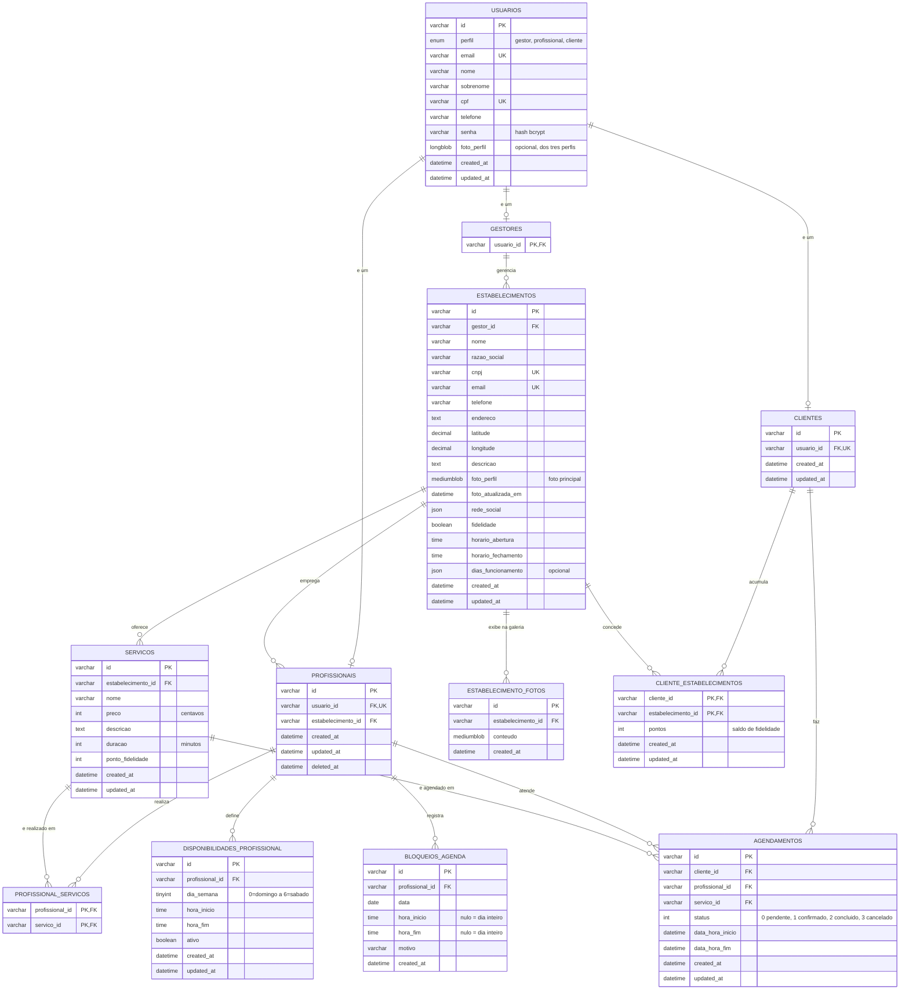

# ⚙️ Etapa 2: APIs, Web Services e Persistência de Dados Distribuída

Este documento serve como diretriz mestre de engenharia e repositório de evidências para a **Etapa 2: Desenvolvimento de APIs, Web Services e Persistência**. Ele foi estruturado para orientar o desenvolvimento prático do backend distribuído e permitir o acompanhamento e auto-gestão das atividades pelos alunos.

---

## 🎯 Rubricas de Avaliação desta Etapa

Ao final desta Etapa, cada aluno será avaliado individualmente nestas 6 competências (incluindo oportunidades de desenvolvimento e reavaliação):

1. **H21a-ADS-CST - Aplicar corretamente os padrões de codificação para o desenvolvimento da API.**: Gerenciar e documentar serviços de TI, de forma clara e objetiva (Reavaliação teórica e prática a partir do gerenciamento de serviços no backend em [src/backend/](src/backend/)).
2. **H23a-ADS-CST - Modelar os dados da API dentro do contexto levantado.**: Desenvolver uma arquitetura de aplicação distribuída (Medido no código em [src/backend/](src/backend/) e na seção [Modelagem da Aplicação e Arquitetura de Dados](#2-modelagem-da-aplicacao-e-arquitetura-de-dados)).
3. **H23b-ADS-CST - Definir corretamente os recursos e as rotas da API.**: Gerenciar uma arquitetura de aplicação distribuída, testando, implantando e avaliando a solução (Medido na seção [Instruções de Implantação e DevOps](#5-instrucoes-de-implantacao-e-devops)).
4. **H23d-ADS-CST - Implementar o processo de autenticação de usuário do sistema.**: Desenvolver APIs e Web Services (Medido na seção [Especificação Avançada de Endpoints](#3-especificacao-avancada-de-endpoints) e atualizações no design de contratos).
5. **H24a-ADS-CST - Definir e documentar a arquitetura da aplicação distribuída.**: Planejar e documentar APIs e Web Services, de forma clara e objetiva (Medido em [src/backend/](src/backend/) e na construção real dos endpoints).
6. **H24b-ADS-CST - Projetar a arquitetura baseada em API.**: Gerenciar APIs e Web Services, testando, implantando e avaliando a solução (Medido na seção [Estratégia e Relatório de Testes Automatizados](#4-estrategia-e-relatorio-de-testes-automatizados)).
7. **H25a-ADS-CST - Selecionar e avaliar corretamente o modelo de dados NoSQL para o contexto da aplicação distribuída.**: Planejar e documentar Banco de dados No-SQL, de forma clara e objetiva (Medido em [src/backend/](src/backend/) e na construção real dos endpoints).
8. **H25b-ADS-CST - Implementar corretamente as funcionalidades que envolvem o banco de dados NoSQL para armazenamento e recuperação de dados.**: Planejar e documentar Banco de dados No-SQL, de forma clara e objetiva (Medido em [src/backend/](src/backend/) e na construção real dos endpoints).
9. **H27a-ADS-CST - Desenvolver testes de unidade.**: Gerenciar APIs e Web Services, testando, implantando e avaliando a solução (Medido na seção [Estratégia e Relatório de Testes Automatizados](#4-estrategia-e-relatorio-de-testes-automatizados)).

---

## 📅 QUADRO DE CONTRIBUIÇÃO REAL (ETAPA 2)

**Atenção alunos:** Preencham esta tabela para atualizar o andamento das tarefas e quem foi o responsável técnico pela construção do backend. Os nomes, usuários e links de evidências devem corresponder aos entregáveis em [src/backend/](src/backend/).

- **Status admitidos**: `⌛ Não Iniciado` | `📝 Em Progresso` | `✔️ Entregue`
- **Autoria Git**: Indica se há commits desse estudante nos arquivos da tarefa.

**Atividades Semanais desta Etapa** (ver [Cronograma do Semestre](contexto.md#-cronograma-do-semestre-semana--periodo)):
- `ATV2.1` — Desenvolvimento de Funcionalidades - API (Semanas 5 a 8)
- `ATV2.2` — Testes - API (Semana 9)

| Rubrica Curricular | ID Tarefa | Atividade Semanal | Descrição Detalhada da Tarefa | Estudante Responsável | GitHub Username | Status de Entrega | Evidência/Seção Temática | Autoria Git |
| :---: | :---: | :---: | :--- | :--- | :---: | :---: | :--- | :---: |
| **H36b** | `T2.1` | `ATV2.1` | Configuração do Boilerplate da API, Roteamento e Inicialização | Pedro Ivo | `PedroD98` | `✔️ Entregue` | [Instalação/README](../src/backend/README.md) | [ ] |
| **H36b** | `T2.2` | `ATV2.1` | Modelagem e Persistência de Dados (Conexão DB, ORM, Schemas) | Raphael Yankous Machado Clemente | `RaphaelYankous` | `✔️ Entregue` | [Seção 2.1](#21-schema-e-diagrama-entidade-relacionamento) | [x] |
| **H36b** | `T2.3` | `ATV2.1` | Implementação de Endpoints CRUD e Lógica de Negócios Principal | Kelven Rodrigues da Silva | `puckelvensilva` | `✔️ Entregue` | [Seções 3.2.2 e 3.2.7](#32-detalhamento-dos-payloads-de-requisição-e-resposta-exemplos) | [x] |
| **H36b** | `T2.4` | `ATV2.1` | Mecanismo de Segurança da API (Autenticação/Autorização JWT) | Pedro Ivo | `PedroD98` | `✔️ Entregue` | [Seção 3.3](#33-segurança-e-autorização) | [ ] |
| **H35b** | `T2.5` | `ATV2.1` | Gateway, Integração de Serviços Web e Clientes HTTP Externos | Kelven Rodrigues da Silva | `puckelvensilva` | `✔️ Entregue` | [Seção 2.2](#22-integracao-e-infraestrutura-distribuida) | [ ] |
| **H36c** | `T2.6` | `ATV2.2` | Desenvolvimento de Testes Automatizados (Unitários/Integração) | João Pedro Lopes | `JoaoLopes994` | `✔️ Entregue` | [Seção 4.0](#4-estratégia-e-relatório-de-testes-automatizados) | [ ] |
| **H36c** | `T2.8` | `ATV2.2` | Proposta de Implantação e Pipeline de CI/CD Backend | Vinícius Claret Nunes | `viniciusclaretnuns` | `✔️ Entregue` | [Seção 5.2](#52-proposta-de-infraestrutura-de-deploy-e-ambiente-em-produção) | [ ] |
| **H36b** | `T2.9` | `ATV2.1` | CRUD de Clientes ligado a Usuários | Julio de Oliveira Nascimento | `xSC4Rx` | `✔️ Entregue` | [Seção 3.2.5](#325-clientes) | [ ] |
| **H36b** | `T2.10` | `ATV2.1` | CRUD de Serviços | Julio de Oliveira Nascimento | `xSC4Rx` | `✔️ Entregue` | [Seção 3.2.4](#324-serviços) | [ ] |
| **H36c** | `T2.11` | `ATV2.2` | Testes unitários de Clientes e Serviços | Julio de Oliveira Nascimento | `xSC4Rx` | `✔️ Entregue` | [Seção 4.0](#4-estratégia-e-relatório-de-testes-automatizados) | [ ] |
| **H36b/H36c** | `T2.9` | `ATV2.1/ATV2.2` | CRUD de Administradores, Fluxo de Fidelidade e Testes Automatizados | Leticia Beatriz da Silva | `leticiabeatrizs` | `✔️ Entregue` | [Módulo Admins](../src/backend/agiliza-api/src/admins/), [Módulo Fidelidade](../src/backend/agiliza-api/src/fidelidade/) e [Testes da API](#4-estratégia-e-relatório-de-testes-automatizados) | [x] |
| **H36b** | `T2.12` | `ATV2.1` | Agendamentos: criação (#94), cancelamento (#95) e listagem do cliente (`/meus`) | Raphael Yankous Machado Clemente | `RaphaelYankous` | `✔️ Entregue` | [Seção 3.2.6](#326-agendamentos) e [módulo Agendamentos](../src/backend/agiliza-api/src/agendamentos/) | [x] |
| **H35b** | `T2.13` | `ATV2.1` | E-mail transacional (SendGrid): avisos de agendamento criado e cancelado (#96) | Raphael Yankous Machado Clemente | `RaphaelYankous` | `✔️ Entregue` | [Seção 3.2.12](#3212-notificações-por-e-mail-sendgrid) e [módulo de e-mail](../src/backend/agiliza-api/src/email/) | [x] |
| **H36c** | `T2.14` | `ATV2.2` | Testes do e-mail (`email.service.spec.ts` e `email.templates.spec.ts`), da listagem do cliente (`agendamentos.listagem.spec.ts`) e da avaliação do cliente (`avaliacoes-cliente.service.spec.ts` e `avaliacoes-cliente.e2e-spec.ts`, #164) | Raphael Yankous Machado Clemente | `RaphaelYankous` | `✔️ Entregue` | [Seção 4](#4-estratégia-e-relatório-de-testes-automatizados) | [x] |
| **H36b** | `T2.15` | `ATV2.1` | CRUD de Profissionais do estabelecimento (listagem interna e pública, criação, detalhes, edição, troca de foto e exclusão) | Vinícius Claret Nunes | `viniciusclaretnuns` | `✔️ Entregue` | [Seção 3.2.3](#323-profissionais) e [módulo Profissionais](../src/backend/agiliza-api/src/profissionais/) | [x] |
| **H36b** | `T2.16` | `ATV2.1` | Bloqueios na agenda do profissional: listagem, cadastro (horário específico ou dia inteiro) e remoção via `/api/minha-agenda/bloqueios` | Vinícius Claret Nunes | `viniciusclaretnuns` | `✔️ Entregue` | [Seção 3.2.9](#329-minha-agenda-e-perfil-do-profissional) e [módulo Agenda](../src/backend/agiliza-api/src/agenda/) | [x] |
| **H36b** | `T2.17` | `ATV2.1` | Perfil do profissional autenticado: consulta do perfil, atualização de nome/sobrenome, troca de foto e avaliações recebidas | Vinícius Claret Nunes | `viniciusclaretnuns` | `✔️ Entregue` | [Seção 3.2.9](#329-minha-agenda-e-perfil-do-profissional) e [módulo Perfil Profissional](../src/backend/agiliza-api/src/perfil-profissional/) | [x] |
| **H36b** | `T2.18` | `ATV2.1` | Agenda do profissional autenticado (`/api/minha-agenda`): visão do dia com disponibilidades, agendamentos e bloqueios | Vinícius Claret Nunes | `viniciusclaretnuns` | `✔️ Entregue` | [Seção 3.2.9](#329-minha-agenda-e-perfil-do-profissional) e [módulo Agenda](../src/backend/agiliza-api/src/agenda/) | [x] |

---

# 1. Escopo e Objetivos do Backend

O backend do sistema **Agiliza** é responsável por centralizar a lógica de negócios da plataforma, expondo uma API REST desenvolvida em **NestJS** (Node.js e TypeScript). Ele atende tanto ao aplicativo móvel em React Native quanto ao painel web em React.js, focando no gerenciamento de horários, regras operacionais e controle de concorrência para evitar agendamentos simultâneos (*double booking*).

### Módulos do Sistema
* **Autenticação e Perfis (Identity)**: Gerencia o cadastro e acesso dos perfis de Cliente, Profissional e Gestor do Estabelecimento (RF-001) usando autenticação via JWT e controle de permissões por perfil (RBAC).
* **Core de Agendamentos**: Processa a criação de reservas (RF-006), calcula os intervalos livres com base na duração dos serviços (RF-005) e valida a concorrência de horários para evitar choques na grade (RNF-005).
* **Catálogo e Gestão**: Permite cadastrar e alterar dados do estabelecimento (RF-002), catálogo de serviços e combos (RF-004), além dos horários de trabalho, folgas e bloqueios dos profissionais (RF-008).
* **Fidelidade e Avaliações**: Trata as regras de pontuação pós-serviço (RF-014) e registra o histórico de notas e avaliações recebidas (RF-013).
* **Integrações Externas**: Envia e-mails transacionais (confirmação, lembretes e cancelamentos) consumindo serviços externos de forma assíncrona com Axios (RF-010).

### Tecnologias Utilizadas
* **Backend**: Node.js com **NestJS**, mantendo a estrutura organizada em módulos desacoplados.
* **Banco de Dados**: **MySQL 8.0**, utilizando pool de conexões gerenciado pelo ORM para garantir consistência e integridade referencial nas transações.
* **Segurança**: Criptografia de senhas com `bcrypt` no banco e proteção de endpoints privados via JWT (HS256) validado por Guards.

### Volumetria e Desempenho
A API opera no modelo *stateless*, autenticando requisições diretamente via JWT sem persistir dados de sessão na memória do servidor. As rotas e consultas foram estruturadas para processar a busca e o cálculo de horários livres dentro do limite aceitável de resposta estabelecido no projeto (tempo inferior a 3 segundos, conforme o RNF-002), assegurando uma boa usabilidade no aplicativo móvel e mantendo a base de código modular para facilitar futuras divisões da arquitetura.

---

# 2. Modelagem da Aplicação e Arquitetura de Dados

*(Esta seção atende diretamente à rubrica **H35b**)*

## 2.1. Schema e Diagrama Entidade-Relacionamento

O banco relacional é o MySQL, acessado pelo TypeORM. O MongoDB complementa o sistema com logs, artefatos e as avaliações pós-atendimento (ver seção 5.2) e, por isso, não aparece neste diagrama. As tabelas do MySQL são criadas por *migrations* (arquivos que montam o banco), que ficam em [`src/backend/agiliza-api/src/db/migrations/`](../src/backend/agiliza-api/src/db/migrations/).

Quase todas as tabelas usam um `id` único do tipo UUID (um código gerado automaticamente, como `a1b2c3d4-...`). As exceções são `gestores`, que usa o próprio `usuario_id` como chave, e `profissional_servicos` e `cliente_estabelecimentos`, que usam chave composta. As tabelas se ligam por chaves estrangeiras (FK), que guardam o `id` da tabela relacionada. É isso que o diagrama abaixo mostra.

Na tabela de descrição mais abaixo, a coluna "Situação" indica se a tabela já foi implementada (**Implementada**) ou se faz parte do modelo previsto para as próximas entregas (**Prevista**).

### Diagrama Entidade-Relacionamento (DER)



### Descrição das tabelas

| Tabela | Finalidade | Chaves e restrições principais | Requisito | Situação |
| :--- | :--- | :--- | :---: | :---: |
| `usuarios` | Identidade, credenciais e foto de perfil de todos os perfis (login e JWT). | PK `id`; `email` e `cpf` únicos; `foto_perfil` opcional (*migration* `1791500000000-MoverFotoPerfilParaUsuarios`). | RF-001 | Implementada |
| `gestores` | Marca que o usuário é dono/gerente (gestor). | PK é o próprio `usuario_id`, que é FK para `usuarios`. | RF-001 | Implementada |
| `clientes` | Marca que o usuário é cliente e liga agendamentos e fidelidade a ele. | `usuario_id` FK única para `usuarios`. | RF-001 | Implementada |
| `profissionais` | Profissional vinculado a um estabelecimento. | `usuario_id` FK única; `estabelecimento_id` FK; `deleted_at` marca a exclusão lógica (*migration* `1791400000000-AdicionarDeletedAtProfissionais`). | RF-003 | Implementada |
| `estabelecimentos` | Barbearia/salão, com endereço e coordenadas (latitude e longitude) para a busca por proximidade. | `gestor_id` FK; `cnpj` e `email` únicos; `foto_perfil` (foto principal) e `foto_atualizada_em` opcionais (*migration* `1791600000000-AdicionarFotoAtualizadaEmEstabelecimentos`). A antiga coluna JSON `fotos`, nunca usada, foi removida pela *migration* `1791700000000-CriarEstabelecimentoFotos`. `dias_funcionamento` (JSON, opcional) guarda a lista de dias em que o estabelecimento atende (*migration* `1791200000000-AdicionarDiasFuncionamentoEstabelecimentos`). | RF-002, RF-011 | Implementada |
| `estabelecimento_fotos` | Galeria do estabelecimento: até 10 fotos além da foto principal, uma linha por foto (*migration* `1791700000000-CriarEstabelecimentoFotos`). | `estabelecimento_id` FK (remove em cascata junto com o estabelecimento); `conteudo` mediumblob fora das consultas comuns (`select: false`); índice (`estabelecimento_id`, `created_at`), que dá a ordem de envio. | RF-002 | Implementada |
| `servicos` | Catálogo de serviços com preço, duração e pontos de fidelidade. | `estabelecimento_id` FK (a chave estrangeira será criada junto com a tabela `estabelecimentos`). | RF-004 | Implementada |
| `profissional_servicos` | Relação N:N entre profissionais e serviços que eles realizam (*migration* `1791300000000-CreateProfissionalServicosTable`). | PK composta (`profissional_id`, `servico_id`); FKs para `profissionais` e `servicos` (removem em cascata); índice em `servico_id`. | RF-003 | Implementada |
| `disponibilidades_profissional` | Expediente semanal de cada profissional (dia da semana, hora de início e fim, ativo ou não). | `profissional_id` FK (remove em cascata); índice (`profissional_id`, `dia_semana`). | RF-003, RF-005 | Implementada |
| `bloqueios_agenda` | Folgas e bloqueios de agenda. Sem `hora_inicio`/`hora_fim`, o bloqueio vale o dia todo. | `profissional_id` FK (remove em cascata); índice (`profissional_id`, `data`). | RF-008 | Implementada |
| `agendamentos` | Reservas de horário. O `status` é numérico (0 pendente, 1 confirmado, 2 concluído, 3 cancelado). | FKs para cliente, profissional e serviço; índice (`profissional_id`, `data_hora_inicio`) para acelerar a busca de conflitos. | RF-006, RF-009 | Implementada |
| `avaliacoes` | Nota e comentário após o atendimento concluído. | **Coleção do MongoDB, não tabela do MySQL** (Mongoose): `clienteId`, `profissionalId`, `agendamentoId`, `nota` (1–5), `comentario` e `timestamps`. Não há *migration* correspondente. | RF-013 | Implementada (MongoDB) |
| `avaliacoes_vinculos` | Liga um agendamento à sua avaliação feita pelo cliente e guarda a foto opcional da avaliação. | **Coleção do MongoDB, não tabela do MySQL** (Mongoose): `agendamentoId` (índice **único**), `clienteId`, `avaliacaoId`, `foto` (opcional, fora das consultas comuns) e `timestamps`. O índice único impede avaliar o mesmo atendimento duas vezes, mesmo com dois envios ao mesmo tempo. A foto fica aqui para não alterar a coleção `avaliacoes`. | RF-013 | Implementada (MongoDB) |
| `cliente_estabelecimentos` | Saldo de pontos de fidelidade de um cliente em cada estabelecimento. | PK composta (`cliente_id`, `estabelecimento_id`); FKs para `clientes` e `estabelecimentos` (`RESTRICT`). | RF-014 | Implementada (saldo e crédito) |
| `tokens_redefinicao_senha` | Armazena tokens temporários gerados para redefinição de senha (*migration* `1792000000000-CriarTabelaTokensRedefinicaoSenha`). | `usuario_id` FK para `usuarios` (remove em cascata); `token_hash` (SHA-256) com índice; `expira_em` (validade de 2h) e `utilizado_em` (preenchido no resgate). | RF-001 | Implementada |

### Decisões de modelagem

- **Um único cadastro de credenciais:** `usuarios` guarda e-mail, CPF, nome e senha de qualquer perfil. `gestores`, `clientes` e `profissionais` guardam só o que é específico de cada perfil, ligados 1:1 a `usuarios`. Isso evita repetir a senha em três tabelas e mantém o login atual (`api/auth/login`) funcionando com uma tabela só.
- **Localização do estabelecimento:** o endereço fica num campo de texto, e a latitude e a longitude ficam em colunas separadas. As coordenadas são o que permite ordenar os estabelecimentos por proximidade (RF-011).
- **Fotos:** a foto de perfil fica no próprio banco (tipo blob), numa única coluna de `usuarios` usada pelos três perfis. A coluna não é lida nas consultas comuns (`select: false` na entidade), para que agenda, busca, listas e login não carreguem imagens: só a rota de foto, o perfil do profissional e a lista e o detalhe de profissionais do gestor pedem a foto explicitamente. A foto principal do estabelecimento segue o mesmo modelo, em `estabelecimentos.foto_perfil`. A galeria, que é uma lista, fica na tabela `estabelecimento_fotos`, com uma linha por foto: cada foto tem id próprio para ser removida e servida sozinha, a ordem vem de `created_at` e o limite de 10 é um `COUNT`. A busca e a Home não leem essa tabela.
- **Prevenção de *double booking* (RNF-005):** o `data_hora_fim` (início + duração do serviço) permite à API verificar sobreposição de intervalos antes de gravar, respondendo `409 Conflict`. Agendamentos com status `cancelado` são ignorados nessa verificação, liberando o horário. O índice (`profissional_id`, `data_hora_inicio`) é comum, e não único, porque um índice único continuaria bloqueando o horário de um agendamento cancelado; ele só acelera a busca de conflitos.
- **Fidelidade como saldo:** a tabela `cliente_estabelecimentos` guarda um saldo (`pontos`) por par cliente + estabelecimento. O crédito e o saldo estão implementados; o extrato de movimentos, incluindo histórico e resgate, permanece previsto.
- **MongoDB:** logs, artefatos e as avaliações da coleção `avaliacoes` (RF-013) ficam no MongoDB (ver seção 5.2) e, por isso, não aparecem neste DER relacional.

## 2.2. Integracao e Infraestrutura Distribuida
Como o nosso sistema lida diretamente com agendamentos de barbearias e salões (onde múltiplos clientes podem tentar marcar horários no mesmo segundo), a arquitetura do backend em **NestJS** foi pensada para garantir consistência nos dados e uma boa experiência no app mobile (**React Native**). 

Abaixo detalhamos como tratamos a concorrência, o banco e a comunicação entre os serviços:

### 1. Tratamento de Concorrência e Consistência (Agendamentos)
O maior desafio em um sistema de agendamentos é evitar o duplo agendamento (*race condition*). Para resolver isso:
* Antes de gravar um novo horário na tabela de agendamentos do **MySQL**, a API roda uma validação lógica para checar se o profissional já possui compromisso naquele exato minuto.
* Caso outro usuário seja mais rápido e reserve a vaga primeiro, a API barra a operação e retorna um erro HTTP `409 (Conflict)`, avisando o app que o horário não está mais disponível.

### 2. Gerenciamento de Conexões com o Banco de Dados
* Para evitar gargalos de performance e lentidão nas consultas vindas do aplicativo React Native, utilizamos o pool de conexões gerenciado pelo ORM da aplicação.
* Em vez de abrir uma nova conexão com o MySQL a cada requisição HTTP (o que consumiria muita memória e tempo de processamento), a aplicação reutiliza conexões abertas de um pool configurado, agilizando o retorno das listagens de estabelecimentos, serviços e profissionais.

### 3. Comunicação entre Cliente e Servidor
* **Requisições Síncronas (REST):** A comunicação entre o app móvel e o backend ocorre de forma síncrona via HTTP/REST. Todas as rotas sensíveis (como criar agendamentos ou editar perfis) exigem o envio de um token **JWT** no header da requisição para garantir segurança e validação de permissões (RBAC).
* **Operações Assíncronas:** Tarefas que podem demorar um pouco mais — como o upload de fotos de perfil ou imagens dos estabelecimentos para o CDN/servidor — são tratadas de forma assíncrona utilizando recursos assíncronos do Node.js (Async/Await e Promises), garantindo que a thread principal da API não fique travada e o app não sofra com *timeouts*.

### 4. Visão de Escalabilidade
Embora o projeto esteja rodando de forma monolítica e local nesta fase da disciplina, a divisão clara de módulos no NestJS (separando Auth, Estabelecimentos, Profissionais, Serviços e Agendamentos) facilita muito uma futura evolução para microsserviços ou a adição de cache (como Redis) caso o sistema precise escalar para muitos clientes simultâneos em produção.

---

# 3. Especificação Avançada de Endpoints

*(Esta seção atende diretamente à rubrica **H36b**)*

Abaixo devem estar listados os contratos reais que foram ou serão implementados no diretório [src/backend/](../src/backend/). Cada endpoint deve ser detalhado descrevendo métodos HTTP, URLs, payloads aceitos e possíveis status codes.

### 3.1. Relação Geral de Endpoints

| Método / Verbo | Caminho da Rota (URI) | Descrição do Recurso / Ação | Reclama Autenticação? | Responsável Técnico |
| :---: | :--- | :--- | :---: | :---: |
| `POST` | `/api/auth/register` | Criação de conta (cliente, gestor ou profissional) | Não | Pedro Ivo Dias Ferreira da Silva |
| `POST` | `/api/auth/login` | Autenticação e geração de JWT | Não | Pedro Ivo Dias Ferreira da Silva |
| `POST` | `/api/auth/recuperar-senha` | Solicitação de link temporário para redefinição de senha via e-mail transacional (SendGrid) | Não | João Pedro Lopes da Silva |
| `POST` | `/api/auth/redefinir-senha` | Atualização de credencial via token criptografado (SHA-256) recebido por e-mail | Não | João Pedro Lopes da Silva |
| `GET` | `/api/estabelecimentos` | Listagem de estabelecimentos (sem filtros/paginação nesta versão) | Não | Kelven Rodrigues da Silva |
| `POST` | `/api/estabelecimentos` | Criação de um novo estabelecimento | Sim | Kelven Rodrigues da Silva |
| `GET` | `/api/estabelecimentos/{id}` | Detalhes de um estabelecimento | Não | Kelven Rodrigues da Silva |
| `GET` | `/api/estabelecimentos/meus` | Lista de estabelecimentos do gestor autenticado (somente perfil `gestor`) | Sim | Kelven Rodrigues da Silva |
| `GET` | `/api/estabelecimentos/gestor/{gestorId}` | Lista de estabelecimentos de um gestor | Sim | Kelven Rodrigues da Silva |
| `PATCH` | `/api/estabelecimentos/{id}` | Edição parcial de um estabelecimento | Sim | Kelven Rodrigues da Silva |
| `DELETE` | `/api/estabelecimentos/{id}` | Exclusão de um estabelecimento | Sim | Kelven Rodrigues da Silva |
| `PATCH` | `/api/estabelecimentos/{id}/foto` | Envio ou troca da foto principal (só o gestor dono, `multipart/form-data`) | Sim | Pedro Dias |
| `GET` | `/api/estabelecimentos/{id}/foto` | Imagem da foto principal | Não | Pedro Dias |
| `GET` | `/api/estabelecimentos/{id}/fotos` | Lista das fotos da galeria, em ordem de envio | Não | Pedro Dias |
| `POST` | `/api/estabelecimentos/{id}/fotos` | Envio de uma ou mais fotos para a galeria (só o gestor dono, `multipart/form-data`) | Sim | Pedro Dias |
| `GET` | `/api/estabelecimentos/{id}/fotos/{fotoId}` | Imagem de uma foto da galeria | Não | Pedro Dias |
| `DELETE` | `/api/estabelecimentos/{id}/fotos/{fotoId}` | Remoção de uma foto da galeria (só o gestor dono) | Sim | Pedro Dias |
| `POST` | `/api/avaliacoes` | Criação de uma avaliação pós-atendimento (RF-013) | Sim | Kelven Rodrigues da Silva |
| `GET` | `/api/avaliacoes` | Listagem de avaliações (mais recentes primeiro) | Sim | Kelven Rodrigues da Silva |
| `GET` | `/api/avaliacoes/{id}` | Detalhes de uma avaliação | Sim | Kelven Rodrigues da Silva |
| `PATCH` | `/api/avaliacoes/{id}` | Edição da nota/comentário de uma avaliação | Sim | Kelven Rodrigues da Silva |
| `DELETE` | `/api/avaliacoes/{id}` | Exclusão de uma avaliação | Sim | Kelven Rodrigues da Silva |
| `POST` | `/api/avaliacoes/agendamento/{agendamentoId}` | O cliente avalia um atendimento concluído seu (nota, comentário e foto opcionais) | Sim | Raphael Yankous |
| `GET` | `/api/avaliacoes/cliente/minhas` | Avaliações já feitas pelo cliente autenticado | Sim | Raphael Yankous |
| `GET` | `/api/avaliacoes/agendamento/{agendamentoId}/foto` | Foto que o cliente enviou na avaliação (só o dono) | Sim | Raphael Yankous |
| `GET` | `/api/estabelecimentos/{estabelecimentoId}/profissionais` | Lista de profissionais do estabelecimento (só o gestor dono) | Sim | [Nome do Aluno] |
| `GET` | `/api/estabelecimentos/{estabelecimentoId}/profissionais/publicos` | Lista de profissionais do estabelecimento para qualquer usuário logado, sem e-mail | Sim | Leticia Beatriz da Silva |
| `POST` | `/api/estabelecimentos/{estabelecimentoId}/profissionais` | Criação de profissional no estabelecimento | Sim | [Nome do Aluno] |
| `GET` | `/api/estabelecimentos/{estabelecimentoId}/profissionais/{id}` | Detalhes de um profissional (só o gestor dono) | Sim | [Nome do Aluno] |
| `PATCH` | `/api/estabelecimentos/{estabelecimentoId}/profissionais/{id}` | Edição de um profissional (só o gestor dono) | Sim | [Nome do Aluno] |
| `PATCH` | `/api/estabelecimentos/{estabelecimentoId}/profissionais/{id}/foto` | Troca da foto de um profissional (só o gestor dono) | Sim | [Nome do Aluno] |
| `DELETE` | `/api/estabelecimentos/{estabelecimentoId}/profissionais/{id}` | Exclusão lógica de um profissional (só o gestor dono) | Sim | [Nome do Aluno] |
| `GET` | `/api/estabelecimentos/{estabelecimentoId}/profissionais/{id}/agendamentos` | Agenda de agendamentos do profissional | Sim | [Nome do Aluno] |
| `GET` | `/api/estabelecimentos/{estabelecimentoId}/servicos` | Lista de serviços do estabelecimento (só o gestor dono) | Sim | Julio de Oliveira Nascimento |
| `GET` | `/api/estabelecimentos/{estabelecimentoId}/servicos/publicos` | Lista de serviços do estabelecimento para qualquer usuário logado | Sim | Leticia Beatriz da Silva |
| `POST` | `/api/estabelecimentos/{estabelecimentoId}/servicos` | Criação de serviço no estabelecimento | Sim | Julio de Oliveira Nascimento |
| `GET` | `/api/estabelecimentos/{estabelecimentoId}/servicos/{id}` | Detalhes de um serviço | Sim | Julio de Oliveira Nascimento |
| `PATCH` | `/api/estabelecimentos/{estabelecimentoId}/servicos/{id}` | Edição parcial de um serviço | Sim | Julio de Oliveira Nascimento |
| `DELETE` | `/api/estabelecimentos/{estabelecimentoId}/servicos/{id}` | Exclusão de um serviço | Sim | Julio de Oliveira Nascimento |
| `POST` | `/api/clientes` | Criação de um cliente | Não | [Julio de Oliveira Nascimento] |
| `GET` | `/api/clientes` | Listagem de todos os clientes | Sim | [Julio de Oliveira Nascimento] |
| `GET` | `/api/clientes/{id}` | Perfil de um cliente | Sim | [Julio de Oliveira Nascimento] |
| `PATCH` | `/api/clientes/{id}` | Edição de um cliente | Sim | [Julio de Oliveira Nascimento] |
| `DELETE` | `/api/clientes/{id}` | Deleta um cliente | Sim | [Julio de Oliveira Nascimento] |
| `GET` | `/api/agendamentos/meus` | Lista dos agendamentos do cliente autenticado (substitui a rota `/api/clientes/{id}/agendamentos`, que não foi implementada) | Sim | Raphael Yankous |
| `GET` | `/api/agendamentos/disponibilidade` | Cálculo de horários livres para agendamento | Sim | [Nome do Aluno] |
| `POST` | `/api/agendamentos` | Criação de um novo agendamento (só o perfil cliente; o cliente vem do token) | Sim | Raphael Yankous |
| `GET` | `/api/agendamentos` | Listagem paginada de agendamentos com filtros | Sim | [Nome do Aluno] |
| `GET` | `/api/agendamentos/{id}` | Detalhes de um agendamento | Sim | [Nome do Aluno] |
| `PATCH` | `/api/agendamentos/{id}` | Alteração de status de um agendamento | Sim | [Nome do Aluno] |
| `DELETE` | `/api/agendamentos/{id}` | Cancelamento de um agendamento pelo cliente dono (cancelamento lógico: o status vira `3` e o horário volta a ficar livre) | Sim | Raphael Yankous |
| `POST` | `/api/profissionais/{profissionalId}/disponibilidades` | Cadastro de disponibilidade semanal recorrente do profissional (só o gestor dono) | Sim | João Pedro Lopes |
| `GET` | `/api/profissionais/{profissionalId}/disponibilidades` | Lista de disponibilidades do profissional (qualquer usuário logado) | Sim | João Pedro Lopes |
| `PATCH` | `/api/disponibilidades/{id}` | Alteração de uma disponibilidade (só o gestor dono) | Sim | João Pedro Lopes |
| `DELETE` | `/api/disponibilidades/{id}` | Remoção de uma disponibilidade (só o gestor dono) | Sim | João Pedro Lopes |
| `POST` | `/api/profissionais/{profissionalId}/bloqueios` | Cadastro de bloqueio de agenda (folga, férias, imprevisto) (só o gestor dono) | Sim | João Pedro Lopes |
| `GET` | `/api/profissionais/{profissionalId}/bloqueios` | Lista de bloqueios do profissional (só o gestor dono) | Sim | João Pedro Lopes |
| `DELETE` | `/api/bloqueios/{id}` | Remoção de um bloqueio (só o gestor dono) | Sim | João Pedro Lopes |
| `GET` | `/api/profissionais/{profissionalId}/horarios-disponiveis` | Cálculo de horários livres de um profissional em uma data | Sim | João Pedro Lopes |
| `GET` | `/api/minha-agenda` | Agenda do dia (disponibilidades, agendamentos e bloqueios) do profissional autenticado | Sim | Vinícius Claret Nunes |
| `GET` | `/api/minha-agenda/bloqueios` | Lista os bloqueios do profissional autenticado | Sim | Vinícius Claret Nunes |
| `POST` | `/api/minha-agenda/bloqueios` | Cadastra um bloqueio de horário ou de dia inteiro na agenda do profissional autenticado | Sim | Vinícius Claret Nunes |
| `DELETE` | `/api/minha-agenda/bloqueios/{id}` | Remove um bloqueio do profissional autenticado | Sim | Vinícius Claret Nunes |
| `GET` | `/api/minha-agenda/disponibilidades` | Lista a disponibilidade semanal do profissional autenticado | Sim | Leticia Beatriz da Silva |
| `POST` | `/api/minha-agenda/disponibilidades` | Cadastra um horário semanal do profissional autenticado | Sim | Leticia Beatriz da Silva |
| `DELETE` | `/api/minha-agenda/disponibilidades/{id}` | Remove um horário semanal do profissional autenticado | Sim | Leticia Beatriz da Silva |
| `GET` | `/api/meu-perfil-profissional` | Perfil e catálogo do estabelecimento do profissional autenticado | Sim | Vinícius Claret Nunes |
| `PATCH` | `/api/meu-perfil-profissional` | Atualização do nome e sobrenome do profissional autenticado | Sim | Vinícius Claret Nunes |
| `PATCH` | `/api/meu-perfil-profissional/foto` | Substituição da foto do profissional autenticado (`multipart/form-data`) | Sim | Vinícius Claret Nunes |
| `GET` | `/api/meu-perfil-profissional/avaliacoes` | Avaliações recebidas e nota média do profissional autenticado | Sim | Vinícius Claret Nunes |
| `GET` | `/api/meu-perfil-cliente` | Dados do perfil (nome, sobrenome e e-mail) do cliente autenticado | Sim | João Pedro Lopes  |
| `GET` | `/api/meu-perfil-cliente/fidelidade` | Pontos de fidelidade e meta do próximo resgate do cliente autenticado | Sim | João Pedro Lopes |
| `GET` | `/api/usuarios/me/foto` | Foto de perfil do usuário autenticado, de qualquer perfil | Sim | Pedro Dias |
| `GET` | `/api/notificacoes` | Lista as notificações do usuário autenticado, de qualquer perfil | Sim | Leticia Beatriz da Silva |
| `PATCH` | `/api/notificacoes/{id}/lida` | Marca uma notificação do usuário autenticado como lida | Sim | Leticia Beatriz da Silva |

O `PATCH /api/agendamentos/{id}` recebe um status inteiro: `0` (pendente), `1`
(confirmado), `2` (concluído) ou `3` (cancelado). Ao concluir, a API credita os pontos
do serviço no saldo de `cliente_estabelecimentos` somente quando o programa do
estabelecimento está ativo e o serviço oferece pontos positivos. Status e crédito
usam a mesma transação. Concluído e cancelado são estados definitivos: uma tentativa
de alterá-los para outro estado retorna `409`; repetir o mesmo estado via `PATCH`
retorna `200` sem novo crédito. A alteração permanece disponível a qualquer usuário
autenticado, por decisão temporária; as permissões serão revisadas futuramente.

---

### 3.2. Detalhamento dos Payloads de Requisição e Resposta (Exemplos)

Cada tópico abaixo pode ser expandido individualmente.

<details>

<summary><b>3.2.1. Autenticação</b></summary>

### 3.2.1. Autenticação

#### Endpoint: `/api/auth/register` (Criação de conta)
- **Método**: `POST`
- **Autenticação**: Não
- **Payload de Requisição**:
  ```json
  {
    "nome": "kelven",
    "email": "kelven@pucminas.br",
    "password": "123@mudar",
    "perfil": "cliente",
    "telefone": "(31) 98897-2684"
  }
  ```
- **Resposta Sucesso (`201 Created`)**:
  ```json
  {
    "id": 123,
    "nome": "kelven",
    "email": "kelven@pucminas.br",
    "perfil": "cliente"
  }
  ```
- **Erro (`409 Conflict`)**:
  ```json
  {
    "status": 409,
    "error": "Este e-mail já está em uso.",
    "message": "Conflict"
  }
  ```

#### Endpoint: `/api/auth/login` (Login)
- **Método**: `POST`
- **Autenticação**: Não
- **Payload de Requisição**:
  ```json
  {
    "email": "kelven@pucminas.br",
    "senha": "123@mudar"
  }
  ```
- **Resposta Sucesso (`200 OK`)**: só o token. E-mail, perfil e expiração ficam dentro dele (payload `{ "sub", "email", "role", "iat", "exp" }`), e ele vale **8 horas**.
  ```json
  {
    "access_token": "eyJhbGciOiJIUzI1NiIsInR5cCI6IkpXVCJ9..."
  }
  ```
- **Erro (`401 Unauthorized`)**: e-mail inexistente ou senha incorreta.
  ```json
  {
    "message": "Email ou senha inválidos.",
    "error": "Unauthorized",
    "statusCode": 401
  }
    ```
    #### Endpoint: `/api/auth/recuperar-senha` (Solicitação de Recuperação de Senha)
  - **Método**: `POST`
  - **Autenticação**: Não
  - **Payload de Requisição**:
  ```json
  {
    "email": "kelven@pucminas.br"
  }
  ```
  - **Resposta Sucesso (`200 OK`)**: resposta neutra retornada independentemente da existência do e-mail na base, mitigando enumeração de usuários.
  ```json
  {
    "message": "Se o e-mail informado estiver cadastrado, você receberá as instruções para redefinir sua senha."
  }
  ```
  - **Erro (`400 Bad Request`)**: e-mail ausente ou fora do formato padrão.
  ```json
  {
    "statusCode": 400,
    "message": ["email must be an email"],
    "error": "Bad Request"
  }
  ```

  #### Endpoint: `/api/auth/redefinir-senha` (Redefinição de Senha por Token)
  - **Método**: `POST`
  - **Autenticação**: Não
  - **Payload de Requisição**:
  ```json
  {
    "token": "a4f8b1c2d3e4f5a6b7c8d9e0f1a2b3c4d5e6f7a8b9c0d1e2f3a4b5c6d7e8f9a0",
    "novaSenha": "NovaSenha@2026"
  }
  ```
  - **Resposta Sucesso (`200 OK`)**:
  ```json
  {
    "message": "Senha redefinida com sucesso."
  }
  ```
  - **Erro (`400 Bad Request`)**: token inválido, expirado ou já utilizado.
  ```json
  {
    "statusCode": 400,
    "message": "Token de recuperação inválido ou expirado.",
    "error": "Bad Request"
  }
  ```
  - **Erro (`400 Bad Request`)**: validação de tamanho mínimo de senha.
  ```json
  {
    "statusCode": 400,
    "message": ["novaSenha must be longer than or equal to 6 characters"],
    "error": "Bad Request"
  }
  ```

</details>

---


<details>

<summary><b>3.2.2. Estabelecimentos (barbearias/salões)</b></summary>

### 3.2.2. Estabelecimentos (barbearias/salões)

> **Implementação real:** módulo em [`src/backend/agiliza-api/src/estabelecimentos/`](../src/backend/agiliza-api/src/estabelecimentos/), persistido no **MySQL** via TypeORM (tabela `estabelecimentos`). O prefixo global da API é `api` (ver `main.ts`), então as rotas começam em `/api/...`. Os campos do payload seguem **camelCase**, conforme o `CreateEstabelecimentoDto`.

#### Endpoint: `/api/estabelecimentos` (Lista de estabelecimentos)
- **Método**: `GET`
- **Autenticação**: Não
- **Parâmetros de Consulta**: nenhum nesta versão. A listagem devolve a base completa; os filtros de busca (`nome`, `distancia`, `servico`) e a paginação (`pagina`) estão previstos, mas ainda não foram implementados.
- **Resposta Sucesso (`200 OK`)**:
  ```json
  [
    {
      "id": "a1b2c3d4-0000-0000-0000-000000000000",
      "nome": "Barbearia Clássica",
      "razaoSocial": "Barbearia Clássica LTDA",
      "cnpj": "12.345.678/0001-90",
      "email": "contato@clasica.com.br",
      "endereco": "Av. do Contorno, 500 - Belo Horizonte/MG",
      "latitude": -19.920382,
      "longitude": -43.938004,
      "telefone": "(31) 3222-4455",
      "descricao": "Barbearia tradicional com foco em cortes clássicos.",
      "fidelidade": true,
      "redeSocial": ["https://instagram.com/barbeariaclassica"],
      "horarioAbertura": "09:00:00",
      "horarioFechamento": "20:00:00",
      "gestorId": "b2c3d4e5-0000-0000-0000-000000000000",
      "createdAt": "2026-09-16T18:00:00.000Z",
      "updatedAt": "2026-09-16T18:00:00.000Z"
    }
  ]
  ```

#### Endpoint: `/api/estabelecimentos` (Criação de estabelecimento)
- **Método**: `POST`
- **Autenticação**: Sim
- **Payload de Requisição** (obrigatórios: `nome`, `razaoSocial`, `cnpj`, `email`, `endereco`, `latitude`, `longitude`, `telefone`, `horarioAbertura`, `horarioFechamento` e `gestorId`):
  ```json
  {
    "nome": "Barbearia Clássica",
    "razaoSocial": "Barbearia Clássica LTDA",
    "cnpj": "12.345.678/0001-90",
    "email": "contato@clasica.com.br",
    "endereco": "Av. do Contorno, 500 - Belo Horizonte/MG",
    "latitude": -19.920382,
    "longitude": -43.938004,
    "telefone": "(31) 3222-4455",
    "descricao": "Barbearia tradicional com foco em cortes clássicos.",
    "fidelidade": true,
    "redeSocial": ["https://instagram.com/barbeariaclassica"],
    "horarioAbertura": "09:00",
    "horarioFechamento": "20:00",
    "gestorId": "b2c3d4e5-0000-0000-0000-000000000000"
  }
  ```
  - `endereco` é um **texto único** (a rua/número/cidade num campo só) e `latitude`/`longitude` são campos separados — é o que permite a busca por proximidade (RF-011).
  - `redeSocial` é uma **lista** de URLs (máximo 5).
  - A foto principal não vai neste payload: ela é enviada depois, em `PATCH /api/estabelecimentos/{id}/foto` (abaixo). As fotos da galeria também ficam fora deste payload: elas têm rotas próprias (`/api/estabelecimentos/{id}/fotos`, abaixo).
- **Resposta Sucesso (`201 Created`)**: retorna o registro criado, no mesmo formato do `GET /api/estabelecimentos/{id}` abaixo.
- **Erro (`400 Bad Request` - parâmetro ausente ou inválido)**:
  ```json
  {
    "statusCode": 400,
    "message": ["nome não deve ser vazio", "razaoSocial não deve ser vazio"],
    "error": "Bad Request"
  }
  ```
- **Erro (`401 Unauthorized` - sem token)**:
  ```json
  {
    "statusCode": 401,
    "message": "Usuário não autenticado"
  }
  ```

#### Endpoint: `/api/estabelecimentos/{id}` (Detalhes do estabelecimento)
- **Método**: `GET`
- **Autenticação**: Não
- **Resposta Sucesso (`200 OK`)**:
  ```json
  {
    "id": "a1b2c3d4-0000-0000-0000-000000000000",
    "nome": "Barbearia Clássica",
    "razaoSocial": "Barbearia Clássica LTDA",
    "cnpj": "12.345.678/0001-90",
    "email": "contato@clasica.com.br",
    "endereco": "Av. do Contorno, 500 - Belo Horizonte/MG",
    "latitude": -19.920382,
    "longitude": -43.938004,
    "telefone": "(31) 3222-4455",
    "descricao": "Barbearia tradicional com foco em cortes clássicos.",
    "fidelidade": true,
    "redeSocial": ["https://instagram.com/barbeariaclassica"],
    "horarioAbertura": "09:00:00",
    "horarioFechamento": "20:00:00",
    "gestorId": "b2c3d4e5-0000-0000-0000-000000000000",
    "fotoAtualizadaEm": "2026-11-07T18:54:49.000Z",
    "createdAt": "2026-09-16T18:00:00.000Z",
    "updatedAt": "2026-09-16T18:00:00.000Z"
  }
  ```
  > O arquivo da foto principal **não** vem nesta resposta nem nas listas (`GET /api/estabelecimentos`, `/meus` e `/gestor/{gestorId}`): a coluna `foto_perfil` não é lida nessas consultas (`select: false`). O campo `fotoAtualizadaEm` é `null` quando não há foto e, quando há, é a data do último envio. O frontend monta a URL `GET /api/estabelecimentos/{id}/foto?v=<timestamp de fotoAtualizadaEm>`, que muda a cada troca e evita mostrar a foto antiga guardada em cache. A busca (`GET /api/estabelecimentos/busca`) e `GET /api/agendamentos/meus` também devolvem `fotoAtualizadaEm`, para os cards mostrarem a foto.
  >
  > Os serviços e profissionais do estabelecimento **não** vêm embutidos nesta resposta: são consultados nas rotas próprias: `/api/estabelecimentos/{id}/servicos/publicos` e `/api/estabelecimentos/{id}/profissionais/publicos` para qualquer usuário logado, e `/api/estabelecimentos/{id}/servicos` e `/api/estabelecimentos/{id}/profissionais` só para o gestor dono.
- **Erro (`404 Not Found`)**:
  ```json
  {
    "statusCode": 404,
    "message": "Estabelecimento com ID a1b2c3d4-0000-0000-0000-000000000000 não encontrado."
  }
  ```

#### Endpoint: `/api/estabelecimentos/meus` (Estabelecimentos do gestor logado)
- **Método**: `GET`
- **Autenticação**: Sim
- **Autorização**: somente o perfil `gestor`. Cliente e profissional recebem `403 Forbidden`.
- **Parâmetros**: nenhum. O gestor é obtido do token JWT (`sub`), então um gestor só lista os **próprios** estabelecimentos — não é possível consultar os de outra pessoa.
- **Resposta Sucesso (`200 OK`)**: array com os estabelecimentos do gestor logado, no mesmo formato do `GET /api/estabelecimentos/{id}`. Se não houver nenhum, a resposta é `[]` (não há `404`).
  ```json
  [
    {
      "id": "a1b2c3d4-0000-0000-0000-000000000000",
      "nome": "Barbearia Clássica",
      "razaoSocial": "Barbearia Clássica LTDA",
      "cnpj": "12.345.678/0001-90",
      "email": "contato@clasica.com.br",
      "endereco": "Av. do Contorno, 500 - Belo Horizonte/MG",
      "latitude": -19.920382,
      "longitude": -43.938004,
      "telefone": "(31) 3222-4455",
      "descricao": "Barbearia tradicional com foco em cortes clássicos.",
      "fidelidade": true,
      "redeSocial": ["https://instagram.com/barbeariaclassica"],
      "horarioAbertura": "09:00:00",
      "horarioFechamento": "20:00:00",
      "gestorId": "b2c3d4e5-0000-0000-0000-000000000000",
      "createdAt": "2026-09-16T18:00:00.000Z",
      "updatedAt": "2026-09-16T18:00:00.000Z"
    }
  ]
  ```
- **Erro (`401 Unauthorized`)** — token ausente, inválido ou expirado:
  ```json
  {
    "statusCode": 401,
    "message": "Usuário não autenticado"
  }
  ```
- **Erro (`403 Forbidden`)** — perfil diferente de `gestor`:
  ```json
  {
    "statusCode": 403,
    "message": "Você não tem permissão para acessar este recurso."
  }
  ```

#### Endpoint: `/api/estabelecimentos/gestor/{gestorId}` (Lista de estabelecimentos do gestor)
- **Método**: `GET`
- **Autenticação**: Sim
- **Resposta Sucesso (`200 OK`)**: array com os estabelecimentos daquele `gestorId`, no mesmo formato da listagem acima. Se o gestor não tiver estabelecimentos, a resposta é `[]` (não há `404`).

#### Endpoint: `/api/estabelecimentos/{id}` (Edição de estabelecimento)
- **Método**: `PATCH` (atualização parcial — a rota `PUT` prevista inicialmente não foi implementada)
- **Autenticação**: Sim
- **Payload de Requisição**: subconjunto dos campos do `POST` "Criação de estabelecimento"; todos são opcionais e apenas os enviados são alterados.
  ```json
  {
    "telefone": "(31) 3222-9900",
    "horarioAbertura": "08:30",
    "horarioFechamento": "19:00"
  }
  ```
- **Resposta Sucesso (`200 OK`)**: retorna o registro completo atualizado, no mesmo formato do `GET /api/estabelecimentos/{id}`.
- **Erro (`400 Bad Request` - parâmetro ausente ou inválido)**:
  ```json
  {
    "statusCode": 400,
    "message": ["horarioAbertura não deve ser vazio"],
    "error": "Bad Request"
  }
  ```
- **Erro (`404 Not Found`)**:
  ```json
  {
    "statusCode": 404,
    "message": "Estabelecimento com ID a1b2c3d4-0000-0000-0000-000000000000 não encontrado."
  }
  ```

#### Endpoint: `/api/estabelecimentos/{id}` (Exclusão do estabelecimento)
- **Método**: `DELETE`
- **Autenticação**: Sim
- **Resposta Sucesso (`204 No Content`)**: corpo vazio.
- **Erro (`404 Not Found`)**:
  ```json
  {
    "statusCode": 404,
    "message": "Estabelecimento com ID a1b2c3d4-0000-0000-0000-000000000000 não encontrado."
  }
  ```

#### Endpoint: `/api/estabelecimentos/{id}/foto` (Envio ou troca da foto principal)
- **Método**: `PATCH`
- **Autenticação**: Sim
- **Autorização**: somente o perfil `gestor` **dono** do estabelecimento. Cliente, profissional e gestor de outro estabelecimento recebem `403 Forbidden`.
- **Funcionamento**: recebe `multipart/form-data` com o arquivo no campo `foto` e grava a foto principal em `estabelecimentos.foto_perfil`, junto com a data do envio em `foto_atualizada_em`. A validação é a mesma das fotos de perfil (`validarFoto` em [`common/utils/foto-perfil.ts`](../src/backend/agiliza-api/src/common/utils/foto-perfil.ts)): JPG, PNG ou WebP, conferido pelos bytes do arquivo e igual ao tipo declarado, com até 2 MB. O upload aceita até 5 MB (`LIMITE_UPLOAD_FOTO`) para que arquivos entre 2 e 5 MB recebam a mensagem de tamanho. Não há rota para remover a foto principal, só para trocá-la. O frontend usa esta rota na criação (logo depois do `POST`) e na edição (antes do `PATCH` dos dados).
- **Resposta Sucesso (`200 OK`)**:
  ```json
  { "fotoAtualizadaEm": "2026-11-07T18:54:49.885Z" }
  ```
- **Respostas de Erro**:
  - `400 Bad Request`: arquivo ausente (`"Selecione uma foto."`), acima de 2 MB (`"A foto deve ter no máximo 2 MB."`) ou que não é JPG, PNG ou WebP válido (`"A foto deve ser um arquivo JPG, PNG ou WebP válido."`). Nada é gravado.
  - `401 Unauthorized`: token ausente, inválido ou expirado.
  - `403 Forbidden`: perfil diferente de `gestor` ou estabelecimento de outro gestor (`"Você só pode alterar os seus estabelecimentos."`).
  - `404 Not Found`: estabelecimento inexistente.
  - `413 Payload Too Large`: arquivo acima de 5 MB.

#### Endpoint: `/api/estabelecimentos/{id}/foto` (Foto principal)
- **Método**: `GET`
- **Autenticação**: Não (rota pública, `@Public()`). A tag `` não envia o token, e a foto do estabelecimento é conteúdo público.
- **Resposta Sucesso (`200 OK`)**: o próprio arquivo da imagem, com `Content-Type` igual ao tipo detectado pelos bytes (`image/jpeg`, `image/png` ou `image/webp`) e `Cache-Control: public, max-age=31536000, immutable`. O cache longo é seguro porque a URL usada pelo frontend leva a versão `?v=<timestamp>`.
- **Erro (`404 Not Found`)**: estabelecimento inexistente ou sem foto (`"Foto do estabelecimento não encontrada."`).

#### Endpoint: `/api/estabelecimentos/{id}/fotos` (Lista da galeria)
- **Método**: `GET`
- **Autenticação**: Não (rota pública, `@Public()`).
- **Funcionamento**: devolve as fotos da galeria na ordem de envio (`created_at`), só com o id e a data. O arquivo não é lido nesta consulta. Implementado em [`estabelecimento-galeria.service.ts`](../src/backend/agiliza-api/src/estabelecimentos/galeria/estabelecimento-galeria.service.ts), num controller próprio ([`estabelecimento-galeria.controller.ts`](../src/backend/agiliza-api/src/estabelecimentos/galeria/estabelecimento-galeria.controller.ts)).
- **Resposta Sucesso (`200 OK`)**: lista vazia (`[]`) quando a galeria não tem fotos.
  ```json
  [
    { "id": "3b9a1f0e-7c2d-4e8a-9f61-2d5c8b7a4e10", "criadaEm": "2026-11-07T20:31:12.418Z" },
    { "id": "8d0e2c55-1a4b-4f0e-b7c3-6e9f2a1d5b77", "criadaEm": "2026-11-07T20:31:12.431Z" }
  ]
  ```

#### Endpoint: `/api/estabelecimentos/{id}/fotos` (Envio para a galeria)
- **Método**: `POST`
- **Autenticação**: Sim
- **Autorização**: somente o perfil `gestor` **dono** do estabelecimento. Cliente, profissional e gestor de outro estabelecimento recebem `403 Forbidden`.
- **Funcionamento**: recebe `multipart/form-data` com um ou mais arquivos no campo `fotos` (o mesmo nome repetido). O envio é validado por inteiro antes de gravar: cada arquivo passa pelo `validarFoto` (JPG, PNG ou WebP conferido pelos bytes, até 2 MB) e a galeria não pode passar de 10 fotos somando as já gravadas. Se qualquer arquivo falhar, nada é gravado. A gravação acontece numa transação que trava a linha do estabelecimento (`pessimistic_write`) antes de contar as fotos, para que dois envios ao mesmo tempo não passem do limite.
- **Resposta Sucesso (`201 Created`)**: a lista atualizada da galeria, no mesmo formato do `GET`.
- **Respostas de Erro**:
  - `400 Bad Request`: nenhum arquivo (`"Selecione ao menos uma foto."`); arquivo inválido ou acima de 2 MB, com as mesmas mensagens da foto principal e, quando o envio tem mais de um arquivo, o nome dele na frente (`"animacao.gif: A foto deve ser um arquivo JPG, PNG ou WebP válido."`); envio que passaria de 10 fotos (`"A galeria aceita no máximo 10 fotos. Você pode adicionar mais 3."` ou `"A galeria já tem 10 fotos. Remova uma para adicionar outra."`); mais de 10 arquivos numa requisição (`"A galeria aceita no máximo 10 fotos."`; o multer para de ler no 11º arquivo e um filtro da rota troca a mensagem padrão "Too many files").
  - `401 Unauthorized`: token ausente, inválido ou expirado.
  - `403 Forbidden`: perfil diferente de `gestor` ou estabelecimento de outro gestor (`"Você só pode alterar os seus estabelecimentos."`).
  - `404 Not Found`: estabelecimento inexistente.
  - `413 Payload Too Large`: algum arquivo acima de 5 MB.

#### Endpoint: `/api/estabelecimentos/{id}/fotos/{fotoId}` (Foto da galeria)
- **Método**: `GET`
- **Autenticação**: Não (rota pública, `@Public()`).
- **Resposta Sucesso (`200 OK`)**: o arquivo da imagem, com `Content-Type` detectado pelos bytes e `Cache-Control: public, max-age=31536000, immutable`. Uma foto da galeria nunca muda depois de enviada, então a URL com o id já basta para o cache, sem versão.
- **Erro (`404 Not Found`)**: foto inexistente ou de outro estabelecimento (`"Foto da galeria não encontrada."`).

#### Endpoint: `/api/estabelecimentos/{id}/fotos/{fotoId}` (Remoção da galeria)
- **Método**: `DELETE`
- **Autenticação**: Sim
- **Autorização**: somente o perfil `gestor` **dono** do estabelecimento.
- **Resposta Sucesso (`204 No Content`)**: corpo vazio.
- **Respostas de Erro**: `401` sem token; `403` para outro perfil ou gestor de outro estabelecimento; `404` para estabelecimento inexistente ou foto que não é daquele estabelecimento (`"Foto da galeria não encontrada."`).
- **Observação**: ao excluir o estabelecimento, as fotos da galeria são apagadas junto (`ON DELETE CASCADE`).

</details>

---

<details>

<summary><b>3.2.3. Profissionais</b></summary>

### 3.2.3. Profissionais

#### Endpoint: `/api/estabelecimentos/{estabelecimentoId}/profissionais` (Lista de profissionais do estabelecimento)
- **Método**: `GET`
- **Autenticação**: Sim, apenas perfil `gestor` (`@Roles(Role.GESTOR)`), e o estabelecimento da URL precisa pertencer ao gestor do token.
- **Funcionamento**: devolve os profissionais do estabelecimento em ordem alfabética (nome, depois sobrenome), cada um com os serviços que realiza. A resposta é um resumo montado em [`profissional-resumo.ts`](../src/backend/agiliza-api/src/profissionais/profissional-resumo.ts): não inclui CPF, telefone nem senha. A foto vem como data URL (`data:image/png;base64,...`), no mesmo formato de `GET /api/meu-perfil-profissional`, ou `null` quando o profissional não tem foto. `temHorarios` é `true` quando o profissional tem ao menos um horário semanal ativo; sem horário, ele não aparece para os clientes. Os horários de todos os profissionais da lista são conferidos numa única consulta.
- **Resposta Sucesso (`200 OK`)**:
  ```json
  [
    {
      "id": "a1b2c3d4-0000-4000-8000-000000000000",
      "nome": "Mariana",
      "sobrenome": "Costa",
      "email": "mariana.costa@email.com",
      "foto": "data:image/jpeg;base64,/9j/4AAQSkZJRg...",
      "servicos": [{ "id": "c1d2e3f4-0000-4000-8000-000000000000", "nome": "Corte Clássico" }],
      "temHorarios": true
    }
  ]
  ```
- **Respostas de Erro**:
  - `401 Unauthorized`: sem token ou token inválido.
  - `403 Forbidden`: perfil diferente de `gestor`, ou estabelecimento de outro gestor (`"Este estabelecimento não pertence ao gestor."`).
  - `404 Not Found`: estabelecimento inexistente.

#### Endpoint: `/api/estabelecimentos/{estabelecimentoId}/profissionais/publicos` (Lista pública de profissionais)
- **Método**: `GET`
- **Autenticação**: Sim, qualquer perfil logado. Não confere o dono do estabelecimento.
- **Funcionamento**: mesma lista e mesma ordem da rota do gestor, usada pela página do estabelecimento na área do cliente. O resumo vem de `resumirProfissionalPublico` e **não** inclui e-mail nem outros dados de contato. Traz `temHorarios`, que a página do estabelecimento usa para mostrar só quem tem horário cadastrado.
- **Resposta Sucesso (`200 OK`)**:
  ```json
  [
    {
      "id": "a1b2c3d4-0000-4000-8000-000000000000",
      "nome": "Mariana",
      "sobrenome": "Costa",
      "foto": "data:image/jpeg;base64,/9j/4AAQSkZJRg...",
      "servicos": [{ "id": "c1d2e3f4-0000-4000-8000-000000000000", "nome": "Corte Clássico" }],
      "temHorarios": true
    }
  ]
  ```
- **Respostas de Erro**: `401 Unauthorized` sem token ou com token inválido.

#### Endpoint: `/api/estabelecimentos/{estabelecimentoId}/profissionais` (Criação de profissional)
- **Método**: `POST`
- **Autenticação**: Sim, apenas perfil `gestor` (`@Roles(Role.GESTOR)`), e o estabelecimento da URL precisa pertencer ao gestor do token.
- **Funcionamento**: cria, numa única transação, o usuário com perfil `profissional` (senha com hash bcrypt), o vínculo em `profissionais` com o estabelecimento da URL e os vínculos em `profissional_servicos`. Se qualquer etapa falhar, nada é gravado. Depois do cadastro, o profissional já consegue entrar em `/api/auth/login` com o e-mail e a senha informados.
- **Payload de Requisição** (todos os campos são obrigatórios):
  ```json
  {
    "nome": "Mariana",
    "sobrenome": "Costa",
    "email": "mariana.costa@email.com",
    "cpf": "12345678909",
    "telefone": "31999998888",
    "senha": "senha123",
    "servicoIds": ["c1d2e3f4-0000-4000-8000-000000000000"]
  }
  ```
  - `senha`: no mínimo 6 caracteres.
  - `cpf` (11 a 14 caracteres) e `telefone` (8 a 14 caracteres): o front envia só os dígitos.
  - `servicoIds`: lista de UUIDs sem repetição, com ao menos um serviço, todos do estabelecimento da URL.
- **Resposta Sucesso (`201 Created`)**: o profissional criado, com o usuário (sem a senha) e os serviços vinculados.
  ```json
  {
    "id": "5b0c2f7e-0000-4000-8000-000000000000",
    "usuarioId": "9a8b7c6d-0000-4000-8000-000000000000",
    "estabelecimentoId": "a1b2c3d4-0000-0000-0000-000000000000",
    "createdAt": "2026-11-05T12:00:00.000Z",
    "updatedAt": "2026-11-05T12:00:00.000Z",
    "usuario": {
      "id": "9a8b7c6d-0000-4000-8000-000000000000",
      "perfil": "profissional",
      "email": "mariana.costa@email.com",
      "nome": "Mariana",
      "sobrenome": "Costa",
      "cpf": "12345678909",
      "telefone": "31999998888"
    },
    "servicos": [
      { "id": "c1d2e3f4-0000-4000-8000-000000000000", "nome": "Corte Clássico", "preco": 4500, "duracao": 40 }
    ]
  }
  ```
- **Erro (`403 Forbidden` - perfil diferente de gestor)**: `{ "statusCode": 403, "message": "Forbidden resource", "error": "Forbidden" }`
- **Erro (`403 Forbidden` - estabelecimento de outro gestor)**:
  ```json
  { "statusCode": 403, "message": "Este estabelecimento não pertence ao gestor.", "error": "Forbidden" }
  ```
- **Erro (`400 Bad Request` - serviço de outro estabelecimento ou inexistente)**:
  ```json
  { "statusCode": 400, "message": "Algum serviço informado não pertence ao estabelecimento.", "error": "Bad Request" }
  ```
- **Erro (`409 Conflict` - e-mail ou CPF já usado por outra conta, de qualquer perfil)**: a mensagem indica o campo, sem revelar a qual conta ele pertence.
  ```json
  { "statusCode": 409, "message": "Email já cadastrado.", "error": "Conflict" }
  ```
  ```json
  { "statusCode": 409, "message": "CPF já cadastrado.", "error": "Conflict" }
  ```
- **Erro (`400 Bad Request` - parâmetro ausente ou inválido)**:
  ```json
  {
    "status": 400,
    "errors": [
      "CPF não pode ficar em branco",
      "..."
    ],
    "message": "Bad Request"
  }
  ```
- **Observação**: o estabelecimento do vínculo vem sempre do `{estabelecimentoId}` da URL. Se o corpo enviar outro valor, ele é ignorado.
- **Erro (`404 Not Found` - estabelecimento inexistente)**:
  ```json
  {
    "statusCode": 404,
    "message": "Estabelecimento com ID 594ee737-250a-437e-bcfe-10594f158c09 não encontrado.",
    "error": "Not Found"
  }
  ```

#### Endpoint: `/api/estabelecimentos/{estabelecimentoId}/profissionais/{id}` (Detalhes do profissional)
- **Método**: `GET`
- **Autenticação**: Sim, apenas perfil `gestor` (`@Roles(Role.GESTOR)`), e o estabelecimento da URL precisa pertencer ao gestor do token.
- **Funcionamento**: busca o profissional pelo `id` **dentro do estabelecimento da URL**. Um profissional de outro estabelecimento responde `404`, como se não existisse. A resposta é montada em [`profissional-detalhe.ts`](../src/backend/agiliza-api/src/profissionais/profissional-detalhe.ts) e não inclui a senha. A foto vem como data URL, ou `null`. É usada pela tela de edição do frontend.
- **Resposta Sucesso (`200 OK`)**:
  ```json
  {
    "id": "a1b2c3d4-0000-4000-8000-000000000000",
    "nome": "Mariana",
    "sobrenome": "Costa",
    "email": "mariana.costa@email.com",
    "cpf": "12345678909",
    "telefone": "31999998888",
    "foto": "data:image/png;base64,iVBORw0KGgo...",
    "servicos": [{ "id": "c1d2e3f4-0000-4000-8000-000000000000", "nome": "Corte Clássico" }]
  }
  ```
- **Respostas de Erro**:
  - `401 Unauthorized`: sem token ou token inválido.
  - `403 Forbidden`: perfil diferente de `gestor`, ou estabelecimento de outro gestor.
  - `404 Not Found`: estabelecimento inexistente, ou profissional inexistente ou de outro estabelecimento (`"Profissional com ID {id} não encontrado."`).

#### Endpoint: `/api/estabelecimentos/{estabelecimentoId}/profissionais/{id}` (Edição de profissional)
- **Método**: `PATCH`
- **Autenticação**: Sim, com as mesmas regras do `GET` acima.
- **Funcionamento**: altera só os campos enviados. Nome, sobrenome, e-mail e telefone mudam no usuário do profissional, e `servicoIds` substitui a lista de serviços. Tudo é gravado numa única transação. CPF, senha, estabelecimento e usuário **não** são editáveis: esses campos são descartados pela validação global (`whitelist`). A senha não muda, então o profissional continua entrando com a mesma senha (e com o e-mail novo, se ele mudou).
- **Payload de Requisição** (todos os campos são opcionais e seguem as mesmas validações do `POST`):
  ```json
  {
    "nome": "Mariana",
    "sobrenome": "Costa Lima",
    "email": "mariana.lima@email.com",
    "telefone": "31988887777",
    "servicoIds": ["c1d2e3f4-0000-4000-8000-000000000000"]
  }
  ```
- **Resposta Sucesso (`200 OK`)**: o detalhe atualizado, no mesmo formato do `GET`.
- **Respostas de Erro**:
  - `400 Bad Request`: campo inválido, lista de serviços vazia ou serviço de outro estabelecimento (`"Algum serviço informado não pertence ao estabelecimento."`).
  - `401`, `403` e `404`: como no `GET`.
  - `409 Conflict`: e-mail já usado por outra pessoa (`"Email já cadastrado."`).

#### Endpoint: `/api/estabelecimentos/{estabelecimentoId}/profissionais/{id}/foto` (Troca da foto do profissional)
- **Método**: `PATCH`
- **Autenticação**: Sim, com as mesmas regras do `GET` de detalhes.
- **Funcionamento**: recebe `multipart/form-data` com o arquivo no campo `foto` e substitui a foto do usuário do profissional (`usuarios.foto_perfil`). A validação é a mesma de `PATCH /api/meu-perfil-profissional/foto` (função `validarFoto` em [`common/utils/foto-perfil.ts`](../src/backend/agiliza-api/src/common/utils/foto-perfil.ts)): até 2 MB, e o tipo é conferido pelos bytes do arquivo (JPG, PNG ou WebP) e precisa bater com o tipo declarado. Gestor e profissional gravam na mesma coluna, então vale a última troca, e a foto aparece na lista do gestor, na edição e em "Meu perfil". O frontend usa esta rota depois do `POST` de cadastro e depois do `PATCH` de edição, quando o gestor escolhe uma foto.
- **Resposta Sucesso (`200 OK`)**:
  ```json
  { "foto": "data:image/png;base64,iVBORw0KGgo..." }
  ```
- **Respostas de Erro**:
  - `400 Bad Request`: arquivo ausente (`"Selecione uma foto."`), acima de 2 MB (`"A foto deve ter no máximo 2 MB."`) ou que não é JPG, PNG ou WebP válido (`"A foto deve ser um arquivo JPG, PNG ou WebP válido."`). Arquivos muito acima do limite são cortados pelo próprio upload (`413`).
  - `401`, `403` e `404`: como no `GET` de detalhes.

#### Endpoint: `/api/estabelecimentos/{estabelecimentoId}/profissionais/{id}` (Exclusão do profissional)
- **Método**: `DELETE`
- **Autenticação**: Sim, com as mesmas regras do `GET` de detalhes (só o gestor dono, e só profissionais do estabelecimento da URL).
- **Funcionamento**: a exclusão é **lógica**, para preservar o histórico. Numa única transação:
  - as disponibilidades e os bloqueios de agenda do profissional são apagados;
  - o usuário do profissional tem o e-mail trocado por `excluido+{id}@agiliza.invalid`, o CPF por `excluido:{id}` e a senha por um hash aleatório. O nome e o sobrenome ficam. Com isso o login deixa de funcionar, e o e-mail e o CPF ficam livres para um novo cadastro, inclusive em outro estabelecimento;
  - `profissionais.deleted_at` é preenchido (`softDelete` do TypeORM).

  Agendamentos e avaliações não são alterados. O profissional excluído deixa de aparecer em todas as consultas do TypeORM (lista, detalhes, criação de agendamento, "Meu perfil", "Minha agenda"). A busca de estabelecimentos usa `withDeleted: true` para continuar contando as avaliações dele na nota do estabelecimento. **Consultas de histórico** (por exemplo, futuras telas de agendamentos passados) também precisam de `withDeleted: true` para carregar o profissional excluído.
- **Bloqueio**: a exclusão é recusada se o profissional tiver agendamento `pendente` ou `confirmado` com início no futuro. Agendamentos passados, concluídos ou cancelados não bloqueiam.
- **Resposta Sucesso (`204 No Content`)**: corpo vazio.
- **Respostas de Erro**:
  - `401`, `403` e `404`: como no `GET` de detalhes.
  - `409 Conflict`: `"O profissional tem agendamentos pendentes ou confirmados. Cancele ou conclua esses agendamentos antes de excluir."`

#### Endpoint: `/api/estabelecimentos/{estabelecimentoId}/profissionais/{id}/agendamentos` (Lista de agendamentos do profissional)
- **Método**: `GET`
- **Autenticação**: Sim
- **Parâmetros de Consulta**:
  - `data_inicio` (obrigatório)
  - `data_fim` (obrigatório)
- **Resposta Sucesso (`200 OK`)**:
  ```json
  {
    "profissional_id": 1,
    "agendamentos": [
      { "id": 10, "cliente": "Usuário Um", "servico": "Corte Clássico", "dataHora": "2026-09-08T14:00:00-03:00", "status": "confirmado" }
    ]
  }
  ```
- **Erro (`404 Not Found`)**:
  ```json
  {
    "status": 404,
    "error": "Profissional não encontrado.",
    "message": "Not Found"
  }
  ```

</details>

---

<details>

<summary><b>3.2.4. Serviços</b></summary>

### 3.2.4. Serviços

> **Implementação real:** módulo em [`src/backend/agiliza-api/src/servicos/`](../src/backend/agiliza-api/src/servicos/), persistido no **MySQL** via TypeORM (tabela `servicos`, *migration* `1789923143690-CreateServicosTable`). O prefixo global da API é `api` (ver `main.ts`), então as rotas reais são `/api/estabelecimentos/{estabelecimentoId}/servicos` — **não existe o trecho `/v1/`** previsto no planejamento inicial. Os campos do payload seguem **camelCase**, conforme o `CreateServicoDto`.
>
> **Responsável técnico:** **Julio de Oliveira Nascimento** (CRUD de serviços e respectivos testes automatizados).
>
> **Modelagem:** `preco` é um inteiro em **centavos** (`4500` = R$ 45,00 — evita ponto flutuante), `duracao` é um inteiro em **minutos** e `pontoFidelidade` tem `DEFAULT 0` no banco. Existe relação `1:N` com `agendamentos` (`FK_agendamentos_servico ... ON DELETE RESTRICT`). O vínculo com `estabelecimentos` é apenas lógico (`estabelecimento_id varchar(36)` **sem chave estrangeira**).
>
> **Autorização:** o `AuthGuard` é global (`APP_GUARD` em [`auth.module.ts`](../src/backend/agiliza-api/src/auth/auth.module.ts)) e todas as cinco rotas usam `@Roles(Role.GESTOR)`. Além do token JWT, o controller recebe `@CurrentUser() user: JwtPayload` e repassa `user.sub` para o serviço, que confere se o `estabelecimentoId` da URL pertence ao gestor logado (`garantirEstabelecimentoDoGestor`). Sem token ou com perfil diferente de gestor:
> ```json
> { "statusCode": 403, "message": "Você não tem permissão para acessar este recurso." }
> ```
> ou
> ```json
> { "statusCode": 403, "message": "Este estabelecimento não pertence ao gestor." }
> ```
>
> **Validação:** `I18nValidationPipe` + `I18nValidationExceptionFilter({ detailedErrors: false })` configurados globalmente em `main.ts`. ⚠️ O `I18nModule` está instalado **sem `resolvers`**, então hoje as mensagens saem no idioma padrão do `class-validator` (**inglês**); as traduções em português já existem em [`i18n/pt-BR/validation.json`](../src/backend/agiliza-api/src/i18n/pt-BR/validation.json) e passam a valer assim que um resolver (ex.: `AcceptLanguageResolver`) for adicionado.

#### Endpoint: `/api/estabelecimentos/{estabelecimentoId}/servicos` (Lista de serviços do estabelecimento)
- **Método**: `GET`
- **Autenticação**: Sim, apenas perfil `gestor` (`@Roles(Role.GESTOR)`), e o estabelecimento da URL precisa pertencer ao gestor do token (`403` para outro gestor, `404` para estabelecimento inexistente). Para o cliente, use a rota `/publicos` abaixo.
- **Resposta Sucesso (`200 OK`)**: **array** com todos os serviços do estabelecimento — sem paginação e **sem** o envelope `{ total, servicos }` previsto no início do projeto. Sem serviços, a resposta é `[]` (não há `404`).
  ```json
  [
    {
      "id": "c1d2e3f4-0000-0000-0000-000000000000",
      "nome": "Corte Clássico",
      "preco": 4500,
      "descricao": "Corte na tesoura ou máquina com acabamento.",
      "duracao": 40,
      "pontoFidelidade": 1,
      "estabelecimentoId": "a1b2c3d4-0000-0000-0000-000000000000",
      "createdAt": "2026-09-16T18:00:00.000Z",
      "updatedAt": "2026-09-16T18:00:00.000Z"
    }
  ]
  ```

#### Endpoint: `/api/estabelecimentos/{estabelecimentoId}/servicos/publicos` (Lista pública de serviços)
- **Método**: `GET`
- **Autenticação**: Sim, qualquer perfil logado. Não confere o dono do estabelecimento.
- **Funcionamento**: devolve os serviços do estabelecimento no mesmo formato da rota do gestor (nenhum campo é dado pessoal). É usada pela Home do cliente (nomes dos serviços nos cards) e pela página do estabelecimento.
- **Respostas de Erro**: `401 Unauthorized` sem token ou com token inválido.

#### Endpoint: `/api/estabelecimentos/{estabelecimentoId}/servicos` (Criação de serviço)
- **Método**: `POST`
- **Autenticação**: Sim
- **Payload de Requisição** (todos os campos são obrigatórios no DTO):
  ```json
  {
    "nome": "Corte Clássico",
    "preco": 4500,
    "descricao": "Corte na tesoura ou máquina com acabamento.",
    "duracao": 40,
    "pontoFidelidade": 1
  }
  ```
  - ⚠️ **`estabelecimentoId` precisa vir também no corpo.** O controller sobrescreve o campo com o valor da rota ([`servicos.controller.ts:29`](../src/backend/agiliza-api/src/servicos/servicos.controller.ts)), porém a validação do DTO roda **antes** do handler e exige o campo (`@IsString() @IsNotEmpty()` sem `@IsOptional()`). Sem ele a API responde `400`. *Correção planejada: marcar `estabelecimentoId` como `@IsOptional()`.*
  - `pontoFidelidade` também é obrigatório no DTO, apesar do banco ter `DEFAULT 0`.
  - `preco` é **inteiro em centavos** (`4500` = R$ 45,00) e `duracao` é em **minutos**.
- **Resposta Sucesso (`201 Created`)**: retorna a entidade gravada, com `id` UUID e timestamps:
  ```json
  {
    "id": "c1d2e3f4-0000-0000-0000-000000000000",
    "nome": "Corte Clássico",
    "preco": 4500,
    "descricao": "Corte na tesoura ou máquina com acabamento.",
    "duracao": 40,
    "pontoFidelidade": 1,
    "estabelecimentoId": "a1b2c3d4-0000-0000-0000-000000000000",
    "createdAt": "2026-09-16T18:00:00.000Z",
    "updatedAt": "2026-09-16T18:00:00.000Z"
  }
  ```
- **Erro (`400 Bad Request` - parâmetro ausente ou inválido)**:
  ```json
  {
    "statusCode": 400,
    "message": [
      "nome should not be empty",
      "preco must be a positive number",
      "duracao must be an integer number",
      "estabelecimentoId should not be empty"
    ],
    "error": "Bad Request"
  }
  ```
- **Erro (`401 Unauthorized` - sem token ou token inválido)**:
  ```json
  { "statusCode": 401, "message": "Usuário não autenticado" }
  ```

#### Endpoint: `/api/estabelecimentos/{estabelecimentoId}/servicos/{id}` (Detalhes do serviço)
- **Método**: `GET`
- **Autenticação**: Sim
- **Resposta Sucesso (`200 OK`)**: mesmo formato de um item da listagem acima.
- **Erro (`404 Not Found`)**:
  ```json
  {
    "statusCode": 404,
    "message": "Serviço com ID c1d2e3f4-0000-0000-0000-000000000000 não encontrado."
  }
  ```
  > A consulta confere que o serviço pertence ao `{estabelecimentoId}` da URL e que esse estabelecimento é do gestor logado (`findOne` filtra por `estabelecimentoId` e chama `garantirEstabelecimentoDoGestor`). Um serviço de outro estabelecimento responde `404`, como se não existisse.

#### Endpoint: `/api/estabelecimentos/{estabelecimentoId}/servicos/{id}` (Edição de serviço)
- **Método**: `PATCH` (atualização parcial — a rota `PUT` prevista inicialmente não foi implementada)
- **Autenticação**: Sim
- **Payload de Requisição**: subconjunto dos campos do `POST` (`UpdateServicoDto` é `PartialType(CreateServicoDto)`, todos opcionais); somente os campos enviados são alterados (`Object.assign` no registro carregado).
  ```json
  {
    "nome": "Corte Clássico Premium",
    "preco": 5500
  }
  ```
- **Resposta Sucesso (`200 OK`)**: retorna o registro completo atualizado, no mesmo formato do `GET .../{id}`.
- **Erro (`400 Bad Request` - parâmetro ausente ou inválido)**:
  ```json
  {
    "statusCode": 400,
    "message": ["preco must be a positive number"],
    "error": "Bad Request"
  }
  ```
- **Erro (`401 Unauthorized`)**:
  ```json
  { "statusCode": 401, "message": "Usuário não autenticado" }
  ```
- **Erro (`404 Not Found`)**:
  ```json
  {
    "statusCode": 404,
    "message": "Serviço com ID c1d2e3f4-0000-0000-0000-000000000000 não encontrado."
  }
  ```

#### Endpoint: `/api/estabelecimentos/{estabelecimentoId}/servicos/{id}` (Exclusão de serviço)
- **Método**: `DELETE`
- **Autenticação**: Sim
- **Resposta Sucesso (`204 No Content`)**: corpo vazio.
- **Erro (`404 Not Found`)**:
  ```json
  {
    "statusCode": 404,
    "message": "Serviço com ID c1d2e3f4-0000-0000-0000-000000000000 não encontrado."
  }
  ```
- **Observação:** o `agendamentos.servico_id` tem `ON DELETE RESTRICT`, então um serviço já referenciado em agendamentos **não pode** ser excluído: o MySQL recusa e a API devolve `409 Conflict` com mensagem clara.

#### Testes automatizados deste CRUD

| Arquivo | Tipo | Cenários avaliados | Status |
|---|---|---|---|
| [`servicos.service.spec.ts`](../src/backend/agiliza-api/src/servicos/servicos.service.spec.ts) | Unitário (repositório mockado) | criação aplicando o DTO e persistindo, vínculo com o `estabelecimentoId`, propagação de falha do banco, listagem filtrada por estabelecimento e lista vazia, `findOne` (200/404 com mensagem), `update` alterando **só** os campos enviados (200/404 sem `save`), `remove` (sem retorno/404 sem `remove`) — **12 testes** | ✅ Verde |
| [`servicos.controller.spec.ts`](../src/backend/agiliza-api/src/servicos/servicos.controller.spec.ts) | Unitário (controller) | injeção do `estabelecimentoId` da rota no DTO, sobrescrita de um `estabelecimentoId` enviado no corpo, repasse correto dos parâmetros em `findAll`, `findOne`, `update` e `remove` — **6 testes** | ✅ Verde |

```bash
# Rodar apenas os testes deste CRUD
npx vitest run src/servicos
```

#### Pendências de ajuste (previstas para a próxima etapa)

As pendências abaixo foram corrigidas nesta etapa:

| # | Pendência | Status | Arquivo ajustado |
|---|---|---|---|
| 1 | `estabelecimentoId` não deveria ser obrigatório no corpo do `POST` (é sobrescrito pela rota): marcado como `@IsOptional()` | ✔️ Corrigido | [`create-servico.dto.ts`](../src/backend/agiliza-api/src/servicos/dto/create-servico.dto.ts) |
| 2 | Mensagens de validação em inglês: adicionado `AcceptLanguageResolver` ao `I18nModule` para usar as traduções do `validation.json` | ✔️ Corrigido | [`app.module.ts`](../src/backend/agiliza-api/src/app.module.ts) |
| 3 | Excluir serviço com agendamentos vinculados retorna `500`: tratado antes e responde `409 Conflict` | ✔️ Corrigido | [`servicos.service.ts`](../src/backend/agiliza-api/src/servicos/servicos.service.ts) |

Além disso, foi adicionada validação de existência do estabelecimento antes de criar o serviço (`servicos.service.ts`), impedindo a criação de serviços com `estabelecimentoId` inexistente.

</details>

---

<details>

<summary><b>3.2.5. Clientes</b></summary>

### 3.2.5. Clientes

> **Implementação real:** módulo em [`src/backend/agiliza-api/src/clientes/`](../src/backend/agiliza-api/src/clientes/), persistido no **MySQL** via TypeORM (tabelas `clientes` + `usuarios`, *migration* `1790256300000-CreateClientesTable`) — atende ao **RF-001**. O prefixo global da API é `api` (ver `main.ts`), então as rotas reais começam em `/api/clientes`. Os campos do payload seguem **camelCase**, conforme o `CreateClienteDto`.
>
> **Modelagem:** `usuarios` guarda e-mail, CPF, nome, sobrenome, telefone e a senha (hash `bcrypt`) de qualquer perfil; `clientes` marca o perfil e é ligado 1:1 a `usuarios` via `usuario_id`. A foto fica em `usuarios.foto_perfil`, como nos outros perfis. O cadastro cria as duas entidades na mesma transação (QueryRunner) e o retorno aninha o objeto `usuario` dentro do `cliente`.
>
> **Autorização:** somente o `POST` é `@Public()` (cadastro de conta). As demais rotas exigem token JWT, mas **não possuem restrição de perfil** (`@Roles`), ou seja, qualquer usuário autenticado (cliente, profissional ou gestor) pode executá-las.

#### Endpoint: `/api/clientes` (Cadastro de cliente)
- **Método**: `POST`
- **Autenticação**: Não (`@Public()`)
- **Payload de Requisição**:
  ```json
  {
    "nome": "João",
    "sobrenome": "Silva",
    "email": "joao.silva@exemplo.com",
    "senha": "SenhaForte123@",
    "cpf": "123.456.789-00",
    "telefone": "(31) 98765-4321"
  }
  ```
  - `nome`, `sobrenome`, `email`, `senha`, `cpf` e `telefone` são **obrigatórios**.
  - **Foto (opcional):** para enviar a foto, a requisição vai como `multipart/form-data`, com os mesmos campos de texto e o arquivo no campo `foto`. Sem foto, o JSON acima continua aceito. A foto passa pela mesma validação das fotos de profissional (`validarFoto`): JPG, PNG ou WebP conferido pelos bytes do arquivo e igual ao tipo declarado, até 2 MB. Ela é validada **antes** de qualquer gravação: se for recusada, a conta não é criada. A foto aprovada fica em `usuarios.foto_perfil`. O antigo campo `fotoPerfil` em base64 não existe mais e é descartado se enviado.
  - **Gestor:** `POST /api/gestores` (público) recebe os mesmos campos e a mesma foto opcional, com as mesmas regras e respostas de erro.
  - `senha` deve ter no mínimo 6 caracteres; no banco fica apenas o hash `bcrypt`.
- **Resposta Sucesso (`201 Created`)**:
  ```json
  {
    "id": "a1b2c3d4-e5f6-7890-abcd-ef1234567890",
    "usuarioId": "b2c3d4e5-f6a7-8901-bcde-f12345678901",
    "usuario": {
      "id": "b2c3d4e5-f6a7-8901-bcde-f12345678901",
      "perfil": "cliente",
      "email": "joao.silva@exemplo.com",
      "nome": "João",
      "sobrenome": "Silva",
      "cpf": "123.456.789-00",
      "telefone": "(31) 98765-4321",
      "createdAt": "2026-10-05T18:00:00.000Z",
      "updatedAt": "2026-10-05T18:00:00.000Z"
    },
    "createdAt": "2026-10-05T18:00:00.000Z",
    "updatedAt": "2026-10-05T18:00:00.000Z"
  }
  ```
  - O campo `senha` nunca aparece na resposta (`@Exclude()`).
  - A foto não aparece na resposta (nem nas consultas de clientes). Ela é exibida pela rota `GET /api/usuarios/me/foto`.
- **Erro (`400 Bad Request` - dados inválidos)**:
  ```json
  {
    "statusCode": 400,
    "message": ["email must be an email", "senha must be longer than or equal to 6 characters"],
    "error": "Bad Request"
  }
  ```
- **Erro (`400 Bad Request` - foto inválida)**: `"A foto deve ser um arquivo JPG, PNG ou WebP válido."` ou `"A foto deve ter no máximo 2 MB."`.
- **Erro (`413 Payload Too Large`)**: arquivo acima de 5 MB, cortado pelo próprio upload antes da validação.
- **Erro (`409 Conflict` - e-mail ou CPF já cadastrados)**:
  ```json
  {
    "statusCode": 409,
    "message": "Email já cadastrado.",
    "error": "Conflict"
  }
  ```

#### Endpoint: `/api/clientes` (Lista de clientes)
- **Método**: `GET`
- **Autenticação**: Sim
- **Resposta Sucesso (`200 OK`)**: array com todos os clientes e o `usuario` vinculado carregado (mesmo formato do retorno do `POST`).
  ```json
  [
    {
      "id": "a1b2c3d4-e5f6-7890-abcd-ef1234567890",
      "usuarioId": "b2c3d4e5-f6a7-8901-bcde-f12345678901",
      "usuario": {
        "id": "b2c3d4e5-f6a7-8901-bcde-f12345678901",
        "perfil": "cliente",
        "email": "joao.silva@exemplo.com",
        "nome": "João",
        "sobrenome": "Silva",
        "cpf": "123.456.789-00",
        "telefone": "(31) 98765-4321"
      },
      "createdAt": "2026-10-05T18:00:00.000Z",
      "updatedAt": "2026-10-05T18:00:00.000Z"
    }
  ]
  ```

#### Endpoint: `/api/clientes/{id}` (Perfil do cliente)
- **Método**: `GET`
- **Autenticação**: Sim
- **Resposta Sucesso (`200 OK`)**: mesmo formato do `POST` (UUID + `usuario` aninhado).
- **Erro (`404 Not Found`)**:
  ```json
  {
    "statusCode": 404,
    "message": "Cliente com ID a1b2c3d4-e5f6-7890-abcd-ef1234567890 não encontrado.",
    "error": "Not Found"
  }
  ```

#### Endpoint: `/api/clientes/{id}` (Edição de cliente)
- **Método**: `PATCH`
- **Autenticação**: Sim
- **Payload de Requisição**: todos os campos são **opcionais** (`PartialType(CreateClienteDto)`): `nome`, `sobrenome`, `email`, `senha`, `cpf` e `telefone`. Para trocar a foto, a requisição vai como `multipart/form-data` com o arquivo no campo `foto`, com as mesmas regras e erros do cadastro (400 para foto inválida, 413 acima de 5 MB). Remover a foto pela API não está disponível.
- **Resposta Sucesso (`200 OK`)**: objeto cliente atualizado, com o `usuario` aninhado já refletindo as alterações.
- **Erro (`400 Bad Request` - campos inválidos)**: mesmo formato do cadastro.
- **Erro (`404 Not Found`)**:
  ```json
  {
    "statusCode": 404,
    "message": "Cliente com ID a1b2c3d4-e5f6-7890-abcd-ef1234567890 não encontrado.",
    "error": "Not Found"
  }
  ```
- **Erro (`409 Conflict` - e-mail ou CPF pertencentes a outro usuário)**:
  ```json
  {
    "statusCode": 409,
    "message": "Email já em uso por outro usuário.",
    "error": "Conflict"
  }
  ```

#### Endpoint: `/api/clientes/{id}` (Exclusão de cliente)
- **Método**: `DELETE`
- **Autenticação**: Sim
- **Resposta Sucesso (`204 No Content`)**: resposta sem corpo. A exclusão remove o registro em `clientes` **e o `usuarios` vinculado** (FK `usuario_id` com `onDelete: 'CASCADE'`).
- **Erro (`404 Not Found`)**: `Cliente com ID {id} não encontrado.`

> **Nota:** a listagem de agendamentos do cliente não usa `GET /api/clientes/{id}/agendamentos`. Ela foi implementada como `GET /api/agendamentos/meus`, que identifica o cliente pelo token (mesmo padrão de `/api/meu-perfil-cliente`) e está documentada na seção 3.2.6.

</details>

---

<details>

<summary><b>3.2.6. Agendamentos</b></summary>

### 3.2.6. Agendamentos

> **Implementação real:** módulo em [`src/backend/agiliza-api/src/agendamentos/`](../src/backend/agiliza-api/src/agendamentos/). Os IDs são UUIDs e o `status` é numérico (`0` pendente, `1` confirmado, `2` concluído, `3` cancelado). Os horários vão e voltam em ISO 8601.

#### Endpoint: `/api/agendamentos/disponibilidade`
- **Método**: `GET`
- **Autenticação**: Sim
- **Parâmetros de Consulta**:
  - `estabelecimento_id` (obrigatório)
  - `servico_id` (obrigatório)
  - `data` (obrigatório)
- **Resposta Sucesso (`200 OK`)**:
  ```json
  {
    "estabelecimento_id": 1,
    "servico_id": 1,
    "data": "2026-09-08",
    "slots": [
      { "profissional_id": 1, "profissional": "Kelven Rodrigues", "horario": "2026-09-08T09:00:00-03:00" },
      { "profissional_id": 1, "profissional": "Kelven Rodrigues", "horario": "2026-09-08T09:40:00-03:00" },
      { "profissional_id": 2, "profissional": "Sônia Ferreira", "horario": "2026-09-08T10:20:00-03:00" }
    ]
  }
  ```

#### Endpoint: `/api/agendamentos` (Criação de agendamento)
- **Método**: `POST`
- **Autenticação**: Sim, perfil `cliente` (gestor e profissional recebem `403`).
- **Quem é o cliente**: vem do token. O corpo **não** leva `clienteId` nem `status`; campos extras são descartados pela validação global. O agendamento nasce com `status` `0` (pendente).
- **Payload de Requisição**:
  ```json
  {
    "profissionalId": "a1b2c3d4-0000-0000-0000-000000000002",
    "servicoId": "a1b2c3d4-0000-0000-0000-000000000001",
    "dataHoraInicio": "2026-09-08T14:00:00-03:00"
  }
  ```
- **Funcionamento**: numa transação, a API trava o profissional para dois clientes não reservarem o mesmo horário, calcula o fim somando a duração do serviço e grava o agendamento como pendente. O e-mail de confirmação sai depois do commit ([seção 3.2.12](#3212-notificações-por-e-mail-sendgrid)).
- **Resposta Sucesso (`201 Created`)**:
  ```json
  {
    "id": "a1b2c3d4-0000-0000-0000-000000000010",
    "clienteId": "a1b2c3d4-0000-0000-0000-000000000123",
    "profissionalId": "a1b2c3d4-0000-0000-0000-000000000002",
    "servicoId": "a1b2c3d4-0000-0000-0000-000000000001",
    "status": 0,
    "dataHoraInicio": "2026-09-08T17:00:00.000Z",
    "dataHoraFim": "2026-09-08T17:40:00.000Z",
    "createdAt": "2026-09-01T12:00:00.000Z",
    "updatedAt": "2026-09-01T12:00:00.000Z"
  }
  ```
- **Erros**:
  - `400 Bad Request`: horário no passado, início fora de hora cheia ou meia hora (`"O horário precisa começar em hora cheia ou meia hora."`, também quando há segundos), serviço e profissional de estabelecimentos diferentes, fora do horário de funcionamento, fora da agenda do profissional, agenda bloqueada ou corpo inválido.
  - `404 Not Found`: profissional, serviço ou cliente não encontrado.
  - `409 Conflict`: `"O horário selecionado não está mais disponível."` Um agendamento cancelado não ocupa o horário.
- **Notificação no aplicativo**: depois do commit, o agendamento gera notificações ([seção 3.2.13](#3213-notificações-no-aplicativo)). Se o registro falhar, o erro só vai para o log e a resposta continua `201`. O mesmo vale para o cancelamento.

#### Endpoint: `/api/agendamentos/meus` (Agendamentos do cliente autenticado)
- **Método**: `GET`
- **Autenticação**: Sim, perfil `cliente` (gestor e profissional recebem `403`).
- **Parâmetros**: nenhum. O cliente é identificado pelo token, nunca por um ID na URL, então um cliente não consegue listar os agendamentos de outro.
- **Resposta Sucesso (`200 OK`)**: lista do agendamento mais recente para o mais antigo, incluindo cancelados e concluídos (histórico). Lista vazia (`[]`) se o cliente ainda não agendou nada. O `status` é numérico (0 pendente, 1 confirmado, 2 concluído, 3 cancelado).
  ```json
  [
    {
      "id": "a1b2c3d4-0000-0000-0000-000000000010",
      "status": 1,
      "dataHoraInicio": "2026-09-08T17:00:00.000Z",
      "dataHoraFim": "2026-09-08T17:40:00.000Z",
      "clienteId": "a1b2c3d4-0000-0000-0000-000000000123",
      "servico": { "id": "a1b2c3d4-0000-0000-0000-000000000001", "nome": "Corte Clássico" },
      "profissional": { "id": "a1b2c3d4-0000-0000-0000-000000000002", "nome": "Carlos", "sobrenome": "Souza" },
      "estabelecimento": {
        "id": "a1b2c3d4-0000-0000-0000-000000000003",
        "nome": "Barbearia Silva",
        "fotoAtualizadaEm": "2026-11-07T18:54:49.000Z"
      }
    }
  ]
  ```
- **Erro (`404 Not Found`)**: `Cliente não encontrado.` (usuário logado sem cadastro de cliente).
- **Observações**:
  - Usa `withDeleted: true`: o agendamento antigo continua mostrando o profissional que já foi excluído, como a doc exige para consultas de histórico.
  - Busca só os campos acima (`select`), sem carregar as fotos (`longblob`/`mediumblob`) do profissional e do estabelecimento.
  - `estabelecimento.fotoAtualizadaEm` é `null` quando o estabelecimento não tem foto principal. O frontend usa o campo para montar a URL da foto no card do agendamento.
  - Não altera tabelas nem entidades, então **não há migration** para este endpoint.
  - A rota é declarada antes de qualquer futura rota `GET /api/agendamentos/{id}`, para `meus` não ser lido como um ID.
  - Consumido pela tela "Meus agendamentos" do front web (`/cliente/agendamentos`).

#### Endpoint: `/api/agendamentos`
- **Método**: `GET`
- **Autenticação**: Sim
- **Parâmetros de Consulta**: `estabelecimento_id`, `profissional_id`, `cliente_id`, `status` (todos opcionais)
- **Resposta Sucesso (`200 OK`)**:
  ```json
  {
    "total": 3,
    "agendamentos": [
      {
        "id": 10,
        "cliente": "Usuário Um",
        "profissional": "Kelven Rodrigues",
        "servico": "Corte Clássico",
        "dataHora": "2026-09-08T14:00:00-03:00",
        "status": "pendente"
      }
    ]
  }
  ```

#### Endpoint: `/api/agendamentos/{id}` (Detalhes do agendamento)
- **Método**: `GET`
- **Autenticação**: Sim
- **Resposta Sucesso (`200 OK`)**:
  ```json
  {
    "id": 10,
    "id_cliente": 123,
    "id_profissional": 1,
    "id_servico": 1,
    "status": "pendente",
    "dataHora": "2026-09-08T14:00:00-03:00"
  }
  ```
- **Erro (`404 Not Found`)**:
  ```json
  {
    "status": 404,
    "error": "Agendamento não encontrado.",
    "message": "Not Found"
  }
  ```

#### Endpoint: `/api/agendamentos/{id}` (Alteração de status do agendamento)
- **Método**: `PATCH`
- **Autenticação**: Sim
- **Payload de Requisição**:
  ```json
  { "status": "confirmado" }
  ```
- **Resposta Sucesso (`200 OK`)**:
  ```json
  {
    "id": 10,
    "status": "confirmado",
    "dataHora": "2026-09-08T14:00:00-03:00"
  }
  ```
- **Erro (`404 Not Found`)**:
  ```json
  {
    "status": 404,
    "error": "Agendamento não encontrado.",
    "message": "Not Found"
  }
  ```

#### Endpoint: `/api/agendamentos/{id}` (Cancelamento do agendamento)
- **Método**: `DELETE`
- **Autenticação**: Sim, perfil `cliente`, e só o dono do agendamento (o cliente vem do token).
- **Funcionamento**: é um cancelamento lógico: o `status` passa para `3` (cancelado), o horário volta a ficar livre e o registro continua no histórico. O e-mail de cancelamento sai depois do commit ([seção 3.2.12](#3212-notificações-por-e-mail-sendgrid)).
- **Resposta Sucesso (`204 No Content`)**: corpo vazio.
- **Erros**:
  - `403 Forbidden`: `"Você só pode cancelar os seus próprios agendamentos."` (agendamento de outro cliente).
  - `404 Not Found`: `"Agendamento com ID {id} não encontrado."` ou `"Cliente não encontrado."`.
  - `409 Conflict`: `"O agendamento já foi cancelado."` ou `"Não é possível cancelar um agendamento concluído."`.


</details>

---

<details>

<summary><b>3.2.7. Avaliações (pós-atendimento)</b></summary>

### 3.2.7. Avaliações (pós-atendimento)

> **Implementação real:** módulo em [`src/backend/agiliza-api/src/avaliacoes/`](../src/backend/agiliza-api/src/avaliacoes/), persistido no **MongoDB** (Mongoose, coleção `avaliacoes` com `timestamps` habilitados) — atende ao **RF-013**. Cada documento guarda `clienteId`, `profissionalId`, `agendamentoId`, `nota` (1 a 5) e `comentario`. Todas as rotas exigem token JWT (nenhuma é `@Public()`).

#### Endpoint: `/api/avaliacoes` (Criação de avaliação)
- **Método**: `POST`
- **Autenticação**: Sim
- **Payload de Requisição** (`nota` obrigatória entre 1 e 5; `comentario` opcional):
  ```json
  {
    "clienteId": "c3d4e5f6-0000-0000-0000-000000000000",
    "profissionalId": "d4e5f6a7-0000-0000-0000-000000000000",
    "agendamentoId": "e5f6a7b8-0000-0000-0000-000000000000",
    "nota": 5,
    "comentario": "Excelente atendimento!"
  }
  ```
- **Resposta Sucesso (`201 Created`)**:
  ```json
  {
    "_id": "66b1c0a2f1a2b3c4d5e6f7a8",
    "clienteId": "c3d4e5f6-0000-0000-0000-000000000000",
    "profissionalId": "d4e5f6a7-0000-0000-0000-000000000000",
    "agendamentoId": "e5f6a7b8-0000-0000-0000-000000000000",
    "nota": 5,
    "comentario": "Excelente atendimento!",
    "createdAt": "2026-09-16T18:00:00.000Z",
    "updatedAt": "2026-09-16T18:00:00.000Z",
    "__v": 0
  }
  ```
- **Erro (`400 Bad Request` - parâmetro ausente ou inválido)**:
  ```json
  {
    "statusCode": 400,
    "message": ["clienteId não deve ser vazio"],
    "error": "Bad Request"
  }
  ```
  `nota` fora da faixa é barrada por `@Min(1)` / `@Max(5)`; `nota` não numérica é barrada por `@IsNumber()`.
- **Erro (`401 Unauthorized` - sem token)**:
  ```json
  {
    "statusCode": 401,
    "message": "Usuário não autenticado"
  }
  ```

#### Endpoint: `/api/avaliacoes` (Lista de avaliações)
- **Método**: `GET`
- **Autenticação**: Sim
- **Parâmetros de Consulta**: nenhum nesta versão (sem filtros nem paginação).
- **Resposta Sucesso (`200 OK`)**: array com todas as avaliações, ordenado da mais recente para a mais antiga (`createdAt` decrescente), no mesmo formato do `201` acima.

#### Endpoint: `/api/avaliacoes/{id}` (Detalhes da avaliação)
- **Método**: `GET`
- **Autenticação**: Sim
- **Resposta Sucesso (`200 OK`)**: objeto da avaliação (formato do `201` acima).
- **Erro (`404 Not Found`)**:
  ```json
  {
    "statusCode": 404,
    "message": "Avaliação com ID 66b1c0a2f1a2b3c4d5e6f7a8 não encontrada"
  }
  ```

#### Endpoint: `/api/avaliacoes/{id}` (Edição da avaliação)
- **Método**: `PATCH`
- **Autenticação**: Sim
- **Payload de Requisição**: subconjunto dos campos do `POST` (todos opcionais).
  ```json
  {
    "nota": 4,
    "comentario": "Bom atendimento, mas o atraso tirou uma estrela."
  }
  ```
- **Resposta Sucesso (`200 OK`)**: objeto atualizado (`updatedAt` regravado).
- **Erro (`404 Not Found`)**:
  ```json
  {
    "statusCode": 404,
    "message": "Avaliação com ID 66b1c0a2f1a2b3c4d5e6f7a8 não encontrada"
  }
  ```

#### Endpoint: `/api/avaliacoes/{id}` (Exclusão da avaliação)
- **Método**: `DELETE`
- **Autenticação**: Sim
- **Resposta Sucesso (`200 OK`)**:
  ```json
  {
    "deleted": true
  }
  ```
- **Erro (`404 Not Found`)**:
  ```json
  {
    "statusCode": 404,
    "message": "Avaliação com ID 66b1c0a2f1a2b3c4d5e6f7a8 não encontrada"
  }
  ```

#### Avaliação feita pelo cliente (issue #164)

Rotas do cliente logado para avaliar um atendimento concluído. O cliente vem do token; gestor e profissional recebem `403`. Têm dois segmentos depois de `/avaliacoes`, então não colidem com `GET /api/avaliacoes/{id}`. Os dados ficam no MongoDB (coleções `avaliacoes` e `avaliacoes_vinculos`, ver seção 2.1).

##### Endpoint: `/api/avaliacoes/agendamento/{agendamentoId}` (Avaliar um atendimento)
- **Método**: `POST`
- **Autenticação**: Sim, perfil `cliente`, e só o dono do agendamento.
- **Corpo** (`multipart/form-data` ou JSON): `nota` (inteiro de 1 a 5, obrigatório), `comentario` (texto de até 500 caracteres, opcional) e `foto` (opcional, só em `multipart/form-data`: JPG, PNG ou WebP, até 2 MB).
- **Resposta Sucesso (`201 Created`)**:
  ```json
  {
    "id": "6af0057d5239a472018deb3c",
    "agendamentoId": "a1b2c3d4-0000-0000-0000-000000000010",
    "nota": 4,
    "comentario": "Gostei do atendimento.",
    "temFoto": true
  }
  ```
- **Erros**:
  - `400 Bad Request`: nota fora de 1 a 5, comentário longo demais ou foto inválida.
  - `403 Forbidden`: `"Este agendamento pertence a outro cliente."`.
  - `404 Not Found`: `"Agendamento não encontrado."`.
  - `409 Conflict`: `"Só é possível avaliar atendimentos concluídos."` ou `"Este atendimento já foi avaliado."`. Cada atendimento só pode ser avaliado uma vez, e o índice único de `avaliacoes_vinculos` garante isso mesmo com dois envios ao mesmo tempo.

##### Endpoint: `/api/avaliacoes/cliente/minhas` (Avaliações do cliente)
- **Método**: `GET`
- **Autenticação**: Sim, perfil `cliente`.
- **Resposta Sucesso (`200 OK`)**: lista das avaliações que o cliente já fez.
  ```json
  [
    {
      "agendamentoId": "a1b2c3d4-0000-0000-0000-000000000010",
      "nota": 5,
      "comentario": "Atendimento excelente, recomendo!",
      "temFoto": false
    }
  ]
  ```
- **Erro (`404 Not Found`)**: `"Cliente não encontrado."`.

##### Endpoint: `/api/avaliacoes/agendamento/{agendamentoId}/foto` (Foto da avaliação)
- **Método**: `GET`
- **Autenticação**: Sim, perfil `cliente`, e só o dono da avaliação. A foto é privada: a rota exige o token, e o frontend a baixa como arquivo em vez de usar ``.
- **Resposta Sucesso (`200 OK`)**: a imagem (`image/jpeg`, `image/png` ou `image/webp`), com `Cache-Control: private, max-age=300`.
- **Erro (`404 Not Found`)**: `"Foto não encontrada."` (avaliação sem foto ou de outro cliente).
- **Observações**: os endpoints desta subseção são usados pela tela "Avaliar atendimento" do frontend web (`/cliente/agendamentos/{id}/avaliar`).

</details>

---

<details>

<summary><b>3.2.8. Agenda de Profissionais</b></summary>

## 3.2.8. Agenda de Profissionais
 
### Observações gerais
 
* Todos os endpoints exigem autenticação via header `Authorization: Bearer <token>`.
* Sem token válido, qualquer endpoint responde `401 Unauthorized`:
```
{
  "statusCode": 401,
  "message": "Usuário não autenticado"
}
```
 
* Os IDs são UUIDs (texto), e não números inteiros.
* Os erros seguem o formato padrão do NestJS: `statusCode`, `message` e `error`.
---
 
Endpoint: `/api/profissionais/{profissionalId}/disponibilidades` (Cadastro de disponibilidade)
 
* Método: `POST`
* Autenticação: Sim
* Autorização: somente o perfil `gestor` **dono** do estabelecimento do profissional. Cliente, profissional e gestor de outro estabelecimento recebem `403 Forbidden` (`"Este profissional não pertence ao seu estabelecimento."`).
* Profissional inexistente: `404 Not Found` (`"Profissional não encontrado."`).
* Parâmetros de Caminho: `profissionalId` (obrigatório)
* Payload de Requisição:
```
{
  "diaSemana": 1,
  "horaInicio": "09:00",
  "horaFim": "18:00",
  "ativo": true
}
```
 
* Campos:
   * `diaSemana` (obrigatório): de `0` (domingo) a `6` (sábado). A regra é recorrente e vale para todo dia da semana correspondente.
   * `horaInicio` e `horaFim` (obrigatórios): formato `HH:mm`.
   * `ativo` (opcional, padrão `true`): permite desativar a regra sem apagá-la.
* Regras do horário (também na alteração, quando `diaSemana`, `horaInicio` ou `horaFim` mudam; na mesma ordem abaixo), recusadas com `400 Bad Request`:
   * fim depois do início: `"O horário final precisa ser posterior ao horário inicial."`;
   * dentro do funcionamento do estabelecimento: `"O horário precisa estar dentro do funcionamento do estabelecimento (09:00 às 19:00)."`;
   * sem sobreposição com outro horário do profissional no mesmo dia da semana, ativo ou não (horários que só se encostam são aceitos): `"Este horário se sobrepõe a outro já cadastrado na segunda-feira (08:00 às 12:00)."`.
   * Horários salvos antes dessas regras continuam valendo; desativar um deles (`{ "ativo": false }`) não passa pelas regras.
* Resposta Sucesso (`201 Created`):
```
{
  "id": "2a3af7f0-3d75-45a0-9e3b-926aee9157b3",
  "profissionalId": "9eefa7e7-e085-4c64-90e0-6feb8895bdac",
  "diaSemana": 1,
  "horaInicio": "09:00",
  "horaFim": "18:00",
  "ativo": true,
  "createdAt": "2026-10-03T22:44:48.125Z",
  "updatedAt": "2026-10-03T22:44:48.125Z"
}
```
 
* Erro (`400 Bad Request`):
```
{
  "statusCode": 400,
  "message": [
    "diaSemana must not be greater than 6"
  ],
  "error": "Bad Request"
}
```
 
---
 
Endpoint: `/api/profissionais/{profissionalId}/disponibilidades` (Lista de disponibilidades)
 
* Método: `GET`
* Autenticação: Sim
* Autorização: qualquer usuário logado. A página do estabelecimento usa esta lista para saber quais profissionais têm horário cadastrado.
* Parâmetros de Caminho: `profissionalId` (obrigatório)
* Resposta Sucesso (`200 OK`), ordenada por dia da semana e horário de início:
```
[
  {
    "id": "2a3af7f0-3d75-45a0-9e3b-926aee9157b3",
    "profissionalId": "9eefa7e7-e085-4c64-90e0-6feb8895bdac",
    "diaSemana": 1,
    "horaInicio": "09:00:00",
    "horaFim": "18:00:00",
    "ativo": true,
    "createdAt": "2026-10-03T22:44:48.125Z",
    "updatedAt": "2026-10-03T22:44:48.125Z"
  }
]
```
 
* Profissional sem disponibilidades cadastradas (`200 OK`): lista vazia `[]`.
---
 
Endpoint: `/api/disponibilidades/{id}` (Alteração de disponibilidade)
 
* Método: `PATCH`
* Autenticação: Sim
* Autorização: somente o perfil `gestor` **dono** do estabelecimento do profissional. Cliente, profissional e gestor de outro estabelecimento recebem `403 Forbidden` (`"Este profissional não pertence ao seu estabelecimento."`).
* Parâmetros de Caminho: `id` (obrigatório)
* Payload de Requisição (todos os campos são opcionais; envie apenas o que muda):
```
{ "horaFim": "19:00" }
```
 
* Resposta Sucesso (`200 OK`):
```
{
  "id": "2a3af7f0-3d75-45a0-9e3b-926aee9157b3",
  "profissionalId": "9eefa7e7-e085-4c64-90e0-6feb8895bdac",
  "diaSemana": 1,
  "horaInicio": "09:00:00",
  "horaFim": "19:00",
  "ativo": true,
  "createdAt": "2026-10-03T22:44:48.125Z",
  "updatedAt": "2026-10-03T23:10:12.402Z"
}
```
 
* Erro (`404 Not Found`):
```
{
  "message": "Disponibilidade não encontrada",
  "error": "Not Found",
  "statusCode": 404
}
```
 
---
 
Endpoint: `/api/disponibilidades/{id}` (Remoção de disponibilidade)
 
* Método: `DELETE`
* Autenticação: Sim
* Autorização: somente o perfil `gestor` **dono** do estabelecimento do profissional. Cliente, profissional e gestor de outro estabelecimento recebem `403 Forbidden` (`"Este profissional não pertence ao seu estabelecimento."`).
* Parâmetros de Caminho: `id` (obrigatório)
* Resposta Sucesso (`204 No Content`): corpo vazio.
* Erro (`404 Not Found`):
```
{
  "message": "Disponibilidade não encontrada",
  "error": "Not Found",
  "statusCode": 404
}
```
 
---
 
Endpoint: `/api/profissionais/{profissionalId}/bloqueios` (Cadastro de bloqueio)
 
* Método: `POST`
* Autenticação: Sim
* Autorização: somente o perfil `gestor` **dono** do estabelecimento do profissional. Cliente, profissional e gestor de outro estabelecimento recebem `403 Forbidden` (`"Este profissional não pertence ao seu estabelecimento."`).
* Profissional inexistente: `404 Not Found` (`"Profissional não encontrado."`).
* Parâmetros de Caminho: `profissionalId` (obrigatório)
* Payload de Requisição:
```
{
  "data": "2026-10-20",
  "horaInicio": "13:00",
  "horaFim": "14:00",
  "motivo": "Consulta médica"
}
```
 
* Campos:
   * `data` (obrigatório): data específica do bloqueio, formato `AAAA-MM-DD`. Diferente da disponibilidade, o bloqueio não se repete.
   * `horaInicio` e `horaFim` (opcionais): formato `HH:mm`. Se omitidos, o dia inteiro fica bloqueado.
   * `motivo` (opcional): texto livre, apenas informativo.
* Resposta Sucesso (`201 Created`):
```
{
  "id": "7c1d5e2a-9b34-4f6e-8a21-3d0f4b9c6e15",
  "profissionalId": "9eefa7e7-e085-4c64-90e0-6feb8895bdac",
  "data": "2026-10-20",
  "horaInicio": "13:00",
  "horaFim": "14:00",
  "motivo": "Consulta médica",
  "createdAt": "2026-10-03T23:20:41.310Z"
}
```
 
* Erro (`400 Bad Request`):
```
{
  "statusCode": 400,
  "message": [
    "data must be a valid ISO 8601 date string"
  ],
  "error": "Bad Request"
}
```
 
---
 
Endpoint: `/api/profissionais/{profissionalId}/bloqueios` (Lista de bloqueios)
 
* Método: `GET`
* Autenticação: Sim
* Autorização: somente o perfil `gestor` **dono** do estabelecimento do profissional. Cliente, profissional e gestor de outro estabelecimento recebem `403 Forbidden` (`"Este profissional não pertence ao seu estabelecimento."`).
* Profissional inexistente: `404 Not Found` (`"Profissional não encontrado."`).
* Parâmetros de Caminho: `profissionalId` (obrigatório)
* Resposta Sucesso (`200 OK`), ordenada por data:
```
[
  {
    "id": "7c1d5e2a-9b34-4f6e-8a21-3d0f4b9c6e15",
    "profissionalId": "9eefa7e7-e085-4c64-90e0-6feb8895bdac",
    "data": "2026-10-20",
    "horaInicio": "13:00:00",
    "horaFim": "14:00:00",
    "motivo": "Consulta médica",
    "createdAt": "2026-10-03T23:20:41.310Z"
  }
]
```
 
* Profissional sem bloqueios cadastrados (`200 OK`): lista vazia `[]`.
---
 
Endpoint: `/api/bloqueios/{id}` (Remoção de bloqueio)
 
* Método: `DELETE`
* Autenticação: Sim
* Autorização: somente o perfil `gestor` **dono** do estabelecimento do profissional. Cliente, profissional e gestor de outro estabelecimento recebem `403 Forbidden` (`"Este profissional não pertence ao seu estabelecimento."`).
* Parâmetros de Caminho: `id` (obrigatório)
* Resposta Sucesso (`204 No Content`): corpo vazio.
* Erro (`404 Not Found`):
```
{
  "message": "Bloqueio não encontrado",
  "error": "Not Found",
  "statusCode": 404
}
```
 
---
 
Endpoint: `/api/profissionais/{profissionalId}/horarios-disponiveis` (Cálculo de horários livres)
 
* Método: `GET`
* Autenticação: Sim
* Parâmetros de Caminho: `profissionalId` (obrigatório)
* Parâmetros de Consulta:
   * `data` (obrigatório): data desejada, formato `AAAA-MM-DD`.
   * `servicoId` (obrigatório): serviço que será agendado. Sua duração define se o atendimento cabe a partir de cada horário.
* Exemplo de chamada: `/api/profissionais/9eefa7e7-e085-4c64-90e0-6feb8895bdac/horarios-disponiveis?data=2026-10-12&servicoId=ID-DO-SERVICO`
* Regra de cálculo:
   * Os horários de início vão de 30 em 30 minutos e caem sempre em hora cheia ou meia hora (`:00` ou `:30`), seja qual for a duração do serviço.
   * Cada janela de disponibilidade do profissional naquele dia da semana é recortada pelo horário de funcionamento do estabelecimento do serviço. Uma janela que começa às 08:15 oferece a partir das 08:30.
   * Um horário só é oferecido se o serviço inteiro couber na janela recortada e não colidir com bloqueios nem com agendamentos não cancelados.
   * Horários que já passaram (no relógio do servidor) não são oferecidos.
   * A lista vem em ordem crescente. São as mesmas regras que `POST /api/agendamentos` aplica na confirmação.
* Resposta Sucesso (`200 OK`), exemplo para um serviço de 30 minutos, profissional com disponibilidade das 09:00 às 18:00 e bloqueio das 13:00 às 14:00:
```
[
  "09:00", "09:30", "10:00", "10:30", "11:00", "11:30", "12:00", "12:30",
  "14:00", "14:30", "15:00", "15:30", "16:00", "16:30", "17:00", "17:30"
]
```
 
* Dia em que o profissional não atende (`200 OK`): lista vazia `[]`.
* Erro (`404 Not Found`):
```
{
  "message": "Serviço não encontrado",
  "error": "Not Found",
  "statusCode": 404
}
```
  O mesmo `404` acontece com a mensagem `Estabelecimento não encontrado` quando o estabelecimento do serviço não existe.

</details>


---


<details>

<summary><b>3.2.9. Minha agenda e perfil do profissional</b></summary>

### 3.2.9. Minha agenda e perfil do profissional

> **Implementação real:** controllers em [`src/backend/agiliza-api/src/agenda/minha-agenda.controller.ts`](../src/backend/agiliza-api/src/agenda/minha-agenda.controller.ts) e [`src/backend/agiliza-api/src/perfil-profissional/perfil-profissional.controller.ts`](../src/backend/agiliza-api/src/perfil-profissional/perfil-profissional.controller.ts). Os dados de agenda, profissionais e serviços ficam no **MySQL** (TypeORM) e as avaliações no **MongoDB** (Mongoose). O prefixo global da API é `api`, então as rotas começam em `/api/...`.
>
> **Autorização:** estes endpoints usam `@Roles(Role.PROFISSIONAL)`. Um cliente ou gestor autenticado recebe `403 Forbidden`; sem token válido, a resposta é `401 Unauthorized`.
>
> **Identificação do titular:** diferente das rotas administrativas, o `id` do profissional **não** vai na URL. O vínculo é resolvido pelo `sub` (usuário) do JWT, o que impede um profissional de consultar ou alterar a agenda/perfil de outro.
>
> **Formato dos erros:** padrão do NestJS (`statusCode`, `message` e `error`).

#### Endpoint: `/api/minha-agenda` (Agenda do dia)
- **Método**: `GET`
- **Autenticação**: Sim (perfil `profissional`)
- **Parâmetros de Consulta**:
  - `data` (obrigatório): data desejada no formato `AAAA-MM-DD`.
- **Resposta Sucesso (`200 OK`)**: disponibilidades ativas do dia da semana, bloqueios e agendamentos não cancelados do profissional autenticado. `status` do agendamento é numérico (`0` pendente, `1` confirmado, `2` concluído, `3` cancelado).
  ```json
  {
    "data": "2026-11-04",
    "disponibilidades": [
      { "horaInicio": "09:00:00", "horaFim": "18:00:00" }
    ],
    "bloqueios": [
      { "id": "7c1d5e2a-9b34-4f6e-8a21-3d0f4b9c6e15", "horaInicio": "13:00:00", "horaFim": "14:00:00", "motivo": "Almoço" }
    ],
    "agendamentos": [
      {
        "id": "e5f6a7b8-0000-0000-0000-000000000000",
        "horaInicio": "2026-11-04T14:00:00",
        "horaFim": "2026-11-04T14:40:00",
        "cliente": "João",
        "servico": "Corte Clássico",
        "status": 1
      }
    ]
  }
  ```
  - Profissional sem disponibilidade cadastrada no dia retorna as listas vazias (`200 OK`), e não `404`.
  - Datas e horários são devolvidos sem fuso horário, no horário de parede da agenda (o `DATETIME` do MySQL não guarda fuso).
- **Erro (`400 Bad Request` - `data` ausente ou fora do formato)**:
  ```json
  {
    "statusCode": 400,
    "message": ["data must be a valid ISO 8601 date string"],
    "error": "Bad Request"
  }
  ```
- **Erro (`404 Not Found` - usuário sem vínculo profissional)**:
  ```json
  { "statusCode": 404, "message": "Perfil profissional não encontrado." }
  ```

#### Endpoint: `/api/minha-agenda/bloqueios` (Lista de bloqueios)
- **Método**: `GET`
- **Autenticação**: Sim (perfil `profissional`)
- **Resposta Sucesso (`200 OK`)**: array com os bloqueios do profissional autenticado, ordenado por data decrescente e horário de início. `horaInicio` e `horaFim` vêm `null` quando o bloqueio cobre o dia inteiro. Sem bloqueios, retorna `[]`.
  ```json
  [
    {
      "id": "7c1d5e2a-9b34-4f6e-8a21-3d0f4b9c6e15",
      "data": "2026-11-04",
      "horaInicio": "13:00:00",
      "horaFim": "14:00:00",
      "motivo": "Almoço"
    }
  ]
  ```

#### Endpoint: `/api/minha-agenda/bloqueios` (Criação de bloqueio)
- **Método**: `POST`
- **Autenticação**: Sim (perfil `profissional`)
- **Payload de Requisição** (`data` obrigatória; os demais campos são opcionais):
  ```json
  {
    "data": "2026-11-04",
    "horaInicio": "13:00",
    "horaFim": "14:00",
    "motivo": "Almoço"
  }
  ```
  - `data`: `AAAA-MM-DD`.
  - `horaInicio` e `horaFim`: formato `HH:mm`. **Os dois devem ser informados juntos**, e o fim precisa ser posterior ao início. Omitindo ambos, o bloqueio vale para o **dia inteiro**.
  - `motivo`: texto livre com até 255 caracteres.
- **Resposta Sucesso (`201 Created`)**: bloqueio criado, no mesmo formato de um item da listagem.
- **Erro (`400 Bad Request` - data inválida ou intervalo incoerente)**:
  ```json
  {
    "statusCode": 400,
    "message": "Informe o início e o fim de um intervalo válido ou deixe ambos em branco para o dia inteiro."
  }
  ```
- **Erro (`409 Conflict` - período já ocupado)**:
  ```json
  { "statusCode": 409, "message": "Este horário já está ocupado ou bloqueado." }
  ```
  A verificação roda em transação com trava no registro do profissional, cobrindo bloqueios existentes e agendamentos não cancelados que se sobreponham ao período.

#### Endpoint: `/api/minha-agenda/bloqueios/{id}` (Remoção de bloqueio)
- **Método**: `DELETE`
- **Autenticação**: Sim (perfil `profissional`)
- **Parâmetros de Caminho**: `id` (obrigatório)
- **Resposta Sucesso (`204 No Content`)**: corpo vazio.
- **Erro (`404 Not Found`)**:
  ```json
  { "statusCode": 404, "message": "Bloqueio não encontrado." }
  ```
  A exclusão considera o `profissional_id` do token; um bloqueio de outro profissional também resulta em `404`.

#### Endpoint: `/api/minha-agenda/disponibilidades` (Disponibilidade semanal)
- **Métodos**: `GET` (lista), `POST` (cadastra) e `DELETE /{id}` (remove).
- **Autenticação**: Sim (perfil `profissional`). O profissional vem do token; cliente e gestor recebem `403`, e um usuário sem vínculo de profissional recebe `404`.
- **Payload do `POST`**: `{ "diaSemana": 1, "horaInicio": "09:00", "horaFim": "18:00" }`, com `diaSemana` de `0` (domingo) a `6` (sábado) e horários no formato `HH:mm`. Valores fora disso respondem `400`.
- **Regras do horário**: as mesmas do cadastro pelo gestor (`POST /api/profissionais/{profissionalId}/disponibilidades`): fim depois do início, dentro do funcionamento do estabelecimento e sem sobreposição no mesmo dia, recusadas com `400` e a mensagem correspondente.
- **Resposta do `GET` (`200 OK`)**: as janelas do profissional ordenadas por dia e início, cada uma com `id`, `diaSemana`, `horaInicio`, `horaFim` e `ativo`.
- **Resposta do `POST`**: `201 Created` com a janela criada. **Resposta do `DELETE`**: `204 No Content`; uma janela de outro profissional resulta em `404` (`"Disponibilidade não encontrada."`).
- Usado pela tela "Disponibilidade" do profissional (`/horarios`). O cálculo de horários disponíveis (`/api/profissionais/{id}/horarios-disponiveis`) usa essas janelas.

#### Endpoint: `/api/meu-perfil-profissional` (Perfil do profissional)
- **Método**: `GET`
- **Autenticação**: Sim (perfil `profissional`)
- **Resposta Sucesso (`200 OK`)**:
  ```json
  {
    "nome": "Roberto",
    "sobrenome": "Silva",
    "funcao": "Profissional",
    "estabelecimento": "Barbearia do Pedro",
    "horarioAbertura": "09:00:00",
    "horarioFechamento": "19:00:00",
    "foto": "data:image/png;base64,iVBORw0KGgo...",
    "servicos": [
      { "id": "c1d2e3f4-0000-0000-0000-000000000000", "nome": "Barba Completa", "preco": 3500, "duracao": 30 }
    ]
  }
  ```
  - `foto` é `null` quando não há imagem e, quando existe, é devolvida como *data URI*.
  - `horarioAbertura` e `horarioFechamento` são o funcionamento do estabelecimento; a tela "Disponibilidade" mostra esse intervalo como referência.
  - `servicos` é o catálogo do **estabelecimento** do profissional (a relação individual profissional-serviço ainda está prevista). `preco` é inteiro em centavos e `duracao` em minutos.
  - A resposta não inclui senha, e-mail, CPF, CNPJ nem outros dados de cadastro.
- **Erro (`404 Not Found` - usuário sem vínculo profissional)**:
  ```json
  { "statusCode": 404, "message": "Perfil profissional não encontrado." }
  ```

#### Endpoint: `/api/meu-perfil-profissional` (Atualização do nome)
- **Método**: `PATCH`
- **Autenticação**: Sim (perfil `profissional`)
- **Payload de Requisição** (`nome` e `sobrenome` obrigatórios):
  ```json
  { "nome": "Roberto", "sobrenome": "Silva" }
  ```
- **Resposta Sucesso (`200 OK`)**:
  ```json
  { "nome": "Roberto", "sobrenome": "Silva" }
  ```
- **Erro (`400 Bad Request` - campo vazio ou inválido)**: padrão do `class-validator`.
- **Erro (`404 Not Found` - usuário sem vínculo profissional)**:
  ```json
  { "statusCode": 404, "message": "Perfil profissional não encontrado." }
  ```

#### Endpoint: `/api/meu-perfil-profissional/foto` (Substituição da foto)
- **Método**: `PATCH`
- **Autenticação**: Sim (perfil `profissional`)
- **Content-Type**: `multipart/form-data`
- **Campo**: `foto` (obrigatório) — arquivo **JPG, PNG ou WebP**, até **2 MB**. O tipo real do arquivo é conferido pelos *magic numbers*, não apenas pelo `mimetype`.
- **Resposta Sucesso (`200 OK`)**:
  ```json
  { "foto": "data:image/png;base64,iVBORw0KGgo..." }
  ```
- **Erro (`400 Bad Request` - arquivo ausente, tipo inválido ou conteúdo que não é imagem)**:
  ```json
  { "statusCode": 400, "message": "A foto deve ser um arquivo JPG, PNG ou WebP válido." }
  ```
- **Erro (`413 Payload Too Large` - arquivo acima de 2 MB)**: barrado pelo `FileInterceptor` antes do service.

#### Endpoint: `/api/meu-perfil-profissional/avaliacoes` (Avaliações recebidas)
- **Método**: `GET`
- **Autenticação**: Sim (perfil `profissional`)
- **Resposta Sucesso (`200 OK`)**: avaliações do profissional autenticado, da mais recente para a mais antiga. `media` é `null` enquanto não houver avaliações.
  ```json
  {
    "quantidade": 2,
    "media": 4.5,
    "avaliacoes": [
      { "id": "66b1c0a2f1a2b3c4d5e6f7a8", "nota": 5, "comentario": "Ótimo atendimento!" },
      { "id": "66b1c0a2f1a2b3c4d5e6f7a9", "nota": 4, "comentario": "Bom atendimento." }
    ]
  }
  ```
  - `id` corresponde ao `_id` do documento no MongoDB; o identificador do cliente não é exposto.
  - Sem avaliações: `{ "quantidade": 0, "media": null, "avaliacoes": [] }`.

</details>

---

<details>
<summary><b>3.2.10. Perfil do cliente e pontos de fidelidade</b></summary>
 
> **Implementação real:** controller em [`src/backend/agiliza-api/src/perfil-cliente/perfil-cliente.controller.ts`](../src/backend/agiliza-api/src/perfil-cliente/perfil-cliente.controller.ts). Os dados do perfil e o saldo de pontos ficam no **MySQL** (TypeORM); o saldo é guardado por cliente e por estabelecimento na tabela `cliente_estabelecimentos`. O prefixo global da API é `api`, então as rotas começam em `/api/...`.
>
> **Autorização:** estes endpoints usam `@Roles(Role.CLIENTE)`. Um profissional ou gestor autenticado recebe `403 Forbidden`; sem token válido, a resposta é `401 Unauthorized`.
>
> **Identificação do titular:** o `id` do cliente **não** vai na URL. O vínculo é resolvido pelo `sub` (usuário) do JWT, o que impede um cliente de consultar o perfil ou os pontos de outro.
>
> **Formato dos erros:** padrão do NestJS (`statusCode`, `message` e `error`).
 
#### Endpoint: `/api/meu-perfil-cliente` (Perfil do cliente)
- **Método**: `GET`
- **Autenticação**: Sim (perfil `cliente`)
- **Resposta Sucesso (`200 OK`)**:
```json
  {
    "nome": "Camila",
    "sobrenome": "Ferreira",
    "email": "camila.ferreira@email.com"
  }
```
  - A resposta não inclui senha, CPF, telefone nem a foto de perfil.
- **Erro (`404 Not Found` - usuário sem vínculo de cliente)**:
```json
  {
    "statusCode": 404,
    "message": "Cliente não encontrado.",
    "error": "Not Found"
  }
```
 
#### Endpoint: `/api/meu-perfil-cliente/fidelidade` (Pontos de fidelidade)
- **Método**: `GET`
- **Autenticação**: Sim (perfil `cliente`)
- **Resposta Sucesso (`200 OK`)**:
```json
  {
    "pontos": 320,
    "meta": 400
  }
```
  - `pontos`: soma do saldo do cliente em **todos** os estabelecimentos. Os pontos são creditados quando um agendamento é concluído (`PATCH /api/agendamentos/{id}` com o status de concluído), desde que o serviço tenha `pontoFidelidade` maior que zero e o estabelecimento tenha a fidelidade ativa.
  - `meta`: pontos necessários para o próximo resgate. Hoje é um valor **fixo** (`400`), definido na constante `META_RESGATE_PONTOS`, em `src/fidelidade/fidelidade.constants.ts`, até a regra de resgate ser definida.
  - O quanto falta para o resgate (`meta - pontos`) é calculado pela interface.
  - Cliente sem pontos recebe `{ "pontos": 0, "meta": 400 }` (`200 OK`).
  - Ainda não existe resgate: o saldo apenas acumula.
- **Erro (`404 Not Found` - usuário sem vínculo de cliente)**:
```json
  {
    "statusCode": 404,
    "message": "Cliente não encontrado.",
    "error": "Not Found"
  }
```
 
</details>

<details>
<summary><b>3.2.11. Foto de perfil do usuário autenticado</b></summary>

> **Implementação real:** rota em [`src/backend/agiliza-api/src/usuarios/usuarios.controller.ts`](../src/backend/agiliza-api/src/usuarios/usuarios.controller.ts). A foto de qualquer perfil fica em `usuarios.foto_perfil` (*migration* `1791500000000-MoverFotoPerfilParaUsuarios`, que também removeu as antigas colunas `foto_perfil` de `clientes` e `profissionais`). O menu do usuário, no topo do frontend, usa esta rota para os três perfis.

#### Endpoint: `/api/usuarios/me/foto` (Foto do usuário autenticado)
- **Método**: `GET`
- **Autenticação**: Sim (qualquer perfil). O usuário é o `sub` do JWT; não há id na URL.
- **Resposta Sucesso (`200 OK`)**:
```json
  { "foto": "data:image/png;base64,iVBORw0KGgo..." }
```
  - `foto` é `null` quando o usuário não tem foto.
- **Erro (`401 Unauthorized`)**: sem token ou com token inválido.

</details>

---

<details>
<summary><b>3.2.12. Notificações por e-mail (SendGrid)</b></summary>

### 3.2.12. Notificações por e-mail (SendGrid)

> **Implementação real:** módulo em [`src/backend/agiliza-api/src/email/`](../src/backend/agiliza-api/src/email/) (atende ao **RF-010**). Não é um endpoint: é o `EmailService`, chamado pelo `AgendamentosService` depois que a criação ou o cancelamento do agendamento já foi gravado.

| Ação na API | Assunto do e-mail |
| :--- | :--- |
| `POST /api/agendamentos` (criação) | `Agendamento realizado - Agiliza` |
| `DELETE /api/agendamentos/{id}` (cancelamento) | `Agendamento cancelado - Agiliza` |

O e-mail vai para o **cliente** do agendamento e traz estabelecimento, serviço, profissional, data e horário. Os nomes são escapados antes de entrar no HTML.

- **Envio:** API v3 do SendGrid, chamada com `fetch` e tempo limite de 5 segundos.
- **Falha não derruba o agendamento:** o `EmailService` nunca lança erro. Ele devolve `true` quando o SendGrid aceitou e `false` quando não (resposta de erro, rede fora do ar ou tempo esgotado), e o motivo vai só para o log. A chave da API nunca é escrita no log.
- **Configuração:** em `src/config/development.env`, que não vai para o Git: `SENDGRID_API_KEY`, `SENDGRID_FROM` (remetente) e, opcional, `SENDGRID_API_URL` (troca o endereço do SendGrid, útil em testes). Sem a chave ou o remetente, nenhum e-mail é enviado e só um aviso vai para o log.
- **Limitações:** o envio é síncrono, então a resposta do `POST` e do `DELETE` espera o SendGrid (até 5 segundos); não há reenvio automático; e não existe lembrete antes do horário. O escopo da seção 1 cita lembretes e Axios, mas o código usa `fetch` e envia só os e-mails de criado e de cancelado.
- **Testes:** `email.service.spec.ts` e `email.templates.spec.ts` (12 testes), com `fetch` simulado. Cenários na [seção 4](#4-estratégia-e-relatório-de-testes-automatizados).

</details>

---

<details>

<summary><b>3.2.13. Notificações no aplicativo</b></summary>

### 3.2.13. Notificações no aplicativo

> **Implementação real:** módulo em [`src/backend/agiliza-api/src/notificacoes/`](../src/backend/agiliza-api/src/notificacoes/), tabela `notificacoes` (*migration* `1791600000000-CreateNotificacoesTable`).

- **Quando são criadas**: depois do commit de `POST /api/agendamentos` (tipo `agendamento_criado`, título "Novo agendamento") e de `DELETE /api/agendamentos/{id}` (tipo `agendamento_cancelado`, título "Agendamento cancelado"). Cada evento gera uma notificação para o cliente, uma para o profissional e uma para o gestor do estabelecimento, com a mensagem `"<serviço> em <data e hora> foi criado."` ou `"... foi cancelado."`. Se o registro falhar, o erro só vai para o log e o agendamento ou o cancelamento continua valendo. São independentes do e-mail da [seção 3.2.12](#3212-notificações-por-e-mail-sendgrid), que vai só para o cliente.

#### Endpoint: `/api/notificacoes` (Lista)
- **Método**: `GET`
- **Autenticação**: Sim, qualquer perfil. Lista só as notificações do usuário do token.
- **Resposta Sucesso (`200 OK`)**: as 50 mais recentes, da mais nova para a mais antiga.
  ```json
  [
    {
      "id": "b4c1...",
      "tipo": "agendamento_criado",
      "titulo": "Novo agendamento",
      "mensagem": "Corte em 21/10/2030 10:00 foi criado.",
      "lida": false,
      "criadaEm": "2030-10-20T08:00:00.000Z"
    }
  ]
  ```

#### Endpoint: `/api/notificacoes/{id}/lida` (Marcar como lida)
- **Método**: `PATCH`
- **Autenticação**: Sim, qualquer perfil.
- **Resposta Sucesso (`204 No Content`)**: corpo vazio.
- **Erro (`404 Not Found`)**: `"Notificação não encontrada."`, também quando a notificação é de outro usuário.

</details>

---
 

### 3.3. Segurança e Autorização

#### Autenticação (JWT)

A autenticação é gerenciada pelo módulo `auth` da API (NestJS com `@nestjs/jwt` e `bcrypt`). Todas as rotas exigem um token JWT válido por padrão, exceto as que estiverem marcadas com o decorator `@Public()` (ex.: `POST /api/auth/login`).

- **Fluxo de Login**: `POST /api/auth/login` recebe `email` e `senha`; a senha é conferida com `bcrypt` e, em caso de sucesso, é retornado um JWT no formato `{ "access_token": "<jwt>" }`.
- **Geração do token**: A assinatura usa o algoritmo **HS256** (simétrico), com chave secreta `JWT_SECRET` definida em variável de ambiente.
- **Expiração**: o token expira em **8 horas (28800 segundos)**, um expediente de trabalho, sem renovação automática (não há refresh token). O valor fica na constante `JWT_EXPIRES_IN`, em `src/auth/auth.constants.ts`. Depois disso, o usuário precisa entrar novamente.
- **Envio**: o cliente autentica enviando o header `Authorization: Bearer <access_token>`.

#### Autorização (RBAC)

O controle de acesso será baseado em papéis (RBAC), com os perfis definidos na coluna `perfil` da tabela `usuarios`:

| Perfil | Descrição |
| --- | --- |
| `gestor` | Gestor (dono ou gerente) do estabelecimento (acesso ao painel de gestão) |
| `profissional` | Profissional vinculado ao estabelecimento (consulta da própria agenda) |
| `cliente` | Cliente final (busca, agendamento e histórico) |

> **Atenção:** o perfil `gestor` representa o dono ou gerente de **um estabelecimento**. Ele **não é um superusuário** do sistema e deve gerenciar apenas o próprio cadastro e o(s) próprio(s) estabelecimento(s). (Hoje as rotas `GET/PATCH/DELETE /api/gestores` ainda não restringem o acesso ao próprio registro — ajuste pendente.) Até a Etapa 2 este perfil se chamava `admin`; foi renomeado pela migration `RenomearAdminParaGestor1791100000000` para evitar essa confusão.

A verificação de papéis segue o padrão de **decorators e guards** do NestJS:

- Decorator `@Roles('gestor')` aplicado a controllers/rotas, gravando os papéis permitidos como metadados via `Reflector`;
- Um `RolesGuard` que lê esses metadados e compara com `request.user.perfil` (extraído do JWT), devolvendo `403 Forbidden` em caso de perfil não autorizado;

#### Validação de entrada

O `I18nValidationPipe` global (`src/app.setup.ts`) valida o corpo e os parâmetros de consulta de todas as rotas pelos DTOs, com duas opções:

- **`whitelist: true`**: campos que não estão declarados no DTO são descartados antes de chegar ao controller. Assim, um `id`, `gestorId` ou qualquer outra coluna enviada no corpo não é copiada para a entidade. Sem isso, um `PATCH` ou `POST` com o `id` de outro registro fazia o `save` do TypeORM sobrescrever esse registro. Os campos descartados são ignorados em silêncio: a API não responde `400` por causa deles.
- **`transformOptions: { exposeUnsetFields: false }`**: campos opcionais que não vieram na requisição não aparecem no DTO como `undefined`. Sem isso, um `PATCH` parcial apagaria os campos omitidos ao fazer `Object.assign` na entidade.

Ao criar um DTO, todo campo aceito precisa ter ao menos um decorator do `class-validator` (por exemplo, `@IsOptional()` ou `@IsString()`). Um campo só com `@ApiProperty()` é descartado.

---

# 4. Estratégia e Relatório de Testes Automatizados

*(Esta seção atende diretamente à rubrica H36c)*

### Estratégia de Testes

A equipe adota a abordagem da pirâmide de testes, com três níveis complementares:

1. **Testes unitários:** validam services, DTOs, guards e utilitários isoladamente com Vitest. As dependências externas (repositórios/ORM, `JwtService`, `bcrypt`) são substituídas por mocks (`vi.fn()`). As validações dos DTOs usam instâncias reais e `class-validator`.
2. **Testes de contrato HTTP:** sobem uma aplicação NestJS de teste com `Test.createTestingModule` e disparam requisições usando Supertest. Exercitam controllers, services, guards e JWT reais, com persistência simulada, verificando status, corpos das respostas, validação e regras de acesso. O prefixo, os pipes, o filtro e os interceptors de produção são compartilhados por `src/app.setup.ts`.
3. **Testes de integração com persistência:** previstos para verificar constraints, relacionamentos, transações e concorrência em bancos isolados. Cenários críticos, como o cálculo de disponibilidade e a prevenção de conflito de horários, devem receber cobertura reforçada nos níveis aplicáveis.

**Critérios de priorização:** foram priorizados os módulos que concentram regra de negócio ou segurança (Autenticação/RBAC e Agendamentos), seguidos dos CRUDs de Estabelecimentos, Profissionais, Serviços e Clientes.

**Padrões adotados:**

- Cada rota deve ser testada com pelo menos um cenário de sucesso e os cenários de erro aplicáveis ao seu contrato (validação, autenticação, autorização, recurso inexistente, conflitos, timeout e falhas inesperadas).
- Rotas protegidas devem ser testadas com token válido, ausente, inválido e expirado. Restrições de perfil são verificadas quando declaradas no endpoint.
- Os testes são independentes entre si (dados criados no `beforeEach` e limpos no `afterEach`).
- Testes unitários ficam ao lado do código, em arquivos `*.spec.ts`. Testes E2E ficam na pasta `test/`, em arquivos `*.e2e-spec.ts`.

### Como executar os testes localmente

Execute os comandos em `src/backend/agiliza-api`:

```bash
# Instalar dependências
npm install

# Testes unitários
npm run test

# Testes unitários com relatório de cobertura
npm run test:cov

# Testes de contrato HTTP
npm run test:e2e
```

A configuração `vitest.config.e2e.ts` preserva os metadados dos decorators com o compilador TypeScript e carrega `reflect-metadata` por meio de `test/setup.ts`. Isso permite exercitar a injeção de dependências e a identificação dos DTOs pelo Nest.

- **Ferramentas Utilizadas:** Vitest, `@nestjs/testing`, `class-validator` e Supertest.
- **Método de Execução do Comando de Teste:** `npm run test:cov`
- **Acompanhamento de Cobertura:** os relatórios devem ser analisados por linhas, branches e funções, junto aos cenários do quadro abaixo. Percentuais devem identificar a suíte e os arquivos medidos; não há limiar automático configurado atualmente.

### Evidência de Testes

Na verificação passaram **781 de 787 testes unitários em 44 arquivos e 600 de 635 testes HTTP em 15 arquivos**. A suíte de autenticação, emissão de tokens e recuperação de credenciais foi aprovada na íntegra. Os 6 testes unitários que falham validam o limite de tamanho do telefone nos DTOs e o mock de erro do SendGrid, falhas já presentes na main. Os 35 testes HTTP que falham também já falhavam antes do fluxo de autenticação e recuperação: 15 em `test/servicos.e2e-spec.ts`, que ainda usa o contrato anterior à proteção das rotas de serviços (#202), e 20 em `test/perfis.e2e-spec.ts` e `test/perfil-cliente.e2e-spec.ts`, que ainda esperam o comportamento anterior à tela "Meus dados" (#210).

A cobertura unitária medida sobre services, guards, política de acesso e validador de unicidade foi de **100% de linhas, statements e funções e 96,56% de branches**.


### Quadro de Cobertura de Testes

| Módulo do Sistema | Tipo de Teste | Cenários Avaliados | Status da Suíte |
|---|---|---|---|
| Autenticação (`/auth`) | Unitário + contrato HTTP | Login válido com JWT, senha incorreta e usuário inexistente (401), validação traduzida (400), conteúdo e expiração do token; solicitação de recuperação de senha com resposta neutra (200), disparo simulado via SendGrid (`EmailService`), redefinição de senha com validação de hash (SHA-256), bloqueio de token expirado ou já utilizado (400) e atualização criptográfica da credencial via BCrypt | ✔️ Unitários e HTTP entregues |
| Usuários | Unitário + contrato HTTP | Cadastro público, hash e serialização, unicidade no DTO (400) e no banco simulado (409), validação do perfil, listagem autenticada | ✔️ Unitários e HTTP entregues; integração com banco pendente |
| Gestores | Unitário + contrato HTTP | Cadastro público transacional, CRUD restrito a gestor, hash, atualização parcial, duplicidade (409), recurso ausente (404), exclusão (204) | ✔️ Unitários e HTTP entregues; integração com banco pendente |
| Autorização (RBAC) | Unitário + contrato HTTP | JWT válido/ausente/inválido/expirado, rotas públicas, restrições de perfil (403), precedência das políticas e declarações inválidas | ✔️ Unitários e HTTP entregues |
| Estabelecimentos | Unitário + contrato HTTP | CRUD, limites de coordenadas e redes sociais, transformação de decimais, filtro por gestor, listas vazias, atualização parcial, 401/404/500, exclusão 204 | ✔️ Unitários e HTTP entregues; integração com banco pendente |
| Avaliações (MongoDB) | Unitário + contrato HTTP + validação de schema | CRUD autenticado, limites da nota, campos obrigatórios, ordenação, 400/401/404/500, exclusão com `deleted: true` | ✔️ Unitários e HTTP entregues; integração com banco pendente |
| Profissionais | Unitário + contrato HTTP | Vínculo com usuário e estabelecimento, CRUD autenticado, filtro por estabelecimento, serialização sem senha, listas vazias, 400/401/404, exclusão 204, lista pública para qualquer perfil sem e-mail, lista do gestor restrita ao dono e `temHorarios` só com horário ativo, numa consulta só | ✔️ Unitários e HTTP entregues; integração com banco pendente |
| Serviços | Unitário + contrato HTTP (repositório simulado) | CRUD autenticado, validação dos DTOs, lista vazia, atualização parcial, JWT ausente/inválido/expirado, 404, exclusão 204 sem corpo, timeout 408, erro 500 e lista pública para qualquer perfil, com a lista do gestor barrada para cliente e profissional | ✔️ Unitários e HTTP entregues; integração com banco pendente |
| Clientes | Unitário + contrato HTTP | Cadastro transacional, hash e foto, duplicidade (409), chamadas de commit/rollback com mocks, CRUD, validações, atualização parcial, manutenção do próprio email/CPF, serialização sem senha, exclusão do usuário vinculado | ✔️ Unitários e HTTP entregues; integração com banco pendente |
| Agenda (disponibilidades e bloqueios) | Unitário + contrato HTTP | CRUD implementado, dias/horários, intervalos e limites de sobreposição, listas e ordenação, horários de 30 em 30 min alinhados ao relógio, recorte pelo funcionamento do estabelecimento, horários que já passaram, bloqueios integrais/parciais, escrita e lista de bloqueios só pelo gestor dono (403 para cliente, profissional e gestor de outro estabelecimento), lista de disponibilidades e horários livres abertos a qualquer perfil, regras do horário (fim depois do início, dentro do funcionamento, sem sobreposição no mesmo dia, desativação de horário antigo sem passar pelas regras), 400/401/403/404 | ✔️ Unitários e HTTP entregues; integração com banco pendente |
| Minha agenda (profissional) | Unitário + contrato HTTP | Consulta do dia restrita ao profissional do token, disponibilidades/agendamentos/bloqueios, bloqueio parcial e integral, conflito (409), remoção do próprio bloqueio, disponibilidade semanal do próprio profissional (listar, cadastrar com as regras do horário e remover), 400/401/403/404 | ✔️ Unitários e HTTP entregues; integração com banco pendente |
| Perfil profissional | Unitário + contrato HTTP | Consulta sem dados sensíveis, atualização de nome, upload de foto (JPG/PNG/WebP e limite de 2 MB), avaliações e nota média, 400/401/403/404/413 | ✔️ Unitários e HTTP entregues; integração com banco pendente |
| Agendamentos | Unitário + contrato HTTP | Criação pelo cliente do JWT, duração/expediente/disponibilidade, início em hora cheia ou meia hora, bloqueios, conflitos (409), chamadas de commit/rollback com mocks, cancelamento lógico, autoria (403), status numérico, estados definitivos, crédito na conclusão e falha de e-mail ou de notificação após o commit sem derrubar a operação | ✔️ Unitários e HTTP entregues; integração com banco pendente |
| Fidelidade | Unitário + fluxo HTTP de agendamentos | Primeiro crédito, incremento e consulta do saldo no service, pontos inválidos, programa ativo/desativado, serviço sem pontos, repetição sem duplicidade, controle de commit/rollback com mocks | ✔️ Unitários e fluxo HTTP de crédito aprovados; integração com banco pendente |
| E-mail | Unitário (12 testes) | Montagem dos e-mails de criado e de cancelado, escape de HTML, envio ao SendGrid (`fetch` simulado), uso de `SENDGRID_API_URL`, não envio sem chave ou sem remetente, resposta 401 e 500, falha de rede ou tempo esgotado sem lançar erro e chave nunca escrita no log | ✔️ Unitários entregues |
| Notificações no aplicativo | Unitário + contrato HTTP | Três notificações (cliente, profissional e gestor) ao criar e ao cancelar, nada criado sem agendamento ou estabelecimento, lista das 50 mais recentes só do usuário do token, marcar como lida só a própria (404 para a de outro), 401 | ✔️ Unitários e HTTP entregues |
| Foto do usuário | Unitário + contrato HTTP | Foto do usuário do token para os três perfis, foto nula, 401, leitura só da coluna de foto e das fotos da lista de profissionais numa só consulta, foto fora da resposta de `GET /usuarios` | ✔️ Unitários e HTTP entregues; integração com banco pendente |
| Galeria do estabelecimento | Unitário + contrato HTTP | Lista em ordem de envio sem ler o arquivo, imagem pública com cache imutável, envio de várias fotos numa transação com trava, recusa do envio inteiro por arquivo inválido, tamanho ou limite de 10 (inclusive 11 arquivos numa requisição), 403 para outro perfil ou gestor, 404 da foto de outro estabelecimento e remoção | ✔️ Unitários e HTTP entregues; integração com banco pendente |
| Perfil do cliente | Unitário + contrato HTTP | Consulta do perfil sem dados sensíveis (apenas nome, sobrenome e e-mail), pontos de fidelidade somados pelo cliente do token com a meta de resgate, saldo zero, titular resolvido pelo token com id enviado na requisição ignorado, 401/403/404 | ✔️ Unitários e HTTP entregues; integração com banco pendente |
| Fidelidade | Unitário + fluxo HTTP de agendamentos e do perfil do cliente | Primeiro crédito, incremento e consulta do saldo no service, soma do total de pontos do cliente (com e sem saldo), pontos inválidos, programa ativo/desativado, serviço sem pontos, repetição sem duplicidade, controle de commit/rollback com mocks | ✔️ Unitários e fluxo HTTP de crédito e de consulta aprovados; integração com banco pendente |

Os testes seguem o contrato atualmente implementado. A persistência simulada verifica as chamadas e a ordem das operações transacionais, mas não comprova rollback, constraints ou concorrência em bancos reais.

---

# 5. Instruções de Implantação e DevOps

*(Esta seção atende diretamente à rubrica **H35c**)*

Abaixo detalhe como a aplicação backend é empacotada de forma portável e como seria o processo ideal de implantação/hospedagem em nuvem (proposta teórica). **Nota:** Não há cobrança de deploy prático em nuvem nesta disciplina; a avaliação consiste na demonstração teórica da arquitetura física proposta e nas automações de build/testes locais.

## 5.1. Conteinerização de Serviços

Nesta etapa do projeto, optou-se pela **execução local direta** dos serviços sem a utilização de conteinerização via Docker, priorizando a agilidade no fluxo de desenvolvimento, debugging e a validação integrada dos módulos desenvolvidos em **NestJS** e **MySQL** utilizando *NodeJS*. 

Abaixo estão detalhados os caminhos dos diretórios do projeto e a forma como a aplicação se conecta e se comunica localmente:

### 1. Caminho e Estrutura do Backend
O código-fonte da API, contendo os módulos de autenticação, regras de negócios e controladores, está centralizado na estrutura padrão do NestJS:
* **Caminho do Backend:** [`src/backend/`](src/backend/agiliza-api)
* **Instruções de Inicialização Local:** O projeto gerencia suas dependências via `npm`. O ambiente é configurado localmente através dos comandos descritos no [README do Backend](../src/backend/README.md), utilizando variáveis de ambiente mapeadas via arquivo `.env` para apontar para a instância do banco de dados relacional.

### 2. Comunicação Local entre a API (NestJS) e o Banco de Dados (MySQL)
Diferente de um ambiente conteinerizado onde a comunicação ocorre via nomes de serviços em uma rede virtual Docker (`bridge`), nesta fase o ecossistema opera da seguinte forma:
* **Servidor MySQL:** Executado localmente na máquina do desenvolvedor (ou via instância isolada de SGBD na porta padrão `3306`).
* **String de Conexão:** O módulo de persistência do NestJS estabelece a conexão com o banco de dados relacional utilizando parâmetros locais configurados nas variáveis de ambiente:
  ```env
  DB_HOST=localhost
  DB_PORT=3306
  DB_USER=root
  DB_PASSWORD=sua_senha
  DB_NAME=agiliza_db

---

## 5.2. Proposta de Infraestrutura de Deploy e Ambiente em Produção

A infraestrutura de produção proposta para o AGILIZA será baseada em serviços de nuvem, mantendo a separação entre as diferentes camadas definidas na arquitetura do sistema.

A aplicação Web, desenvolvida em React, será hospedada em um serviço de hospedagem para aplicações Web, como a Vercel. A aplicação móvel, desenvolvida em React Native, realizará a comunicação com os serviços de back-end por meio de requisições HTTPS e, quando necessário, conexões WebSocket.

A API principal, desenvolvida utilizando Node.js e NestJS, será hospedada em um serviço de nuvem, como o Render, ficando responsável pela execução das regras de negócio, comunicação com os bancos de dados e integração com serviços externos.

O processo de integração e entrega contínua será realizado utilizando GitHub Actions, permitindo validar automaticamente as alterações realizadas no código-fonte e automatizar o processo de implantação das novas versões do sistema.

### Modelo de CI/CD Planejado

O processo de CI/CD será integrado ao repositório do projeto por meio do GitHub Actions.

A cada `push` ou abertura de `pull request`, será iniciado automaticamente um pipeline de validação do código.

Esse pipeline deverá executar as seguintes etapas:

1. Obter a versão mais recente do código-fonte;
2. Configurar a versão do Node.js utilizada pelo projeto;
3. Instalar as dependências da aplicação;
4. Executar verificações de padronização e qualidade do código;
5. Executar os testes automatizados;
6. Realizar o build das aplicações;
7. Verificar se existem erros que impeçam a aplicação de ser executada em produção.

Caso alguma dessas etapas apresente erro, o pipeline será interrompido e a alteração deverá ser corrigida antes de ser incorporada à versão principal do sistema.

Para alterações aprovadas e integradas à branch `main`, será executada a etapa de entrega contínua.

No caso da aplicação Web, uma nova versão poderá ser automaticamente publicada no ambiente de produção hospedado na Vercel.

Para a API NestJS, a atualização da branch principal iniciará a implantação da nova versão no serviço responsável pela hospedagem da API, como o Render.

A aplicação React Native também passará pelas etapas de validação, testes e build. Entretanto, sua distribuição em produção dependerá da geração das versões destinadas às plataformas móveis e de sua disponibilização por meio das respectivas lojas de aplicativos.

Dessa forma, o fluxo de desenvolvimento planejado pode ser representado da seguinte maneira:

    Desenvolvedor
         |
         | Push / Pull Request
         v
       GitHub
         |
         v
    GitHub Actions
         |
         +-- Instalação de dependências
         |
         +-- Verificação de código
         |
         +-- Testes automatizados
         |
         +-- Build
         |
         v
     Validação concluída
         |
         v
      Branch main
         |
         +---------------------+
         |                     |
         v                     v
    Deploy Web              Deploy API
      Vercel                  Render

### Arquitetura Física Proposta

A infraestrutura de produção seguirá a arquitetura distribuída definida para o AGILIZA.

A camada de interface será composta pela aplicação Web desenvolvida em React e pela aplicação móvel desenvolvida utilizando React Native.

A aplicação Web poderá ser hospedada na Vercel, permitindo o acesso ao sistema por meio de navegadores utilizando conexão HTTPS.

A aplicação React Native será instalada nos dispositivos móveis dos usuários e realizará a comunicação com o back-end através da Internet utilizando HTTPS e, quando necessário, WebSocket.

As aplicações clientes não possuirão acesso direto aos bancos de dados.

Toda comunicação será realizada através dos serviços de back-end, garantindo que autenticação, autorização, validações e regras de negócio sejam processadas antes do acesso aos dados.

A autenticação será realizada utilizando o mecanismo definido na arquitetura do sistema, combinando autorização OAuth com tokens JWT. Após a autenticação do usuário, o token será validado antes do acesso às funcionalidades protegidas disponibilizadas pela API.

A API principal será desenvolvida utilizando Node.js e NestJS e hospedada em um serviço de nuvem, como o Render.

A API será responsável por acessar os dois modelos de persistência definidos para a aplicação.

O banco de dados MySQL será utilizado para o armazenamento das informações relacionais do sistema, como usuários, estabelecimentos, profissionais, serviços e agendamentos.

O MongoDB será utilizado para informações que não necessitam seguir o mesmo modelo relacional, como logs, artefatos e documentos gerados pelo sistema.

O serviço MongoDB poderá ser disponibilizado por meio do MongoDB Atlas, enquanto o banco MySQL será hospedado utilizando um serviço de banco de dados gerenciado em nuvem.

Além dos bancos de dados, a API também realizará integração com serviços externos. Para o envio de mensagens de e-mail, será utilizado o SendGrid, conforme previsto na arquitetura do sistema.

A arquitetura física de produção pode ser representada de forma simplificada da seguinte maneira:

                         Internet
                            |
              +-------------+-------------+
              |                           |
              v                           v
         Aplicação Web              Aplicação Mobile
            React                    React Native
           Vercel
              |                           |
              +-------------+-------------+
                            |
                     HTTPS / WSS
                            |
                            v
                 Autenticação / OAuth
                            |
                    Validação JWT
                            |
                            v
                     API Principal
                  Node.js / NestJS
                        Render
                            |
              +-------------+-------------+
              |             |             |
              v             v             v
            MySQL        MongoDB        SendGrid
         Banco relacional  Atlas       Serviço de
                                      envio de e-mail

### Gerenciamento de Variáveis de Ambiente e Secrets

Informações sensíveis da aplicação não serão armazenadas diretamente no código-fonte ou enviadas para o repositório GitHub.

Essas informações serão configuradas por meio de variáveis de ambiente e mecanismos de gerenciamento de secrets disponibilizados pelas plataformas utilizadas na infraestrutura.

Entre as principais configurações previstas estão:

- `DATABASE_URL` ou credenciais equivalentes para conexão com o MySQL;
- `MONGODB_URI` para conexão com o MongoDB;
- `JWT_SECRET` para assinatura e validação dos tokens JWT;
- credenciais utilizadas pelo provedor OAuth;
- `SENDGRID_API_KEY` e `SENDGRID_FROM_EMAIL`: credenciais e remetente autenticado para envio dos e-mails transacionais (como links temporários de recuperação de acesso da tela de redefinição de senha).
- `APP_URL`: URL base da aplicação Web utilizada na interpolação do link dinâmico enviado no corpo da mensagem (`${APP_URL}/redefinir-senha?token=...`).

No GitHub Actions, credenciais necessárias durante os processos de build e deploy serão armazenadas utilizando o GitHub Secrets.

Nos serviços de hospedagem, as credenciais serão configuradas diretamente como variáveis de ambiente do ambiente de produção.

Essa estratégia evita a exposição de informações sensíveis no repositório e permite manter configurações diferentes para desenvolvimento, testes e produção.


---

# 6. Referências Acadêmicas e de Engenharia

[Registre as referências que deram suporte técnico para a modelagem lógica, banco de dados ou metodologias de automação do backend das APIs.]

1. **DATE, C. J**. *Introdução a Sistemas de Bancos de Dados*. Rio de Janeiro: Elsevier, 2004.
2. **RICHARDSON, Leonard; RUBY, Sam**. *RESTful Web Services*. O'Reilly Media, 2007.
3. **JSON WEB TOKENS.** *JWT.IO - Introduction to JSON Web Tokens*. Auth0 by Okta, 2026. Disponível em: <https://jwt.io/introduction/>. Acesso em: 16 set. 2026.
4. **MYSQL.** *MySQL 8.0 Reference Manual*. Oracle Corporation, 2026. Disponível em: <https://dev.mysql.com/doc/>. Acesso em: 16 set. 2026.
5. **NESTJS.** *NestJS: A progressive Node.js framework*. NestJS, 2026. Disponível em: <https://docs.nestjs.com/>. Acesso em: 16 set. 2026.
6. **NODE.JS.** *Node.js v20 LTS Documentation*. OpenJS Foundation, 2026. Disponível em: <https://nodejs.org/docs/>. Acesso em: 16 set. 2026

