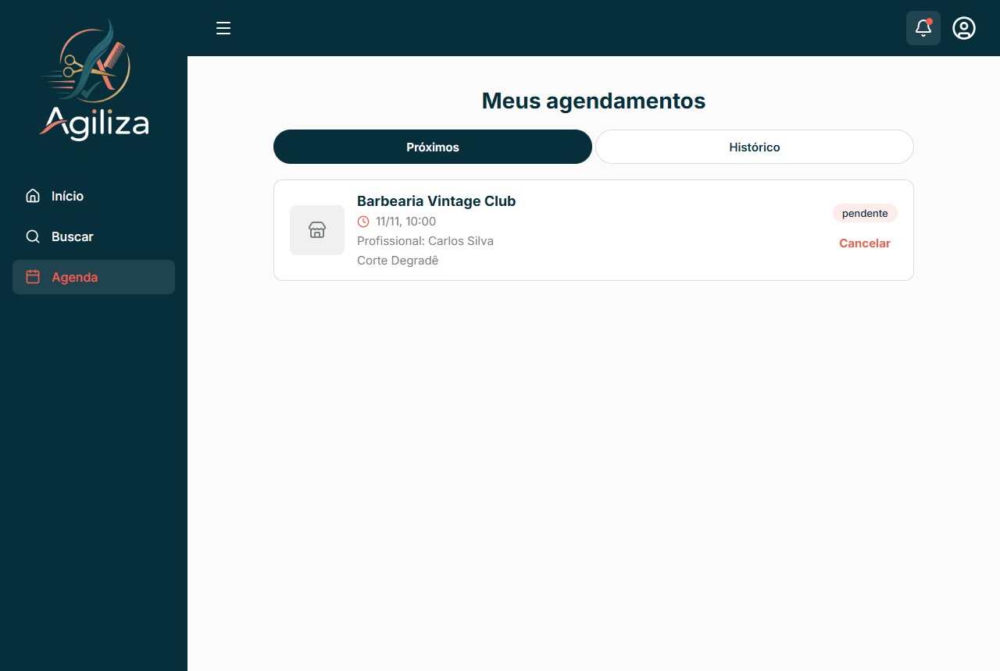
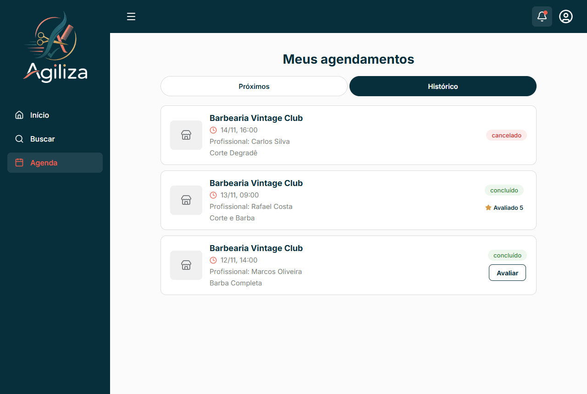
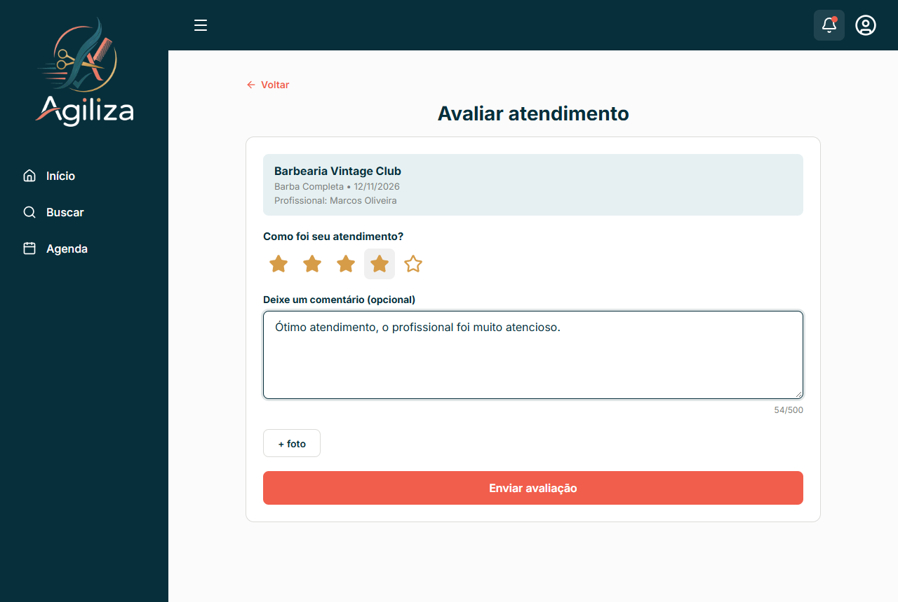
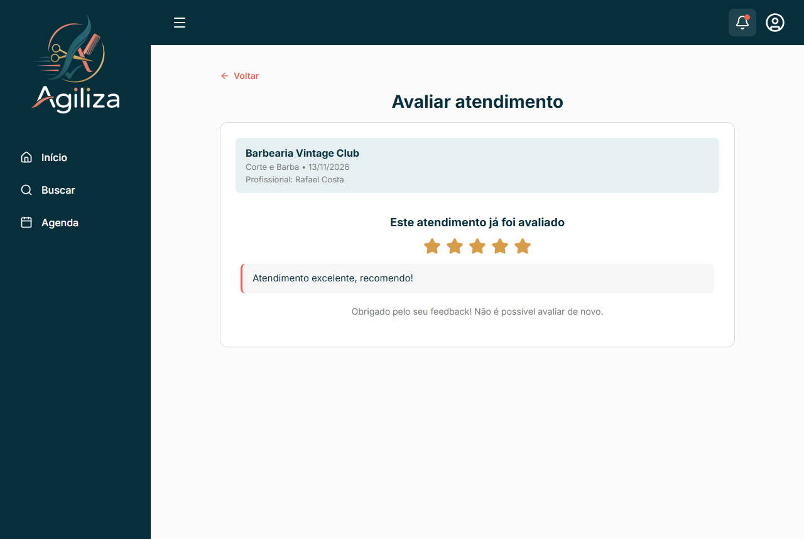
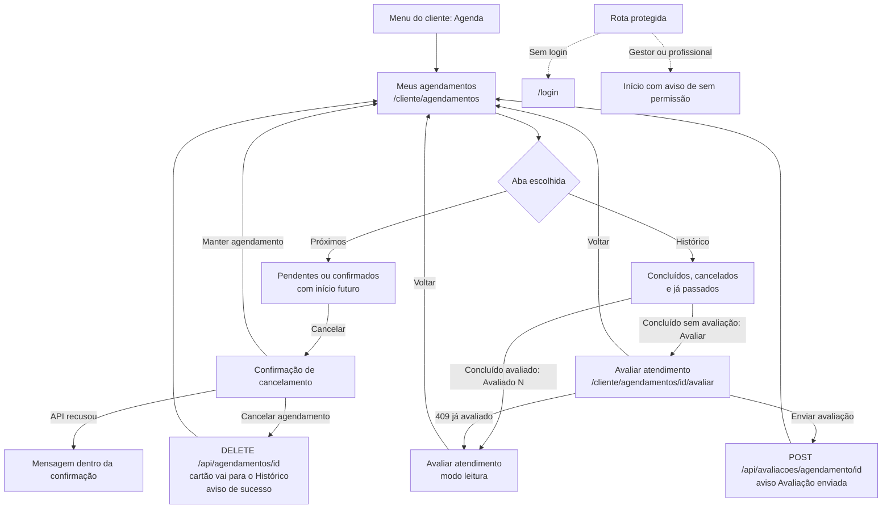
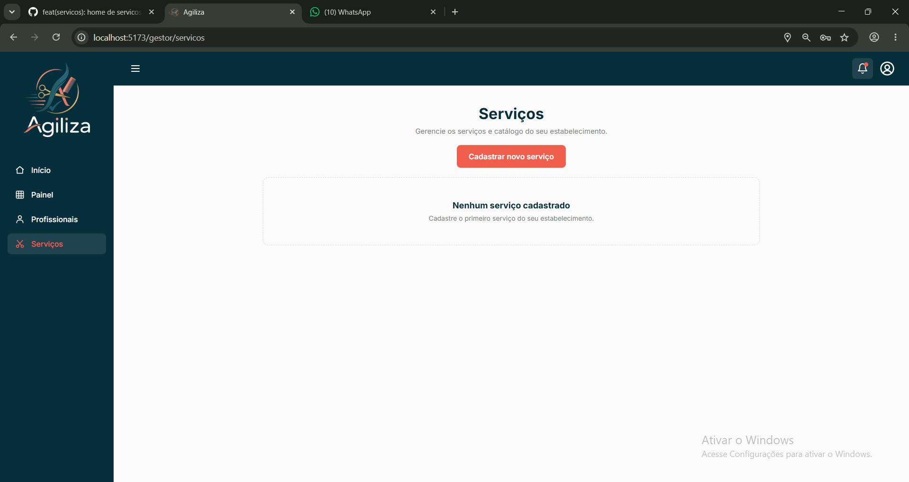
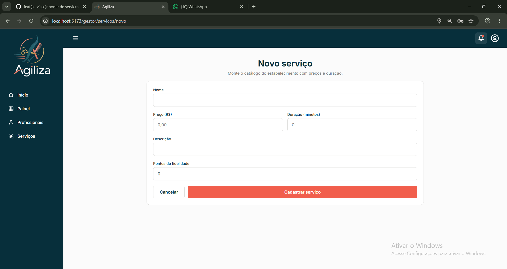
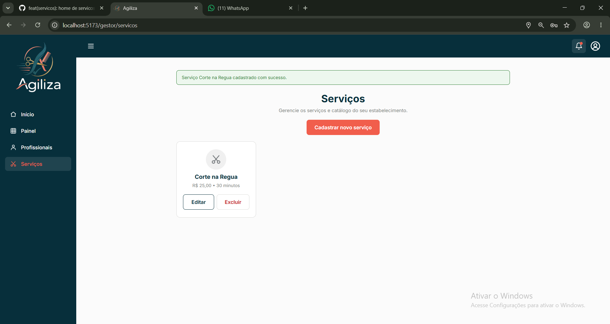
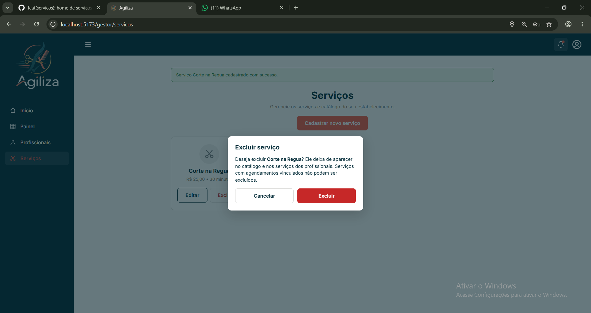
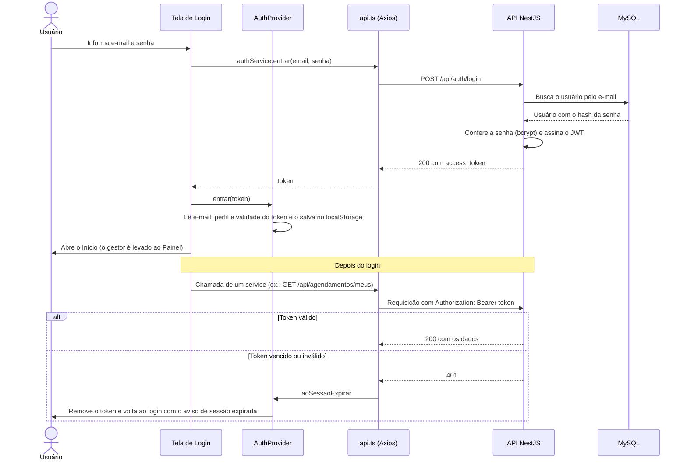

# 💻 Etapa 3: Interface Web Responsiva (Front-end Web)

Este documento serve como diretriz mestre de interface e repositório de evidências para a **Etapa 3: Desenvolvimento do Front-end Web**. Ele foi estruturado para orientar o desenvolvimento prático do cliente web e permitir o acompanhamento e a auto-gestão das atividades pelos alunos.

---

## 🎯 Rubricas de Avaliação desta Etapa

Ao final desta Etapa, cada aluno será avaliado individualmente nestas 6 competências (incluindo oportunidades de desenvolvimento e reavaliação):

1. **H21a-ADS-CST - Aplicar corretamente os padrões de codificação para o desenvolvimento da API.**: Gerenciar e documentar serviços de TI, de forma clara e objetiva (Reavaliação teórica e prática a partir do gerenciamento de serviços no frontend web em [src/frontend/](../src/frontend/)).
2. **H21b-ADS-CST - Aplicar corretamente os padrões de codificação para o desenvolvimento da aplicação web.**: Desenvolver uma arquitetura de aplicação distribuída (Integração dinâmica do cliente web com as APIs do backend distribuído desenvolvidas na Etapa 2, medido no código em [src/frontend/](../src/frontend/) e na seção [Fluxo de Dados e Integração com Backend](#3-fluxo-de-dados-e-integração-com-backend)).
3. **H22a-ADS-CST - Utilizar corretamente Framework web MVC.**: Gerenciar uma arquitetura de aplicação distribuída, testando, implantando e avaliando a solução (Processo de empacotamento, otimização de build estático e elaboração da proposta de deploy automatizado do front-end Web, medido na seção [Instruções de Implantação e DevOps Web](#5-instruções-de-implantação-e-devops-web)).
4. **H23c-ADS-CST - Implementar o projeto de interface e o fluxo de telas do sistema de uma aplicação web.**: Planejar e documentar uma aplicação Web, de forma clara e objetiva (Reavaliação/ajustes de planejamento, diagramação e design, medido em [docs/frontend-web.md](frontend-web.md)).
5. **HH24c-ADS-CST - Elaborar e documentar o projeto de interface e o fluxo de telas do sistema de uma aplicação web.**: Desenvolver uma aplicação Web (Construção de telas e componentes funcionais baseados no layout responsivo planejado, consumo de dados assíncronos e controle de estados locais, medido em [src/frontend/](../src/frontend/) e na seção [Desenvolvimento de Páginas e Componentes](#2-desenvolvimento-de-páginas-e-componentes)).
6. **H27b-ADS-CST - Desenvolver testes de integração.**: Gerenciar uma aplicação Web, testando, implantando e avaliando a solução (Escrita de suítes de testes automatizados unitários de componentes ou de interface de ponta a ponta, e auditoria de qualidade/performance no ecossistema web, medido na seção [Estratégia e Relatório de Testes Web](#4-estratégia-e-relatório-de-testes-web)).

---

## 📅 QUADRO DE CONTRIBUIÇÃO REAL (ETAPA 3)

**Atenção alunos:** Preencham esta tabela para atualizar o andamento das tarefas e quem foi o responsável técnico pela construção do Front-end Web. Os nomes, usuários e links de evidências devem corresponder aos entregáveis em [src/frontend/](../src/frontend/).

- **Status admitidos**: `⌛ Não Iniciado` | `📝 Em Progresso` | `✔️ Entregue`
- **Autoria Git**: Indica se há commits desse estudante nos arquivos da tarefa.

**Atividades Semanais desta Etapa** (ver [Cronograma do Semestre](contexto.md#-cronograma-do-semestre-semana--período)):
- `ATV3.1` — Desenvolvimento de Funcionalidades - Web (Semanas 10 a 12)
- `ATV3.2` — Testes - Front-End Web (Semana 13)

| Rubrica Curricular | ID Tarefa | Atividade Semanal | Descrição Detalhada da Tarefa | Estudante Responsável | GitHub Username | Status de Entrega | Evidência/Seção Temática | Autoria Git |
| :---: | :---: | :---: | :--- | :--- | :---: | :---: | :--- | :---: |
| **H37b** | `T3.1` | `ATV3.1` | Configuração do Projeto Web — projeto React com Vite e TypeScript, ESLint e estrutura inicial de pastas (commit `d81a414f`) | Kelven Rodrigues da Silva | `puckelvensilva` | `✔️ Entregue` | [Instalação/README](../src/frontend/README.md) | [x] |
| **H37b** | `T3.2` | `ATV3.1` | Estilização Global — paleta de cores e estilos globais iniciais (`styles/global.css`), layout inicial da Home e componente de botão (commit `d81a414f`) | Kelven Rodrigues da Silva | `puckelvensilva` | `✔️ Entregue` | [Seção 1.1](#11-identidade-visual-da-interface-web) | [x] |
| **H37b** | `T3.3` | `ATV3.1` | Desenvolvimento das Telas Chaves – Home do cliente (com vitrine e geolocalização), Perfil/Pontos de Fidelidade do cliente, Perfil/Meus Dados do Gestor e Telas de Recuperação/Redefinição de Senha com ajuste ergonômico no Login | João Pedro Lopes da Silva | `JoaoLopes994` | `✔️ Entregue` | [Seção 2.1 – Telas do cliente, do gestor e de autenticação](#21-telas-implementadas) | [x] |
| **H37b** | `T3.3` | `ATV3.1` | Desenvolvimento das Telas Chaves – busca e detalhe de estabelecimento, Painel do gestor, criação/edição do estabelecimento, geolocalização e navegação de gestão | Kelven Rodrigues da Silva | `puckelvensilva` | `✔️ Entregue` | [Seção 2.1 – Telas do gestor e estabelecimento](#21-telas-implementadas) | [x] |
| **H35b** | `T3.4` | `ATV3.1` | Integração das telas de busca e gestão com a API — `estabelecimentoService.ts` e `gestorService.ts`, incluindo busca por localização, resumo do Painel e dados do estabelecimento | Kelven Rodrigues da Silva | `puckelvensilva` | `✔️ Entregue` | [Seção 3.2](#32-serviços-de-chamada-à-api) | [x] |
| **H35b** | `T3.4` | `ATV3.1` | Consumo Assíncrono da API backend — instância Axios em `api.ts` (`VITE_API_URL`, timeout e JWT no cabeçalho `Authorization`), `authService.ts` e `cadastroService.ts` (PR #171) | Pedro Dias | `PedroD98` | `✔️ Entregue` | [Seção 3.2](#32-serviços-de-chamada-à-api) | [x] |
| **H37b** | `T3.3` | `ATV3.1` | Desenvolvimento da Agenda da equipe (`/gestor/agenda`), com cards dos profissionais e horários livres, agendados e bloqueados, exclusiva para o gestor | Kelven Rodrigues da Silva | `puckelvensilva` | `✔️ Entregue` | [Seção 2.1 – Telas do gestor](#21-telas-implementadas) | [x] |
| **H35b** | `T3.4` | `ATV3.1` | Integração da Agenda da equipe com `agendaProfissionalService.ts` e a rota segura `/agenda-gestor/:profissionalId` | Kelven Rodrigues da Silva | `puckelvensilva` | `✔️ Entregue` | [Seção 3.2](#32-serviços-de-chamada-à-api) | [x] |
| **H35b** | `T3.4` | `ATV3.1` | Consumo Assíncrono da API backend — `agendaProfissionalService.ts` (agenda do dia e bloqueios do profissional logado) e `perfilProfissionalService.ts` (perfil, nome, foto e avaliações recebidas) (commit `49c2dc6`) | Vinícius Claret Nunes | `ViniciusClaretNunes` | `✔️ Entregue` | [Seção 3.2](#32-serviços-de-chamada-à-api) | [x] |
| **H37b** | `T3.3` | `ATV3.1` | Desenvolvimento das Telas Chaves — Telas de Serviços: home com listagem em cards, cadastro, edição e exclusão (issue #173, PRs #194/#198) | Julio de Oliveira Nascimento | `xSC4Rx` | `✔️ Entregue` | [Seção 2.1 — Telas do gestor: Serviços](#21-telas-implementadas) | [x] |
| **H35b** | `T3.4` | `ATV3.1` | Consumo Assíncrono da API backend — Serviços de integração com a API (`gestorService.ts`, `usuarioService.ts`, `authService.ts`), integração de e-mail transacional via SendGrid e tratamento de DTOs/erros | João Pedro Lopes da Silva | `JoaoLopes994` | `✔️ Entregue` | [Seção 3.2 — Serviços de Chamada à API](#32-serviços-de-chamada-à-api) | [x] |
| **H35b** | `T3.4` | `ATV3.1` | Consumo Assíncrono da API backend — `servicosService.ts` (listar, buscar, cadastrar, atualizar e excluir com `ServicoError`) | Julio de Oliveira Nascimento | `xSC4Rx` | `✔️ Entregue` | [Seção 2.1 — Telas do gestor: Serviços](#21-telas-implementadas) | [x] |
| **H37b** | `T3.3` | `ATV3.1` | Desenvolvimento das Telas Chaves — Meus agendamentos: lista com abas Próximos/Histórico e cancelamento (commits 7b46748 e 2177409) | Raphael Yankous Machado Clemente | `RaphaelYankous` | `✔️ Entregue` | [Seção 2.1 — Telas do cliente: Meus agendamentos](#21-telas-implementadas) | [x] |
| **H37b** | `T3.3` | `ATV3.1` | Desenvolvimento das Telas Chaves — Avaliar atendimento: nota, comentário e foto, com bloqueio de avaliação repetida (issue #164) | Raphael Yankous Machado Clemente | `RaphaelYankous` | `✔️ Entregue` | [Seção 2.1 — Telas do cliente: Avaliar atendimento](#21-telas-implementadas) | [x] |
| **H35b** | `T3.4` | `ATV3.1` | Consumo Assíncrono da API backend — `agendamentosService.ts` (listar os agendamentos do cliente e cancelar, com `AgendamentoError`) e `avaliacoesService.ts` (listar, enviar e buscar a foto, com `AvaliacaoError`) | Raphael Yankous Machado Clemente | `RaphaelYankous` | `✔️ Entregue` | [Seção 2.1 — Telas do cliente: Avaliar atendimento](#21-telas-implementadas) | [x] |
| **H37b** | `T3.3` | `ATV3.1` | Desenvolvimento das Telas Chaves — Login e Cadastro de conta (cliente e gestor), com validação antes do envio, máscaras e foto de perfil opcional no cadastro (PRs #171 e #200) | Pedro Dias | `PedroD98` | `✔️ Entregue` | [Seção 2.1 — Cadastro de conta com foto](#21-telas-implementadas) | [x] |
| **H37b** | `T3.2` | `ATV3.1` | Layout padrão das telas logadas — `AppLayout` com menu lateral por perfil e menu do celular, `MenuUsuario` com a foto do usuário (`FotoPerfilProvider`), avisos de navegação e ícones com `lucide-react` e revisão dos estilos globais em `styles/global.css` (PRs #171, #200 e #209) | Pedro Dias | `PedroD98` | `✔️ Entregue` | [Seção 2.1 — Foto do usuário e Ícones](#21-telas-implementadas) | [x] |
| **H37b** | `T3.3` | `ATV3.1` | Desenvolvimento das Telas Chaves — Profissionais do gestor: lista em cartões, cadastro, edição e exclusão, com foto do profissional (PRs #186, #187 e #189) | Pedro Dias | `PedroD98` | `✔️ Entregue` | [Seção 2.1 — Telas do gestor: Profissionais](#21-telas-implementadas) | [x] |
| **H35b** | `T3.4` | `ATV3.1` | Consumo Assíncrono da API backend — `profissionaisService.ts` (listar, buscar, cadastrar, atualizar, enviar foto e excluir, com `ProfissionalError`) e hook `useProfissionaisDoEstabelecimento` | Pedro Dias | `PedroD98` | `✔️ Entregue` | [Seção 2.1 — Telas do gestor: Profissionais](#21-telas-implementadas) | [x] |
| **H37b** | `T3.3` | `ATV3.1` | Desenvolvimento das Telas Chaves — Fotos do estabelecimento: foto principal no cadastro, na edição e nos cards, galeria gerenciada pelo gestor e galeria com foto ampliada no detalhe (PR #205) | Pedro Dias | `PedroD98` | `✔️ Entregue` | [Seção 2.1 — Foto principal e Galeria](#21-telas-implementadas) | [x] |
| **H35b** | `T3.4` | `ATV3.1` | Consumo Assíncrono da API backend — `galeriaService.ts` e envio da foto principal em `estabelecimentoService.ts` (com `GaleriaError` e `FotoEstabelecimentoError`) (PR #205) | Pedro Dias | `PedroD98` | `✔️ Entregue` | [Seção 2.1 — Foto principal e Galeria](#21-telas-implementadas) | [x] |
| **H37b** | `T3.3` | `ATV3.1` | Agendamento pelo cliente (RF-005) — escolha de serviço e profissional no detalhe do estabelecimento (componente `Cartao`), grade da Escolha de horários pelo funcionamento do estabelecimento e separação das listas públicas das listas do gestor (commits `0337efd`, `cc4a4f4` e `6decf88`, PR #215) | Leticia Beatriz da Silva | `leticiabeatrizs` | `✔️ Entregue` | [Seção 2.1 — Galeria do estabelecimento](#21-telas-implementadas) | [x] |
| **H37b** | `T3.5` | `ATV3.1` | Gerenciamento de Estado Global do Cliente — `AuthProvider` com a sessão JWT em `localStorage` (`sessao.ts`), `RotaProtegida`, `RotaPublica` e `RotaPorPerfil`, menu por perfil e volta ao login quando a API responde `401` (PRs #171 e #186) | Pedro Dias | `PedroD98` | `✔️ Entregue` | [Seção 2.2](#22-rotas-e-estado-de-autenticação) | [x] |
| **H37c** | `T3.6` | `ATV3.2` | Desenvolvimento de Testes Modernos – Testes de componentes e integração das telas de Perfil/Meus Dados do Gestor, Recuperar Senha e Redefinir Senha (`PerfilGestor.spec.tsx`, `MeusDadosGestor.spec.tsx`, `RecuperarSenha.spec.tsx` e `RedefinirSenha.spec.tsx`) com Vitest e Testing Library | João Pedro Lopes da Silva | `JoaoLopes994` | `✔️ Entregue` | [Seção 4.1 – Arquivos de Testes](#41-arquivos-de-testes) | [x] |
| **H37c** | `T3.6` | `ATV3.2` | Desenvolvimento de Testes Modernos — Vitest, React Testing Library e MSW: funções utilitárias, componentes compartilhados, rotas e layout e as telas implementadas, com a API simulada (issue #206) | Pedro Dias | `PedroD98` | `✔️ Entregue` | [Seção 4.1](#41-arquivos-de-testes) | [x] |
| **H37c** | `T3.6` | `ATV3.2` | Testes da Agenda da equipe com Vitest, React Testing Library e MSW: carregamento, miniagendas, seleção de profissional, alteração de data e erro (4 testes) | Kelven Rodrigues da Silva | `puckelvensilva` | `✔️ Entregue` | [Seção 4.1](#41-arquivos-de-testes) | [x] |
| **H37c** | `T3.8` | `ATV3.2` | Proposta de Implantação e Pipeline de CI/CD Web — hospedagem estática com *rewrite* para o React Router, pipeline com `npm ci`, lint, testes e build, e `VITE_API_URL` por ambiente (commit `6fb653c`) | Kelven Rodrigues da Silva | `puckelvensilva` | `✔️ Entregue` | [Seção 5.2](#52-proposta-de-infraestrutura-de-deploy-e-automação-de-builds) | [x] |

---

# 1. Escopo e Diretrizes da Interface Web

O frontend web entregue é uma SPA em React 19 com Vite e TypeScript. Ele se conecta à API REST NestJS por Axios, usando a URL configurável `VITE_API_URL`, e atende aos perfis cliente, profissional e gestor com rotas protegidas. A interface prioriza responsividade, feedback de carregamento e erro, validação antes do envio, componentes reutilizáveis e acessibilidade por nomes, papéis e estados visíveis.

## 1.1. Identidade Visual da Interface Web

A interface usa React com Vite, CSS Modules e componentes próprios, sem framework visual externo. A identidade combina azul-marinho para títulos e ações principais, coral para ações de destaque, dourado para avaliações e superfícies claras com bordas neutras. Os estilos são responsivos e priorizam cartões, espaçamento consistente, foco visível, rótulos acessíveis e adaptação para telas estreitas.

---

# 2. Desenvolvimento de Páginas e Componentes

*(Esta seção atende diretamente à rubrica **H37b**)*

Abaixo detalhe como as interfaces visuais foram implementadas nos diretórios de código em [src/frontend/](../src/frontend/).

## 2.1. Telas Implementadas

As telas desenvolvidas são descritas abaixo por fluxo e perfil, com suas rotas, integrações, estados de carregamento/erro e regras de acesso. As evidências visuais funcionais disponíveis estão vinculadas nas subseções específicas de cada fluxo.

### Acesso: Login, Cadastro e recuperação de senha

*   **Login** (`/login` — [`pages/Login/index.tsx`](../src/frontend/agiliza/src/pages/Login/index.tsx)): formulário de e-mail e senha, com o botão de mostrar e ocultar a senha do `TextField`, o link **Esqueceu a senha?**, alinhado à esquerda logo acima do botão **Entrar**, que leva a `/recuperar-senha`, e o link **Criar conta**, que leva a `/cadastro`.
    *   **Validação no envio:** e-mail válido e senha obrigatória, com as mensagens junto a cada campo. Nada é enviado enquanto houver erro.
    *   **Envio:** `authService.entrar` chama `POST /api/auth/login`. No sucesso, o `AuthProvider` guarda o token e o usuário vai para o Início (`/`). Senha errada mostra "E-mail ou senha inválidos.", e a falta de conexão mostra uma mensagem própria; nos dois casos, o campo de senha é limpo.
    *   **Recados:** depois do cadastro, a tela mostra "Conta criada com sucesso! Entre com seu e-mail e senha."; quando a sessão vence, mostra "Sua sessão expirou. Entre novamente."; depois da redefinição de senha, mostra "Sua senha foi redefinida com sucesso. Faça login com a nova senha.".
    *   **Controle de acesso:** `/login`, `/cadastro`, `/recuperar-senha` e `/redefinir-senha` ficam dentro de `RotaPublica` ([`routes/RotaPublica.tsx`](../src/frontend/agiliza/src/routes/RotaPublica.tsx)), que leva o usuário já logado para o Início.
*   **Cadastro** (`/cadastro` — [`src/frontend/agiliza/src/pages/Cadastro/`](../src/frontend/agiliza/src/pages/Cadastro/)): para conta de cliente ou de gestor, o formulário tem no topo, abaixo do seletor de tipo de conta, o `CampoFoto` com o botão de lápis (**Escolher foto**, que vira **Trocar foto** depois da escolha), a legenda "Foto (opcional)" e, com uma foto escolhida, a lixeira (**Remover foto**). Um arquivo fora da regra mostra o erro no próprio campo e impede o envio.
    *   **Envio:** [`services/cadastroService.ts`](../src/frontend/agiliza/src/services/cadastroService.ts) envia `multipart/form-data` para `POST /api/clientes` ou `POST /api/gestores`, com a foto no campo `foto` quando houver. O cadastro é uma etapa só: se a API recusar a foto, a conta não é criada, a mensagem aparece no campo de foto e os demais dados continuam preenchidos. No sucesso, o usuário vai para o login, e a foto aparece no menu do topo depois de entrar.
*   **Recuperar senha** (`/recuperar-senha` — [`src/frontend/agiliza/src/pages/RecuperarSenha/index.tsx`](../src/frontend/agiliza/src/pages/RecuperarSenha/index.tsx)): interface pública de solicitação de recuperação de credenciais de acesso.
    *   **Formulário e Validações:** campo de e-mail com validação de formato e obrigatoriedade, acompanhado de botão de submissão e atalho de retorno para a tela de Login (`/login`).
    *   **Consumo da API:** submete requisição assíncrona para `POST /api/auth/recuperar-senha`.
    *   **Tratamento de feedback e segurança:** exibe mensagem neutra de confirmação para prevenir ataques de enumeração de contas ("Se o e-mail informado estiver cadastrado, enviamos as instruções para redefinir sua senha."), além de tratamento visual de indisponibilidade momentânea da API.
*   **Redefinir senha** (`/redefinir-senha` — [`src/frontend/agiliza/src/pages/RedefinirSenha/index.tsx`](../src/frontend/agiliza/src/pages/RedefinirSenha/index.tsx)): interface de cadastro da nova senha através de token temporário recebido via e-mail transacional.
    *   **Captura de Parâmetros:** extrai automaticamente o token da URL via query parameter (`?token=...`). Sem o token, a tela mostra "Link de recuperação inválido ou incompleto." e o link **Solicitar nova recuperação**, no lugar do formulário.
    *   **Controles de Entrada:** campos para "Nova senha" e "Confirmar nova senha" com botões para alternar visibilidade (mostrar/ocultar senha), validação de tamanho mínimo (6 caracteres) e checagem de divergência entre os dois campos.
    *   **Consumo e Redirecionamento:** submete `POST /api/auth/redefinir-senha`. No sucesso, leva o usuário ao login, que mostra "Sua senha foi redefinida com sucesso. Faça login com a nova senha.". Token expirado ou inválido (400) mostra a mensagem da API, ou "Link inválido ou expirado. Solicite uma nova recuperação.", num alerta acima do formulário.
*   **Chamadas à API:** em [`services/authService.ts`](../src/frontend/agiliza/src/services/authService.ts) (`entrar`, `solicitarRecuperacaoSenha` e `redefinirSenha`), que traduzem os erros em `LoginError`, `RecuperarSenhaError` e `RedefinirSenhaError`.

*Screenshots funcionais de Login, Cadastro e recuperação de senha:*


### Menu do usuário e notificações

*   **Menu do usuário:** o avatar no topo ([`components/MenuUsuario/`](../src/frontend/agiliza/src/components/MenuUsuario/)) mostra a foto de qualquer perfil (cliente, gestor ou profissional) e o ícone padrão quando não há foto. A foto é carregada uma vez pelo `FotoPerfilProvider` ([`contexts/FotoPerfilProvider.tsx`](../src/frontend/agiliza/src/contexts/FotoPerfilProvider.tsx)) em `GET /api/usuarios/me/foto` ([`services/usuarioService.ts`](../src/frontend/agiliza/src/services/usuarioService.ts)). Quando o profissional troca a foto em "Meu perfil", a tela atualiza o contexto com `definirFoto` e o menu muda na hora.
*   **Perfil do cliente** (`/cliente/perfil`): o cabeçalho mostra a mesma foto do menu, lida do contexto com `useFotoPerfil()`, ou o ícone `pessoa` quando o cliente não tem foto.
*   **Notificações** (sino no topo do [`AppLayout`](../src/frontend/agiliza/src/components/AppLayout/AppLayout.tsx)): carrega `GET /api/notificacoes` ao entrar, mostra um ponto quando há notificação não lida e abre um painel com o título e a mensagem de cada uma. Clicar numa não lida chama `PATCH /api/notificacoes/{id}/lida` e a marca como lida na hora. Sem notificações, o painel mostra "Você não tem notificações novas."

*Screenshots funcionais do menu do usuário e das notificações:*


### Telas do cliente: Home, Perfil e Meus Dados

*   **Home do cliente** (`/` — [`src/frontend/agiliza/src/pages/Home/`](../src/frontend/agiliza/src/pages/Home/)): tela principal do cliente autenticado, contendo vitrine dos estabelecimentos parceiros com cálculo dinâmico de proximidade através de coordenadas de geolocalização do navegador (`navigator.geolocation`).
    *   **Catálogo em cards:** consome `GET /api/estabelecimentos`, renderizando foto principal, endereço formatado e atalhos diretos para agendamento.
    *   **Tratamento de estados:** gerenciamento visual para localização pendente/negada, carregamento com feedback e tratamento para ausência de estabelecimentos cadastrados.
*   **Perfil do cliente** (`/cliente/perfil` — [`src/frontend/agiliza/src/pages/PerfilCliente/PerfilCliente.tsx`](../src/frontend/agiliza/src/pages/PerfilCliente/PerfilCliente.tsx)): central de informações da conta do cliente autenticado (RF-001 e RF-014).
    *   **Identidade e Saldo:** consome `GET /api/meu-perfil-cliente` para nome, sobrenome e e-mail, e lê o avatar do `FotoPerfilContext`. Consulta `GET /api/meu-perfil-cliente/fidelidade` para renderizar o saldo de fidelidade acumulado e a barra de progresso visual em direção à meta de resgate.
    *   **Navegação:** disponibiliza links de acesso rápido para "Meus dados" (`/cliente/meus-dados`), atalho para histórico de agendamentos (`/cliente/agendamentos`) e seções institucionais/suporte.
    *   **Controle de Acesso:** restrito a contas com perfil `cliente` através de `RotaPorPerfil perfis={['cliente']}`.
*   **Meus dados do cliente** (`/cliente/meus-dados` — [`src/frontend/agiliza/src/pages/MeusDadosCliente/index.tsx`](../src/frontend/agiliza/src/pages/MeusDadosCliente/index.tsx)): interface de atualização cadastral do próprio cliente.
    *   **Formulário reutilizável:** utiliza o componente `FormularioCliente`, carregando os dados vigentes via `GET /api/clientes/{id}` (com o ID resolvido com base na sessão autenticada).
    *   **Campos e Validações:** permite edição de Nome, Sobrenome, E-mail, Telefone (máscara flexível para até 20 caracteres) e atualização de foto (`CampoFoto`). O CPF permanece visível apenas para leitura (imutável após cadastro).
    *   **Envio multipart:** submete dados via `PATCH /api/clientes/{id}` utilizando `FormData`. Caso haja alteração da imagem de perfil, sincroniza o `FotoPerfilContext` na hora.
    *   **Navegação e Feedback:** ao concluir com sucesso, redireciona o cliente de volta para `/cliente/perfil` injetando a notificação de confirmação no `location.state`, descartada automaticamente pelo `AppLayout` após 3 segundos.

*Screenshots funcionais do cliente:*


### Telas do cliente: Detalhe do estabelecimento e agendamento

*   **Escolha de serviço e profissional no detalhe do estabelecimento:** a página abre sem serviço escolhido. Os serviços vêm de `GET /api/estabelecimentos/{id}/servicos/publicos` e os profissionais de `GET /api/estabelecimentos/{id}/profissionais/publicos` (sem e-mail). Ao escolher um serviço, aparece "Escolha o profissional", só com quem presta o serviço e tem horário de atendimento cadastrado (campo `temHorarios` da lista, sem uma consulta por profissional), em cartões selecionáveis com a foto (ou a inicial) e o nome ([`OpcaoProfissional`](../src/frontend/agiliza/src/pages/Estabelecimento/OpcaoProfissional.tsx)). Nenhum vem marcado; ao trocar de serviço, o profissional continua marcado se também presta o novo serviço. Sem profissional, aparece "Nenhum profissional disponível para este serviço.". O botão **Agendar horário** só habilita com serviço e profissional e abre `/cliente/horarios?estabelecimentoId=…&profissionalId=…&servicoId=…`.
*   **Escolha de horários** (`/cliente/horarios` — [`pages/EscolhaHorarios/index.tsx`](../src/frontend/agiliza/src/pages/EscolhaHorarios/index.tsx)): a grade vai da abertura do estabelecimento até o último início antes do fechamento, de 30 em 30 minutos. Ficam habilitados só os horários que `GET /api/profissionais/{id}/horarios-disponiveis` devolve; os demais aparecem como "indisp.". Num dia sem horários, a grade dá lugar à mensagem "Não há horários disponíveis neste dia.". Se a confirmação for recusada, a tela mostra a mensagem do backend (por exemplo, horário que já passou ou que acabou de ser ocupado), limpa a seleção e recarrega os horários do dia; para `403`, mostra "Só clientes podem fazer agendamentos.".
*   **Componente [`Cartao`](../src/frontend/agiliza/src/components/Cartao/Cartao.tsx):** layout dos cartões verticais (mídia num círculo, nome em até 2 linhas, conteúdo e rodapé opcional), usado nos cartões de serviço e de profissional do gestor e na escolha do profissional. Com `aoSelecionar`, o cartão inteiro vira um botão com `aria-pressed`, destacado em coral quando selecionado; sem ele, é um `article`.

*Screenshots funcionais do agendamento:*


### Telas do cliente: Meus agendamentos

*   **Meus agendamentos** (`/cliente/agendamentos` — [`src/frontend/agiliza/src/pages/MeusAgendamentos/`](../src/frontend/agiliza/src/pages/MeusAgendamentos/)): aberta pelo item "Agenda" do menu do cliente, conforme o wireframe da Tela 7 (RF-009). A rota fica dentro de `RotaPorPerfil perfis={['cliente']}`: gestor e profissional voltam ao Início com o aviso "Você não tem permissão para acessar essa página.", e quem não está logado vai para `/login`.
    *   **Lista:** os agendamentos do cliente logado vêm de `GET /api/agendamentos/meus` e aparecem em cartões ([`CartaoAgendamento.tsx`](../src/frontend/agiliza/src/pages/MeusAgendamentos/CartaoAgendamento.tsx)) com o nome do estabelecimento, um selo de status (pendente, confirmado, concluído ou cancelado), a data e hora com ícone de relógio (`Hoje, 10:30` ou `05/09, 15:00`), o profissional responsável (`Profissional: Carla Mendes`) e o nome do serviço.
    *   **Abas:** o `SegmentedControl` alterna entre **Próximos** (pendentes ou confirmados com início futuro, do mais próximo ao mais distante) e **Histórico** (concluídos, cancelados e já passados, do mais recente ao mais antigo).
    *   **Cancelamento:** o botão **Cancelar** só aparece em agendamentos pendentes ou confirmados. Ele abre uma confirmação (`Modal`) com o serviço, o estabelecimento e a data, com os botões **Manter agendamento** e **Cancelar agendamento**. Confirmado, a tela chama `DELETE /api/agendamentos/{id}`, passa o cartão para o Histórico como cancelado, sem recarregar a página, e mostra "Agendamento cancelado com sucesso.". Se a API recusar (agendamento de outro cliente, inexistente, já cancelado ou concluído), a mensagem aparece dentro da confirmação.
    *   **Estados:** "Carregando agendamentos…" enquanto a lista carrega; um alerta de erro se a consulta falhar; e uma mensagem própria de lista vazia em cada aba.
*   **Chamadas à API:** centralizadas em [`services/agendamentosService.ts`](../src/frontend/agiliza/src/services/agendamentosService.ts) (`listarMeusAgendamentos` e `cancelarAgendamento`), que traduzem os erros da API em `AgendamentoError`. A lista é carregada pelo hook [`useMeusAgendamentos`](../src/frontend/agiliza/src/hooks/useMeusAgendamentos.ts). O status usa os mesmos valores numéricos do enum `StatusAgendamento` do backend (0 pendente, 1 confirmado, 2 concluído, 3 cancelado).
*   **Itens acrescentados a arquivos compartilhados:** o ícone `relogio` em [`components/Icone/`](../src/frontend/agiliza/src/components/Icone/), a função `formatarDataHora` em [`utils/formatacao.ts`](../src/frontend/agiliza/src/utils/formatacao.ts) e o caminho do item "Agenda" do cliente em [`routes/menuPorPerfil.ts`](../src/frontend/agiliza/src/routes/menuPorPerfil.ts).

### Telas do cliente: Avaliar atendimento

*   **Acesso pela lista:** em **Meus agendamentos**, o cartão de um atendimento **concluído** ganha o botão **Avaliar**, que leva a `/cliente/agendamentos/:id/avaliar`. Se o cliente já avaliou, o botão é trocado pelo selo **Avaliado N** (estrela e nota), que leva à mesma tela em modo de leitura. Enquanto as avaliações carregam, nenhum dos dois aparece, para o botão não piscar antes do selo. A rota fica dentro de `RotaPorPerfil perfis={['cliente']}`, com o mesmo comportamento das outras telas do cliente.
*   **Avaliar atendimento** (`/cliente/agendamentos/:id/avaliar` — [`src/frontend/agiliza/src/pages/AvaliarAtendimento/`](../src/frontend/agiliza/src/pages/AvaliarAtendimento/), issue #164): mostra o resumo do atendimento (estabelecimento, serviço, data e profissional responsável, que vem de `agendamento.profissional`) e o formulário [`FormularioAvaliacao`](../src/frontend/agiliza/src/pages/AvaliarAtendimento/FormularioAvaliacao.tsx).
    *   **Campos:** a nota de 1 a 5 estrelas (obrigatória), um comentário opcional de até 500 caracteres, com contador, e uma foto opcional (botão **+ foto**).
    *   **Validação no envio:** sem nota, o envio é barrado com "Escolha uma nota de 1 a 5.". A foto é conferida no navegador (JPG, PNG ou WebP, até 2 MB) por `validarFoto`, e o erro aparece junto ao campo, sem anexar o arquivo.
    *   **Envio:** `POST /api/avaliacoes/agendamento/{id}` em `multipart/form-data`, com `nota`, `comentario` (só se preenchido) e `foto` (só se escolhida). No sucesso, o cliente volta a **Meus agendamentos**, que exibe "Avaliação enviada. Obrigado!" pelo aviso de navegação no `state` da rota.
    *   **Avaliação repetida:** cada atendimento só pode ser avaliado uma vez. Quem abre a tela de um atendimento já avaliado vê "Este atendimento já foi avaliado", com a nota, o comentário e a foto enviados, e nenhum formulário. Se a API responder 409 no envio (por exemplo, avaliado em outra aba), a tela troca o formulário por esse mesmo aviso.
    *   **Estados:** "Carregando atendimento…" enquanto as listas carregam; alerta de erro se a consulta falhar; "Atendimento não encontrado." para um `id` que não é do cliente; "Só é possível avaliar atendimentos concluídos." para atendimento pendente, confirmado ou cancelado; e um alerta acima do botão **Enviar avaliação** para os erros do envio, que aparece com "Enviando…" enquanto a chamada está em andamento.
*   **Chamadas à API:** centralizadas em [`services/avaliacoesService.ts`](../src/frontend/agiliza/src/services/avaliacoesService.ts) (`listarMinhasAvaliacoes`, `enviarAvaliacao`, `buscarFotoAvaliacao` e `validarFoto`), que traduzem os erros 400, 403, 404, 409 e 413 e a falha de rede em `AvaliacaoError`. A foto da avaliação é privada e exige o token, por isso é baixada como arquivo e exibida por [`FotoAvaliacao`](../src/frontend/agiliza/src/pages/AvaliarAtendimento/FotoAvaliacao.tsx), e não por `` direto. A lista de avaliações do cliente vem do hook [`useMinhasAvaliacoes`](../src/frontend/agiliza/src/hooks/useMinhasAvaliacoes.ts).
*   **Componentes reutilizáveis criados:** `SeletorEstrelas` ([`components/SeletorEstrelas/`](../src/frontend/agiliza/src/components/SeletorEstrelas/)), com cinco estrelas em `radiogroup`, destaque ao passar o mouse, troca de nota pelas setas do teclado e o modo `somenteLeitura` para exibir uma nota já dada; e `AnexoFoto` ([`components/AnexoFoto/`](../src/frontend/agiliza/src/components/AnexoFoto/)), com o botão **+ foto**, prévia da imagem escolhida, botão de lixeira (**Remover foto**) e mensagem de erro.
*   **Itens acrescentados a arquivos compartilhados:** a rota de avaliação em [`App.tsx`](../src/frontend/agiliza/src/App.tsx) e, em [`pages/MeusAgendamentos/`](../src/frontend/agiliza/src/pages/MeusAgendamentos/), o botão **Avaliar** e o selo **Avaliado N** no `CartaoAgendamento`, que exibe o profissional e o cita no texto acessível desses dois botões.

*Screenshots funcionais das telas de Meus agendamentos e Avaliar atendimento (dados de teste):*









#### Fluxo de telas do cliente: agendamentos e avaliação

O diagrama mostra o caminho do cliente logado a partir do item "Agenda" do menu, e o que acontece com quem não pode acessar.



**Comparação com os wireframes da Etapa 1** (Telas 7 e 9 de [contexto.md](contexto.md)):

| Wireframe | Previsto | Implementado na web |
| :--- | :--- | :--- |
| Tela 7, Meus Agendamentos | Cartões com horário e status | Igual: cartão com estabelecimento, selo de status, data e hora, serviço |
| Tela 7 | Cancelar por *swipe* | Botão **Cancelar** com confirmação em `Modal`, porque o *swipe* é um gesto de celular |
| Tela 7 | Filtros por data e status | Duas abas, **Próximos** e **Histórico**, que separam os agendamentos por situação e por data |
| Tela 7 | Avaliar serviço | Botão **Avaliar** e selo **Avaliado N** no cartão do atendimento concluído |
| Tela 9, Avaliação | Estrelas, comentário com contador e botão Enviar | Igual: `SeletorEstrelas`, comentário de até 500 caracteres com contador e **Enviar avaliação** |
| Tela 9 | Opção de foto (descrita na tabela de telas) | **+ foto** opcional, com prévia e remoção |
| Tela 9 | Voltar para a lista depois de enviar | Igual: volta a Meus agendamentos com o aviso "Avaliação enviada. Obrigado!" |

### Telas do profissional: Agenda, Bloqueios, Disponibilidade e Perfil

*   **Agenda do profissional** (`/agenda` — [`pages/AgendaProfissional/AgendaProfissional.tsx`](../src/frontend/agiliza/src/pages/AgendaProfissional/AgendaProfissional.tsx)): aberta pelo item "Agenda" do menu do profissional. Mostra o dia escolhido ("Minha agenda · Hoje" ou a data), os sete dias da semana para escolher, as setas de semana anterior e próxima e o botão **Ir para hoje**.
    *   **Grade do dia:** vem de `GET /api/minha-agenda?data=AAAA-MM-DD`. Os horários de atendimento do profissional aparecem em blocos de 30 minutos, marcados como **Livre**, **Bloqueado** (com o motivo) ou agendado (cliente e serviço). Blocos seguidos do mesmo atendimento ou do mesmo bloqueio aparecem juntos.
    *   **Ações:** clicar num bloco abre um `Modal`. Num horário livre, o profissional informa um motivo opcional e confirma o bloqueio (`POST /api/minha-agenda/bloqueios`); num bloqueado, pode remover o bloqueio (`DELETE /api/minha-agenda/bloqueios/{id}`); num agendado, vê o cliente e o serviço. Depois de cada ação, a agenda é recarregada. Se o horário acabou de ser ocupado (409), a tela avisa e atualiza a grade.
    *   **Estados:** "Carregando agenda..." enquanto carrega; num dia sem horários de atendimento, um aviso e, quando houver, a lista "Bloqueios do dia"; conta sem vínculo com estabelecimento (404) mostra "Seu perfil profissional ainda não está vinculado a um estabelecimento.". O link **Adicionar ou gerenciar bloqueios** leva a `/bloqueios`.
*   **Bloqueios** (`/bloqueios` — [`pages/Bloqueios/Bloqueios.tsx`](../src/frontend/agiliza/src/pages/Bloqueios/Bloqueios.tsx)): registro de folgas, pausas e imprevistos, aberto pelo item "Bloqueios" do menu do profissional.
    *   **Novo bloqueio:** data, início e fim (ou **Bloquear o dia inteiro**) e motivo opcional. Antes de enviar, a tela confere se o fim é depois do início. O envio usa `POST /api/minha-agenda/bloqueios` e mostra "Bloqueio registrado. Ele também aparece na agenda do dia.".
    *   **Lista:** os bloqueios de `GET /api/minha-agenda/bloqueios`, com data, período (ou "Dia inteiro") e motivo. **Excluir** pede confirmação e chama `DELETE /api/minha-agenda/bloqueios/{id}`.
    *   **Estados:** "Carregando bloqueios..." enquanto carrega; "Nenhum bloqueio registrado." para a lista vazia; "Não foi possível consultar os bloqueios." com o botão **Tentar novamente** se a lista não carregar. Período que coincide com um agendamento ou outro bloqueio (409) mostra "Já existe um agendamento ou bloqueio neste período.".
*   **Minha disponibilidade** (`/horarios`, perfil profissional — [`pages/HorariosProfissional/index.tsx`](../src/frontend/agiliza/src/pages/HorariosProfissional/index.tsx)): o profissional cadastra os horários semanais (dia, início e fim) usados no cálculo dos horários disponíveis, vê a lista em ordem de dia e início e remove os que não valem mais. O formulário e a lista são o componente [`EditorHorarios`](../src/frontend/agiliza/src/components/EditorHorarios/EditorHorarios.tsx), que começa com a abertura e o fechamento do estabelecimento. Remover um horário pede confirmação. A tela mostra o funcionamento do estabelecimento (vindo de `/api/meu-perfil-profissional`) e, antes de enviar, confere as mesmas regras da API ([`utils/horarios.ts`](../src/frontend/agiliza/src/utils/horarios.ts)): fim depois do início, dentro do funcionamento e sem sobreposição com outro horário do mesmo dia. Se a API recusar, mostra a mensagem dela. Usa `/api/minha-agenda/disponibilidades`.
*   **Perfil do profissional** (`/perfil` — [`pages/PerfilProfissional/PerfilProfissional.tsx`](../src/frontend/agiliza/src/pages/PerfilProfissional/PerfilProfissional.tsx)): aberto pelo item "Perfil" do menu do usuário. Mostra a foto (ou as iniciais), o nome, a função, o estabelecimento e a nota média com a quantidade de avaliações, vindos de `GET /api/meu-perfil-profissional` e `GET /api/meu-perfil-profissional/avaliacoes`.
    *   **Foto e nome:** **Adicionar foto** (ou **Alterar foto**) confere o arquivo com `validarArquivoFoto` (JPG, PNG ou WebP até 2 MB), envia em `PATCH /api/meu-perfil-profissional/foto` e atualiza a foto do menu na hora. **Editar nome** abre um `Modal` com nome e sobrenome, salvos em `PATCH /api/meu-perfil-profissional`.
    *   **Conta profissional:** **Meus serviços** lista os serviços do estabelecimento com preço e duração, só para consulta, porque a edição é do gestor; **Avaliações recebidas** lista a nota e o comentário de cada avaliação; **Sair** encerra a sessão e volta ao login. Dados bancários, Notificações e Ajuda aparecem como itens ainda indisponíveis.
    *   **Estados:** "Carregando perfil..." enquanto carrega; conta sem vínculo (404) mostra o aviso para pedir ao gestor que conclua o cadastro; se as avaliações não carregarem, aparece "Avaliações indisponíveis no momento" e o resto da tela continua funcionando.
*   **Controle de acesso:** as quatro rotas ficam dentro de `RotaProfissional` ([`routes/RotaProfissional.tsx`](../src/frontend/agiliza/src/routes/RotaProfissional.tsx)), que leva os outros perfis para o Início.

*Screenshots funcionais das telas do profissional:*


### Telas do gestor: Painel e estabelecimento

*   **Painel do gestor** (`/gestor` — [`src/frontend/agiliza/src/pages/Gestor/Painel.tsx`](../src/frontend/agiliza/src/pages/Gestor/Painel.tsx)): é a tela inicial exclusiva do perfil `gestor`; não existe mais uma tela genérica de início para esse perfil. O componente carrega os estabelecimentos vinculados ao gestor, informa o estado de funcionamento (aberto, fechado ou horário não informado), exibe endereço, telefone, e-mail, CNPJ, fidelidade, quantidade de serviços e quantidade de profissionais.
    *   **Resumo do mês:** cada cartão apresenta serviços realizados, agendamentos, faturamento estimado e agendamentos do dia. Se a consulta dos indicadores falhar, o cartão mostra "Resumo indisponível no momento", sem impedir o uso dos demais dados.
    *   **Ações de gestão:** os botões **Dados do estabelecimento** e **Fotos do estabelecimento** levam, respectivamente, a `/gestor/editar-estabelecimento` e `/gestor/galeria`. O Painel também oferece cadastro quando o gestor ainda não possui estabelecimento e permite tentar novamente quando a carga principal falha.
    *   **Controle de acesso:** `Home` redireciona o gestor para `/gestor`, enquanto o profissional continua usando a tela genérica `/` com atalhos para Agenda e Bloqueios. As rotas de gestão permanecem protegidas por `RotaPorPerfil perfis={['gestor']}`.
*   **Criar e editar estabelecimento** (`/gestor/criar-estabelecimento` e `/gestor/editar-estabelecimento`): formulários para nome, razão social, CNPJ, telefone, e-mail, endereço, descrição, horários, dias de funcionamento, fidelidade e foto principal. A edição recebe o estabelecimento selecionado pelo Painel e preserva a foto atual quando o gestor não escolhe outra.
*   **Busca e detalhe de estabelecimento** (`/buscar` e `/estabelecimentos/:id`): a busca permite consultar estabelecimentos por texto, categoria, nota e preço, ordenar por relevância, nota, preço ou distância e solicitar a localização do navegador quando a ordenação por distância é escolhida. O detalhe mostra os dados do estabelecimento, serviços, contato, foto principal e galeria.
*   **Autoria da implementação:** as telas e integrações acima foram desenvolvidas por Kelven Rodrigues da Silva (`puckelvensilva`), com evidências nos commits `63a3dfb`, `c6731fa`, `4a1ba39`, `a8cddfe`, `861786f` e `bf219c9`.

*Screenshots funcionais do Painel e do estabelecimento:*


### Telas do gestor: Agenda da equipe

*   **Agenda da equipe** (`/gestor/agenda` — [`src/frontend/agiliza/src/pages/Gestor/AgendaEquipe.tsx`](../src/frontend/agiliza/src/pages/Gestor/AgendaEquipe.tsx)): tela exclusiva do gestor que lista os profissionais da barbearia em cards com miniagenda. O gestor seleciona a data e visualiza horários livres, agendados e bloqueados; a agenda selecionada também apresenta os atendimentos, clientes, serviços e motivos dos bloqueios em modo somente leitura. Profissionais e clientes não têm acesso à rota.
    *   Consulta `GET /api/estabelecimentos/meus`, `GET /api/estabelecimentos/{id}/profissionais` e `GET /api/agenda-gestor/{profissionalId}?data=AAAA-MM-DD`.
    *   O item **Agenda da equipe** aparece no menu do gestor logo abaixo de **Painel**.

*Screenshots funcionais da Agenda da equipe:*


### Telas do gestor: Profissionais

*   **Profissionais** (`/gestor/profissionais` — [`src/frontend/agiliza/src/pages/Profissionais/`](../src/frontend/agiliza/src/pages/Profissionais/)): aberta pelo item "Profissionais" do menu do gestor e pelo item "Profissionais" da lista de Gestão do Painel do Gestor. A tela consulta o estabelecimento do gestor logado em `GET /api/estabelecimentos/meus`. Enquanto carrega ou se a consulta falhar, o botão **Cadastrar novo profissional** fica desabilitado. Gestor sem estabelecimento vê o aviso `AvisoSemEstabelecimento` (mensagem e link "Cadastrar estabelecimento", que leva a `/gestor/criar-estabelecimento`).
    *   **Lista:** os profissionais vêm de `GET /api/estabelecimentos/{id}/profissionais`, já em ordem alfabética, e aparecem em cartões verticais do mesmo tamanho ([`CartaoProfissional.tsx`](../src/frontend/agiliza/src/pages/Profissionais/CartaoProfissional.tsx), montado sobre o componente [`Cartao`](../src/frontend/agiliza/src/components/Cartao/Cartao.tsx)), numa grade que vira uma coluna no celular. Cada cartão mostra a foto (ou um ícone padrão) e o nome, sem o sobrenome, centralizados; o e-mail em uma linha, com reticências e o endereço completo ao passar o mouse; e até 3 serviços em chips estáticos, com um chip "+N" que lista os demais ao passar o mouse. CPF e telefone não aparecem, e o cartão não é clicável. Quem não tem horário ativo (`temHorarios` falso) mostra o aviso "Sem horários cadastrados. Enquanto não tiver horário, este profissional não aparece para os clientes.". O rodapé de cada cartão tem o botão **Horários**, na largura toda, que abre a página de horários do profissional, e abaixo dele **Editar**, que abre a edição, e **Excluir**.
    *   **Horários** (`/gestor/profissionais/:id/horarios` — [`pages/Gestor/HorariosDoProfissional.tsx`](../src/frontend/agiliza/src/pages/Gestor/HorariosDoProfissional.tsx)): mostra o nome do profissional, o funcionamento do estabelecimento do gestor e os horários semanais do profissional, com o componente [`EditorHorarios`](../src/frontend/agiliza/src/components/EditorHorarios/EditorHorarios.tsx), o mesmo da tela "Minha disponibilidade". O gestor adiciona e remove horários (a remoção pede confirmação) por `POST /api/profissionais/{id}/disponibilidades` e `DELETE /api/disponibilidades/{id}`, só disponíveis para o gestor dono; o profissional vê as mudanças na tela dele, e vice-versa.
    *   **Exclusão:** **Excluir** abre uma confirmação (`Modal`) com o nome completo do profissional e os botões **Cancelar** e **Excluir**. Confirmada, a tela chama `DELETE /api/estabelecimentos/{id}/profissionais/{profissionalId}`, tira o profissional da lista sem recarregar a página e mostra "Profissional {nome} {sobrenome} excluído com sucesso.". Se o profissional tiver agendamentos pendentes ou confirmados no futuro, a API recusa, e a mensagem aparece dentro da confirmação.
    *   **Estados:** "Carregando profissionais…" enquanto a lista carrega; "Nenhum profissional cadastrado" quando o estabelecimento ainda não tem equipe; um alerta de erro se a consulta falhar.
*   **Novo profissional** (`/gestor/profissionais/novo` — [`src/frontend/agiliza/src/pages/NovoProfissional/`](../src/frontend/agiliza/src/pages/NovoProfissional/)): formulário de cadastro de profissional (issue #172). Não há seletor de estabelecimento, porque cada gestor tem um único estabelecimento.
    *   **Campos:** Foto (opcional, no topo do formulário), Nome, Sobrenome, E-mail, CPF (máscara `000.000.000-00`), Telefone (máscara `(00) 00000-0000`), Senha de acesso (mínimo de 6 caracteres, com botão de mostrar/ocultar) e Serviços. Os serviços vêm de `GET /api/estabelecimentos/{id}/servicos` e são escolhidos em chips de seleção múltipla.
    *   **Horários de atendimento (opcional):** antes dos botões, o componente [`EditorHorarios`](../src/frontend/agiliza/src/components/EditorHorarios/EditorHorarios.tsx) (o mesmo das telas de horários) mostra o funcionamento do estabelecimento e deixa adicionar quantos horários quiser (dia, início e fim), com as mesmas regras da API. A lista fica só na tela até o envio, e remover não pede confirmação. A seção entra pela prop opcional `secaoExtra` do `FormularioProfissional`, que a edição não usa. Dá para cadastrar sem horários; o texto da seção lembra que, sem horário, o profissional não aparece para os clientes.
    *   **Validação no envio:** as mesmas regras do cadastro público ([`utils/validacao.ts`](../src/frontend/agiliza/src/utils/validacao.ts)): campos obrigatórios, e-mail válido, CPF com dígitos verificadores, telefone com DDD e senha com 6 caracteres. Também exige ao menos um serviço. As mensagens aparecem junto a cada campo, e nada é enviado enquanto houver erro. Como o formulário é longo, a tela rola até o primeiro campo com erro (ou até o alerta da API) e põe o foco nele; o mesmo vale na edição.
    *   **Envio:** `POST /api/estabelecimentos/{id}/profissionais` com CPF e telefone só com dígitos. Se o gestor escolheu uma foto, ela é enviada logo depois, em `PATCH /api/estabelecimentos/{id}/profissionais/{profissionalId}/foto`. No sucesso, o gestor vai para o Início, que exibe "Profissional {nome} cadastrado com sucesso."; se só a foto falhar, a mensagem avisa que o cadastro foi feito, mas a foto não foi salva e pode ser enviada pela edição. Depois da foto, cada horário da seção é enviado, um de cada vez, em `POST /api/profissionais/{profissionalId}/disponibilidades`; se algum falhar, o profissional continua cadastrado e a mensagem diz quantos horários não foram salvos e que podem ser cadastrados pelo botão **Horários** da lista (com a foto, a mensagem junta os dois avisos). E-mail ou CPF já usados aparecem no próprio campo; os demais erros (403, 400, rede) aparecem num alerta acima do formulário.
    *   **Cancelar:** volta para `/gestor/profissionais` sem gravar nada.
    *   **Estados:** estabelecimento sem serviços mostra "Nenhum serviço cadastrado no estabelecimento." e desabilita o botão **Cadastrar profissional**. Gestor sem estabelecimento vê o mesmo aviso da tela de Profissionais no lugar do formulário.
*   **Editar profissional** (`/gestor/profissionais/:id/editar` — [`src/frontend/agiliza/src/pages/EditarProfissional/`](../src/frontend/agiliza/src/pages/EditarProfissional/)): carrega o profissional em `GET /api/estabelecimentos/{id}/profissionais/{profissionalId}` e mostra o mesmo formulário do cadastro, preenchido, com a foto atual (ou um ícone padrão) e o botão **Trocar foto**. O CPF aparece só para leitura e não há campo de senha nem de estabelecimento.
    *   **Envio:** **Salvar alterações** chama `PATCH /api/estabelecimentos/{id}/profissionais/{profissionalId}` com nome, sobrenome, e-mail, telefone (só dígitos) e serviços. Se o gestor trocou a foto, ela é enviada logo depois dos dados. No sucesso, o gestor volta à lista, que exibe "Profissional {nome} {sobrenome} atualizado com sucesso."; se só a foto falhar, a mensagem avisa que os dados foram salvos e a foto não. E-mail já usado aparece no próprio campo; os demais erros aparecem num alerta acima do formulário. **Cancelar** volta à lista sem gravar.
    *   **Estados:** profissional inexistente ou de outro estabelecimento mostra "Profissional não encontrado."; gestor sem estabelecimento vê o aviso `AvisoSemEstabelecimento`.
*   **Controle de acesso:** as três rotas ficam dentro de `RotaPorPerfil perfis={['gestor']}` ([`routes/RotaPorPerfil.tsx`](../src/frontend/agiliza/src/routes/RotaPorPerfil.tsx)). Cliente e profissional voltam ao Início com o aviso "Você não tem permissão para acessar essa página."; sem login, vão para `/login`. Os avisos de navegação (sucesso ou erro) são enviados no `state` da rota (`aviso: { tipo, mensagem }`) e exibidos pelo `AppLayout` até a próxima navegação.
*   **Componentes reutilizáveis criados:** `SelecaoChips` ([`components/SelecaoChips/`](../src/frontend/agiliza/src/components/SelecaoChips/)), um campo de seleção múltipla com rótulo, chips (`Chip`), mensagem para lista vazia e erro; `AvisoSemEstabelecimento` ([`components/AvisoSemEstabelecimento/`](../src/frontend/agiliza/src/components/AvisoSemEstabelecimento/)); `FormularioProfissional` ([`components/FormularioProfissional/`](../src/frontend/agiliza/src/components/FormularioProfissional/)), o formulário usado pelo cadastro e pela edição; `CampoFoto` ([`components/CampoFoto/`](../src/frontend/agiliza/src/components/CampoFoto/)), com prévia circular, botões de ícone redondos (lápis para escolher ou trocar a imagem, com `aria-label` e dica ao passar o mouse), a legenda "Foto (opcional)" quando não há imagem e mensagem de erro, validando o arquivo no navegador com `validarArquivoFoto` (JPG, PNG ou WebP até 2 MB, a mesma função usada em "Meu perfil", com as mesmas mensagens da API: "A foto deve ser um arquivo JPG, PNG ou WebP válido." e "A foto deve ter no máximo 2 MB."). Depois de escolher um arquivo, um segundo botão desfaz a escolha: lixeira vermelha (**Remover foto**) quando não há foto salva e seta de desfazer (**Manter foto atual**) quando há, porque nada é apagado no servidor. Os ícones `lapis`, `lixeira` e `desfazer` foram adicionados ao componente `Icone`. O comportamento é o mesmo em todos os formulários que usam o componente. A foto escolhida só é enviada ao enviar o formulário, e **Cancelar** a descarta. O `FormularioProfissional` tem o modo `cadastro` (com senha e CPF editável) ou `edicao` (sem senha e com o CPF só para leitura); o estilo de campo só leitura no `TextField`; as variantes `outline` (contorno e texto `--color-navy`), `danger` (fundo `--color-danger`) e `dangerOutline` (texto `--color-danger` com borda neutra) do `ActionButton`, usadas em **Editar**, na confirmação da exclusão e em **Excluir**; e a variação `estatico` do `Chip` ([`components/Chip/`](../src/frontend/agiliza/src/components/Chip/)), que desenha um `<span>` só para leitura, com fundo `--color-coral-light` e texto `--color-navy`, para etiquetas que não são clicáveis.
*   **Chamadas à API:** centralizadas em [`services/profissionaisService.ts`](../src/frontend/agiliza/src/services/profissionaisService.ts) (`carregarEstabelecimentoDoGestor`, `listarServicos`, `listarProfissionais`, `buscarProfissional`, `cadastrarProfissional`, `atualizarProfissional`, `enviarFotoProfissional` e `excluirProfissional`), que traduzem os erros da API em `ProfissionalError`. A lista é carregada pelo hook [`useProfissionaisDoEstabelecimento`](../src/frontend/agiliza/src/hooks/useProfissionaisDoEstabelecimento.ts).

*Screenshots funcionais de Profissionais:*


### Telas do gestor: Serviços

*   **Serviços** (`/gestor/servicos` — [`src/frontend/agiliza/src/pages/Servicos/`](../src/frontend/agiliza/src/pages/Servicos/)): home do catálogo, aberta pelo item "Serviços" do menu do gestor (rota em [`routes/menuPorPerfil.ts`](../src/frontend/agiliza/src/routes/menuPorPerfil.ts)). Como o projeto permite apenas um estabelecimento por gestor, a tela usa o hook [`useEstabelecimentoDoGestor`](../src/frontend/agiliza/src/hooks/useEstabelecimentoDoGestor.ts) — mesmo padrão de Profissionais — e **não exibe seletor de estabelecimento**. Gestor sem estabelecimento vê `AvisoSemEstabelecimento`; se a consulta falhar, aparece um alerta de erro e o botão **Cadastrar novo serviço** fica desabilitado.
    *   **Lista:** os serviços vêm de `GET /api/estabelecimentos/{id}/servicos` e aparecem em cartões ([`CartaoServico.tsx`](../src/frontend/agiliza/src/pages/Servicos/CartaoServico.tsx), montado sobre o componente `Cartao`) com ícone de tesoura, nome, preço formatado por `formatarPreco` e duração (ex.: "R$ 45,00 • 35 minutos"). Estados: "Carregando serviços…", "Nenhum serviço cadastrado" e alerta de erro. O hook [`useServicosDoEstabelecimento`](../src/frontend/agiliza/src/hooks/useServicosDoEstabelecimento.ts) guarda a lista por estabelecimento e remove o item localmente após a exclusão, sem recarregar a página.
    *   **Exclusão:** **Excluir** abre uma confirmação (`Modal`) que avisa que serviços com agendamentos vinculados não podem ser excluídos. Confirmada, a tela chama `DELETE /api/estabelecimentos/{id}/servicos/{servicoId}`; se existir qualquer agendamento vinculado, a API responde 409 e a mensagem aparece dentro da confirmação. No sucesso, o serviço sai da lista e aparece "Serviço {nome} excluído com sucesso.".
*   **Novo serviço** (`/gestor/servicos/novo` — [`src/frontend/agiliza/src/pages/NovoServico/`](../src/frontend/agiliza/src/pages/NovoServico/)): formulário de cadastro de serviço no catálogo.
    *   **Campos:** Nome, Preço em reais (máscara `mascararMoeda`, enviado em centavos), Duração em minutos (`mascararInteiro`), Descrição e Pontos de fidelidade. Os campos e a validação ficam no componente compartilhado [`FormularioServico`](../src/frontend/agiliza/src/components/FormularioServico/), usado também pela edição.
    *   **Validação no envio:** nome e descrição obrigatórios; preço e duração maiores que zero; nada é enviado enquanto houver erro, e as mensagens aparecem junto a cada campo.
    *   **Envio:** `POST /api/estabelecimentos/{id}/servicos`. No sucesso, o gestor volta à home, que exibe "Serviço {nome} cadastrado com sucesso." via aviso de navegação no `state` da rota. Erros de permissão (403), dados recusados (400) e falha de conexão aparecem num alerta acima do formulário, traduzidos pela `ServicoError`. **Cancelar** volta à home sem gravar nada.
*   **Editar serviço** (`/gestor/servicos/:id/editar` — [`src/frontend/agiliza/src/pages/EditarServico/`](../src/frontend/agiliza/src/pages/EditarServico/)): carrega o serviço em `GET /api/estabelecimentos/{id}/servicos/{servicoId}` e mostra o mesmo formulário do cadastro, preenchido.
    *   **Envio:** **Salvar alterações** chama `PATCH /api/estabelecimentos/{id}/servicos/{servicoId}`. No sucesso, o gestor volta à home com "Serviço {nome} atualizado com sucesso.". Serviço inexistente mostra "Serviço não encontrado."; **Cancelar** volta à lista sem gravar.
*   **Controle de acesso:** as três rotas ficam dentro de `RotaPorPerfil perfis={['gestor']}` ([`routes/RotaPorPerfil.tsx`](../src/frontend/agiliza/src/routes/RotaPorPerfil.tsx)), com os mesmos comportamentos descritos em Profissionais (cliente/profissional são redirecionados com aviso; sem login, vão para `/login`).
*   **Chamadas à API:** centralizadas em [`services/servicosService.ts`](../src/frontend/agiliza/src/services/servicosService.ts) (`listarServicos`, `buscarServico`, `cadastrarServico`, `atualizarServico` e `excluirServico`), que traduzem os erros da API em `ServicoError` — inclusive o 409 de serviço com agendamentos vinculados.

*Screenshots funcionais das telas de Serviços:*









### Foto principal do estabelecimento

*   **Criar estabelecimento** (`/gestor/criar-estabelecimento` — [`pages/Gestor/CriarEstabelecimento.tsx`](../src/frontend/agiliza/src/pages/Gestor/CriarEstabelecimento.tsx)) e **Editar estabelecimento** (`/gestor/editar-estabelecimento` — [`pages/Gestor/EditarEstabelecimento.tsx`](../src/frontend/agiliza/src/pages/Gestor/EditarEstabelecimento.tsx)): o formulário tem no topo o `CampoFoto` da foto principal, com o botão de lápis **Escolher foto principal (opcional)** (que vira **Trocar foto principal**), a legenda "Foto principal (opcional)", o ícone `loja` quando não há foto e a dica "Aparece nos cards e no topo da página do estabelecimento.", ligada ao botão por `aria-describedby`. Na edição, a foto atual vem de `GET /api/estabelecimentos/{id}/foto` e **Manter foto atual** desfaz uma nova escolha. A foto principal não pode ser removida, só trocada.
*   **Envio:** a foto vai à parte, em `PATCH /api/estabelecimentos/{id}/foto` (`multipart/form-data`). Na **edição**, a foto é enviada antes dos dados: se a API recusar a foto, os dados não são enviados, a mensagem aparece no campo e a prévia volta à foto salva. Na **criação**, a foto é enviada logo depois de o estabelecimento ser criado. Se ela for recusada (o caso de um arquivo renomeado, que só a API detecta), o gestor volta ao Painel com o aviso "Estabelecimento cadastrado, mas a foto não foi salva. Envie a foto pela edição do estabelecimento.", como no cadastro de profissional.
*   **Chamadas à API:** em [`services/estabelecimentoService.ts`](../src/frontend/agiliza/src/services/estabelecimentoService.ts): `enviarFotoEstabelecimento` (traduz os erros 400, 403 e 413 em `FotoEstabelecimentoError`), `enviarFotoDoNovoEstabelecimento` (usada pelas duas telas na criação) e `urlFotoEstabelecimento`, que monta a URL da imagem com a versão `?v=<timestamp de fotoAtualizadaEm>` para não mostrar uma foto antiga guardada em cache.
*   **Itens acrescentados a componentes compartilhados:** as props opcionais `dica`, `legenda` (padrão "Foto (opcional)") e `icone` (padrão `pessoa`) do `CampoFoto`, e o ícone `loja` no `Icone`. Os outros formulários que usam o `CampoFoto` não mudam.
*   **Exibição:** o componente [`FotoEstabelecimento`](../src/frontend/agiliza/src/components/FotoEstabelecimento/FotoEstabelecimento.tsx) mostra a foto principal pela URL de `urlFotoEstabelecimento` ou, sem foto, o ícone `loja` sobre fundo neutro (o mesmo visual do `CampoFoto`). Se a imagem falhar ao carregar, ele também volta ao ícone. Cada tela define o tamanho pela `className`: os cards da **Home do cliente** (100×80), da **Busca** (52×52, no lugar das antigas iniciais) e de **Meus agendamentos** (70×64), todos com `loading="lazy"` e `alt=""` porque o nome está ao lado, e a **capa** da página de detalhe (`/estabelecimentos/:id`), logo depois do cabeçalho (nome, selo de fidelidade e descrição), com a largura do conteúdo, 220px de altura (160px no celular) e `alt="Foto de {nome}"`.

### Galeria do estabelecimento

*   **Página "Fotos do estabelecimento"** (`/gestor/galeria` — [`pages/Gestor/Galeria.tsx`](../src/frontend/agiliza/src/pages/Gestor/Galeria.tsx)): o gestor abre pelo botão **Fotos do estabelecimento** no card do Painel, ao lado de "Dados do estabelecimento". A página explica que as fotos aparecem na página do estabelecimento, mostra o contador "N de 10 fotos" e o botão **Adicionar fotos**, que abre a escolha de várias fotos de uma vez. As fotos são gravadas na hora, sem botão de salvar. Com 10 fotos, o botão fica desabilitado e a página avisa que é preciso remover uma para adicionar outra. Sem estabelecimento, aparece o `AvisoSemEstabelecimento` (que ganhou a prop opcional `acao`, aqui "adicionar fotos").
*   **Checagens antes de enviar:** `validarEnvioGaleria` confere se o envio cabe nas vagas restantes ("A galeria aceita no máximo 10 fotos. Você pode adicionar mais N.") e se cada arquivo é JPG, PNG ou WebP de até 2 MB (`validarArquivoFoto`), com o nome do arquivo na mensagem quando são vários. Com qualquer erro, nada é enviado. A API repete as checagens, e as mensagens dela aparecem na página (por exemplo, para um arquivo renomeado).
*   **Remoção:** cada miniatura tem um botão de lixeira ("Remover foto N") que abre o `Modal` de confirmação. A remoção é gravada na hora.
*   **Componente [`GaleriaFotos`](../src/frontend/agiliza/src/components/GaleriaFotos/GaleriaFotos.tsx):** grade de miniaturas (`loading="lazy"`) na ordem de envio, com o botão de remover opcional (`aoRemover`), usado na página do gestor, e a prop opcional `aoAbrir`, usada no detalhe, que transforma cada miniatura num botão "Ampliar foto N de M".
*   **Chamadas à API:** em [`services/galeriaService.ts`](../src/frontend/agiliza/src/services/galeriaService.ts): `listarFotosGaleria`, `enviarFotosGaleria` (campo `fotos` repetido no `multipart/form-data`), `removerFotoGaleria` e `urlFotoGaleria`. Os erros 400, 403, 404 e 413 viram `GaleriaError` com a mensagem para a tela.
*   **Galeria no detalhe do estabelecimento** (`/estabelecimentos/:id` — [`pages/Estabelecimento/index.tsx`](../src/frontend/agiliza/src/pages/Estabelecimento/index.tsx)): abaixo do cartão de informações, a seção **"Fotos"** mostra as miniaturas na ordem de envio. Sem fotos, ou se a lista não puder ser carregada, a seção não aparece e o resto da página continua normal.
*   **Foto ampliada:** clicar numa miniatura abre o componente [`GaleriaAmpliada`](../src/frontend/agiliza/src/components/GaleriaAmpliada/GaleriaAmpliada.tsx), que usa a biblioteca [`yet-another-react-lightbox`](https://yet-another-react-lightbox.com/) (MIT) com o plugin `Counter`. O modal mostra a posição ("3 de 7"), troca de foto pelas setas na tela ou pelas teclas ← e →, dá a volta nas pontas (da última foto vai para a primeira, e vice-versa) e fecha pelo botão "Fechar", pela tecla Esc ou com um clique fora da foto (`closeOnBackdropClick`). A biblioteca também cuida do foco, trava a rolagem da página e permite arrastar no celular. Os rótulos estão em português. A foto principal (capa) não abre o modal.

*Screenshots funcionais da galeria:*


### Telas do gestor: Perfil e Meus Dados

*   **Perfil do gestor** (`/gestor/perfil` — [`src/frontend/agiliza/src/pages/Gestor/PerfilGestor.tsx`](../src/frontend/agiliza/src/pages/Gestor/PerfilGestor.tsx)): central de conta do usuário com perfil Gestor. 
    *   **Estrutura visual:** consome `GET /api/gestores/perfil` para carregar nome completo, e-mail e distintivo "Gestor Agiliza", reaproveitando a foto de perfil do contexto global.
    *   **Navegação contextual:** sem o bloco de pontuação de fidelidade (exclusivo de clientes), provê links para edição de dados pessoais (`/gestor/meus-dados`), atalho para o painel de gestão (`/gestor`) e opções institucionais.
*   **Meus Dados do gestor** (`/gestor/meus-dados` — [`src/frontend/agiliza/src/pages/Gestor/MeusDadosGestor.tsx`](../src/frontend/agiliza/src/pages/Gestor/MeusDadosGestor.tsx)): formulário de manutenção dos dados cadastrais do próprio gestor com verificação de titularidade no backend (403 Forbidden para terceiros).
    *   **Formulário e Upload:** reaproveita a estrutura do `FormularioCliente` com validação de campos obrigatórios, máscaras para CPF e telefone (suportando até 20 caracteres), além do componente de prévia e upload de foto (`multipart/form-data`) via `PATCH /api/gestores/:id`.
    *   **Feedback temporizado:** ao salvar com êxito, redireciona o usuário para `/gestor/perfil` com notificação de confirmação via `location.state`, gerenciada pelo `AppLayout` com descarte automático após 3 segundos.

*Screenshots funcionais do perfil do gestor:*


### Ícones

*   **Biblioteca:** o componente [`Icone`](../src/frontend/agiliza/src/components/Icone/Icone.tsx) usa os desenhos da biblioteca [`lucide-react`](https://lucide.dev/) (ISC), no lugar dos SVGs desenhados à mão. As telas continuam chamando `<Icone nome="..." />` com os mesmos nomes em português, e o componente traduz cada nome para o ícone do Lucide (`lapis` → `Pencil`, `agenda` → `Calendar`, `loja` → `Store` etc.). Os ícones mantêm o tamanho padrão de 20px (prop `tamanho`), traço 2, a cor do texto (`currentColor`) e `aria-hidden`, porque o texto ou o `aria-label` ao lado já descreve a ação.
*   **Ícone preenchido:** a prop opcional `preenchido` pinta o interior do ícone com a cor do texto. É usada na estrela da nota do profissional.
*   **Ícones novos:** `seta-esquerda` (`ChevronLeft`) e `voltar` (`ArrowLeft`). Os caracteres de texto que faziam papel de ícone foram trocados pelo `Icone`: a estrela da nota e das avaliações e as setas dos itens de "Meu perfil" do profissional, as setas de semana anterior e próxima da agenda do profissional e a seta de "Voltar para a busca" no detalhe do estabelecimento.
*   **Como acrescentar um ícone:** escolha o desenho em [lucide.dev/icons](https://lucide.dev/icons), importe o componente em `Icone.tsx` e dê a ele um nome em português no objeto `ICONES`.

## 2.2. Rotas e Estado de Autenticação

O `AuthProvider` mantém o usuário autenticado a partir do JWT salvo em `localStorage`. `RotaProtegida` envia usuários sem sessão para `/login`, enquanto `RotaPorPerfil` restringe as telas aos perfis autorizados e redireciona perfis incompatíveis para `/` com aviso. A rota `/gestor` é protegida exclusivamente para gestores; a tela genérica `/` atende o cliente por meio da Home com mapa e o profissional por meio dos atalhos de Agenda e Bloqueios. Ao receber `401` em uma requisição autenticada, o interceptor do Axios encerra a sessão e direciona o usuário ao login.

---

# 3. Fluxo de Dados e Integração com Backend

*(Esta seção atende diretamente à rubrica **H35b**)*

## 3.1. Arquitetura de Comunicação Cliente-Servidor

O frontend é uma SPA servida como arquivos estáticos que se comunica com a API REST em NestJS por HTTP, com JSON (ou `multipart/form-data` no envio de fotos). Todas as chamadas vão para a URL definida em `VITE_API_URL`, que inclui o prefixo `/api`. A API grava os dados principais no MySQL e as avaliações no MongoDB.

O diagrama mostra o login e uma chamada autenticada feita depois dele:



A resposta do login traz o JWT, e o frontend lê o e-mail, o perfil (campo `role`) e a validade do próprio token, em [`services/sessao.ts`](../src/frontend/agiliza/src/services/sessao.ts). O [`AuthProvider`](../src/frontend/agiliza/src/contexts/AuthProvider.tsx) confere a validade ao abrir a aplicação, a cada navegação e quando a aba volta a ficar visível, e encerra a sessão quando o token vence.

## 3.2. Serviços de Chamada à API

As requisições assíncronas são configuradas em [`services/api.ts`](../src/frontend/agiliza/src/services/api.ts). A instância Axios usa a URL base de `VITE_API_URL` (por padrão, `http://localhost:3000/api`) e timeout de 15 segundos, e um interceptor de requisição injeta o JWT salvo no cabeçalho `Authorization: Bearer`. A função `aoSessaoExpirar`, registrada pelo `AuthProvider`, adiciona um interceptor de resposta que encerra a sessão quando uma chamada autenticada recebe `401`.

```ts
import axios, { isAxiosError } from 'axios'
import { lerToken } from './sessao'

export const api = axios.create({
  baseURL: import.meta.env.VITE_API_URL ?? 'http://localhost:3000/api',
  timeout: 15000,
  headers: { 'Content-Type': 'application/json' },
})

api.interceptors.request.use((config) => {
  const token = lerToken()
  if (token) config.headers.Authorization = `Bearer ${token}`
  return config
})

export function aoSessaoExpirar(callback: () => void): () => void {
  const id = api.interceptors.response.use(undefined, (erro: unknown) => {
    const levouToken = isAxiosError(erro) && Boolean(erro.config?.headers?.Authorization)
    if (levouToken && isAxiosError(erro) && erro.response?.status === 401) callback()
    return Promise.reject(erro)
  })
  return () => api.interceptors.response.eject(id)
}
```

Cada área da aplicação tem um service em [`services/`](../src/frontend/agiliza/src/services/) que usa essa instância, como `agendamentosService.ts` e `profissionaisService.ts`. O service monta a requisição e traduz os erros HTTP numa classe de erro com a mensagem exibida na tela, como `AgendamentoError` e `ProfissionalError`.

---

# 4. Estratégia e Relatório de Testes Web

*(Esta seção atende diretamente à rubrica **H37c**)*

Os testes do frontend rodam com **Vitest** e **React Testing Library**, num navegador simulado (**jsdom**), sem precisar do backend. As chamadas à API são interceptadas pelo **MSW (Mock Service Worker)**, que devolve respostas simuladas para cada teste. Assim o teste passa pelo mesmo caminho da aplicação real: tela, service, axios (com o token no cabeçalho) e resposta HTTP.

A estratégia segue quatro camadas:

*   **Funções puras** (`utils/` e `services/sessao.ts`): formatação de preço, data e distância, máscaras de CPF e telefone, validações dos formulários e leitura do token JWT.
*   **Componentes compartilhados**: renderizados sozinhos, com as props de cada situação (`Modal`, `CampoFoto`, `FotoEstabelecimento`, `GaleriaFotos` e `Cartao`).
*   **Telas**: as telas implementadas, exceto Meus dados do cliente, renderizadas com as rotas e o `AuthProvider`, com a API simulada. Cada teste cobre o caminho feliz e os estados de carregamento, lista vazia e erro, interagindo como o usuário (`@testing-library/user-event`) e buscando os elementos pelo papel e pelo nome acessível (`getByRole`, `getByLabelText`).
*   **Aplicação inteira** (`App.spec.tsx`): o `App` com as rotas reais, para conferir a proteção das rotas por perfil, o menu lateral de cada perfil (inclusive no celular), o menu do usuário e a volta ao login quando a sessão expira.

O que não é HTTP é simulado no próprio teste: o mapa (`react-leaflet`, trocado por marcadores simples com `vi.mock`), a geolocalização do navegador (`vi.stubGlobal`), a largura da tela (`matchMedia`) e o relógio (`vi.useFakeTimers({ toFake: ['Date'] })`), para que telas que dependem do dia e da hora, como a agenda e o painel, deem sempre o mesmo resultado.

Testes de ponta a ponta, com o backend e o banco de dados reais (Playwright), ficam para uma etapa seguinte.

## 4.1. Arquivos de Testes

- **Ferramenta de Asserção de Interface**: `Vitest` 5, `React Testing Library` 16, `@testing-library/user-event`, `@testing-library/jest-dom`, `jsdom` e `MSW` 3.
- **Comando de Execução** (em `src/frontend/agiliza`): `npm test` roda a suíte uma vez, `npm run test:watch` roda de novo a cada alteração e `npm run test:coverage` gera o relatório de cobertura na pasta `coverage/` (fora do git).
- **Organização**: cada teste fica ao lado do arquivo que testa, com o sufixo `.spec.ts` ou `.spec.tsx`, como no backend. Os títulos dos testes estão em português. A configuração está em [`vite.config.ts`](../src/frontend/agiliza/vite.config.ts) e os utilitários compartilhados em [`src/test/`](../src/frontend/agiliza/src/test/):
    *   `setup.ts`: liga o MSW, limpa a tela, as respostas simuladas e o `localStorage` depois de cada teste, e **reprova o teste que chamar uma rota da API sem resposta simulada**, mostrando qual foi a chamada;
    *   `servidor.ts`: o servidor do MSW e a constante `API` (`http://localhost:3000/api`);
    *   `renderizar.tsx`: `renderizarComRotas(rotas, { rota, token })`, que monta a tela com o roteador e o `AuthProvider` (e salva o token, se informado), e `PaginaAtual`, um marcador para conferir para onde a tela navegou;
    *   `token.ts`: `criarToken({ email, perfil, expiraEmSegundos })`, que gera um JWT falso para simular o usuário logado;
    *   `dados.ts`: dados de exemplo reaproveitados entre os testes (`estabelecimentoGestor()` e `arquivoPng()`);
    *   `formularioEstabelecimento.ts`: preenche o formulário de estabelecimento, usado pelas telas de criar e editar;
    *   `tela.ts`: `simularTela({ celular })`, que simula a largura da tela para o layout.
- **Como simular uma resposta da API** num teste:

```tsx
servidor.use(
  http.get(`${API}/agendamentos/meus`, () => HttpResponse.json([])),
)
```

### Tabela de Cobertura de Testes Web:

| Componente Web | Tipo de Teste (Unitário/E2E) | Cenário de Teste Validado | Status da Suíte |
| :--- | :--- | :--- | :---: |
| **Formatação** (`utils/formatacao.ts`) | Unitário | Preço em centavos para reais, distância em metros ou quilômetros, nota com uma casa decimal, data "Hoje, 10:30" ou com dia, mês e ano (8 testes) | ✔️ Passou |
| **Máscaras** (`utils/mascaras.ts`) | Unitário | CPF, telefone fixo e celular, moeda, inteiro e CNPJ enquanto o usuário digita (9 testes) | ✔️ Passou |
| **Validações** (`utils/validacao.ts`) | Unitário | Campo obrigatório, e-mail, CPF com dígito verificador, telefone com DDD, senha mínima, confirmação de senha e arquivo de foto (tipo e 2 MB) (11 testes) | ✔️ Passou |
| **Horários** (`utils/horarios.ts`) | Unitário | Fim igual ou antes do início, fora do funcionamento, limites exatos, sem funcionamento informado, sobreposição com o dia e o horário na mensagem, artigo do domingo e do sábado, encosto e outro dia aceitos, ordem das regras (11 testes) | ✔️ Passou |
| **Sessão** (`services/sessao.ts`) | Unitário | Leitura do token JWT, perfil desconhecido, token vencido e gravação no navegador (4 testes) | ✔️ Passou |
| **`Modal`** | Unitário | Diálogo acessível com título, fechamento por clique fora, bloqueio do fechamento e modo formulário (4 testes) | ✔️ Passou |
| **`CampoFoto`** | Unitário | Legenda sem foto, foto atual, escolha de arquivo, prévia, botões "Remover foto" e "Manter foto atual", erro e dica ligados ao botão (7 testes) | ✔️ Passou |
| **`FotoEstabelecimento`** | Unitário | URL com a versão da foto, ícone sem foto, volta para o ícone quando a imagem falha e texto alternativo vazio (4 testes) | ✔️ Passou |
| **`GaleriaFotos`** | Unitário | Miniaturas em ordem com "Foto N de M", botão de remover com a posição e botão de ampliar com o índice (3 testes) | ✔️ Passou |
| **`Cartao`** | Unitário | Cartão como `article` com rodapé e como botão selecionável com `aria-pressed` (2 testes) | ✔️ Passou |
| **`EditorHorarios`** | Unitário | Funcionamento exibido e formulário começando nele, valores padrão sem funcionamento, lista em ordem de dia e início, carregamento, envio, as três regras recusadas sem enviar, confirmação antes de remover, funcionamento incompleto ignorado, falha ao adicionar e ao remover (12 testes) | ✔️ Passou |
| **Aplicação (rotas e layout)** | Integração (API simulada) | Usuário sem login e token vencido vão para o login, menu de cada perfil com a página atual marcada, cliente barrado nas telas do gestor, gestor barrado na agenda do profissional, 401 durante o uso, menu do usuário (Perfil, Esc, Sair, foto), menu lateral no celular e sino de notificações (ponto de não lida, lista, marcar como lida e lista vazia) e horários do profissional só para o gestor (14 testes) | ✔️ Passou |
| **Login** | Integração (API simulada) | Validação antes de chamar a API, login com token salvo e ida para o início, senha errada (401), servidor fora do ar, recados de conta criada e de sessão expirada, mostrar e esconder a senha, usuário já logado (8 testes) | ✔️ Passou |
| **Cadastro** | Integração (API simulada) | Erros de cada campo, máscaras, conta de cliente com dados limpos, conta de gestor com foto, foto inválida, e-mail já cadastrado (409) e erro de foto devolvido pela API (7 testes) | ✔️ Passou |
| **Início** | Integração | Home do cliente para o cliente, gestor levado ao painel e atalhos do menu para o profissional (3 testes) | ✔️ Passou |
| **Home do cliente** | Integração (API simulada) | Mapa enquadrado nos estabelecimentos ou centrado no usuário, ordem por distância, até 3 serviços e foto por cartão, localização negada ou demorada, filtro sem acentos, categorias, lista vazia, erro e cartão que abre a página do estabelecimento (8 testes) | ✔️ Passou |
| **Busca** | Integração (API simulada) | Lista com nota, distância e preço, textos padrão, busca por nome, troca de ordenação, lista vazia, erro da API, ordenação por distância com a localização do navegador e localização negada (8 testes) | ✔️ Passou |
| **Detalhe do estabelecimento** | Integração (API simulada) | Capa, contato e selo de fidelidade, redes sociais só com http(s), galeria com foto ampliada ("2 de 3", próxima, volta ao início e fechar), galeria vazia ou com erro, foto principal única depois do cabeçalho e sem iniciais, escolha sem pré-seleção, profissionais filtrados pelo serviço com foto ou inicial, troca de serviço, serviço sem profissional, ida para a escolha de horários e estabelecimento que não carrega (13 testes) | ✔️ Passou |
| **Escolha de horários** | Integração (API simulada) | Grade pelo funcionamento do estabelecimento, abertura fora da meia hora, horários indisponíveis e escolhíveis, dia sem horários, falta do estabelecimento na URL, confirmação com aviso em Meus agendamentos, recusa com a mensagem do backend e grade atualizada, e mensagens para 400, 403, 404 e 500 (11 testes) | ✔️ Passou |
| **Minha disponibilidade** (profissional) | Integração (API simulada) | Lista por dia e início, lista vazia, erro ao carregar, adicionar com a lista em ordem, fim antes do início, remover, falha ao remover, voltar à agenda, formulário no funcionamento, funcionamento exibido, horário fora do funcionamento e sobreposto recusados sem chamar a API, encosto aceito, mensagem do backend e perfil que não carrega (15 testes) | ✔️ Passou |
| **Meus agendamentos** | Integração (API simulada) | Carregamento, próximos em ordem, histórico, listas vazias, erro ao carregar, cancelamento confirmado, desistência e recusa da API (409) (7 testes) | ⚠️ Falhando (ver abaixo) |
| **`CartaoAgendamento`** (Meus agendamentos) | Unitário | Profissional responsável no cartão e citado no texto acessível do botão Avaliar e do selo Avaliado (3 testes) | ✔️ Passou |
| **Avaliar atendimento** | Integração (API simulada) | Profissional responsável no resumo do atendimento a avaliar e no atendimento já avaliado (2 testes) | ✔️ Passou |
| **Agenda da equipe** (gestor) | Integração (API simulada) | Carregamento da equipe, miniagendas com horários livres, agendados e bloqueados, seleção de profissional, alteração de data e erro ao carregar (4 testes) | ✔️ Passou |
| **Perfil do cliente** | Integração (API simulada) | Nome, e-mail e foto do menu, pontos com barra de progresso, pontos prontos para resgate, sem meta e erros de carregamento (5 testes) | ✔️ Passou |
| **Painel do gestor** | Integração (API simulada) | Dados, totais e resumo do mês, aberto ou fechado conforme o horário, fidelidade, total que falha e resumo indisponível, gestor sem estabelecimento, "Tentar novamente" e navegação para edição e galeria (6 testes) | ✔️ Passou |
| **Criar estabelecimento** | Integração (API simulada) | Erros de cada campo, cadastro com CNPJ e telefone só com números, envio da foto depois do cadastro, aviso quando a foto falha, foto inválida e recusa da API (6 testes) | ✔️ Passou |
| **Editar estabelecimento** | Integração (API simulada) | Formulário preenchido com a foto atual, salvar alterações, troca da foto antes dos dados, foto recusada sem salvar os dados, recusa da API e modo de cadastro sem dados recebidos (6 testes) | ✔️ Passou |
| **Fotos do estabelecimento** (galeria do gestor) | Integração (API simulada) | Contador, galeria vazia, gestor sem estabelecimento, erros de carregamento, envio de várias fotos, limite de 10 no navegador, arquivo inválido identificado pelo nome, recusa da API (413), galeria completa e remoção confirmada, recusada ou cancelada (11 testes) | ✔️ Passou |
| **Profissionais** | Integração (API simulada) | Cartões com foto, e-mail e até 3 serviços ("+N"), aviso de profissional sem horários, botão de horários, lista vazia, gestor sem estabelecimento, erro, navegação para cadastro e edição e exclusão confirmada ou recusada (9 testes) | ✔️ Passou |
| **Novo profissional** | Integração (API simulada) | Erros de cada campo e falta de serviço, cadastro com dados limpos e aviso, foto que falha, e-mail já cadastrado no campo, estabelecimento sem serviços, serviços que não carregam, cancelar, seção de horários com o funcionamento, adicionar e remover sem chamar a API, horários recusados na tela, horários enviados ao profissional criado, horário que falha, aviso junto com a foto e rolagem até o primeiro erro, os serviços ou o campo apontado pela API (17 testes) | ✔️ Passou |
| **Horários do profissional** (gestor) | Integração (API simulada) | Nome, funcionamento e horários do profissional, formulário no funcionamento, segundo horário no mesmo dia pela rota do gestor, horário fora do funcionamento, mensagem da API, remoção confirmada, cancelada ou com falha, profissional não encontrado, gestor sem estabelecimento e voltar (10 testes) | ✔️ Passou |
| **Editar profissional** | Integração (API simulada) | Formulário preenchido com CPF só para leitura, sem senha e sem horários, salvar com aviso, profissional não encontrado e recusa da API (4 testes) | ✔️ Passou |
| **Serviços** | Integração (API simulada) | Preço em reais e duração no singular ou plural, lista vazia, gestor sem estabelecimento, erros, navegação e exclusão confirmada ou recusada (7 testes) | ✔️ Passou |
| **Novo serviço** | Integração (API simulada) | Erros de cada campo, máscara de moeda e campos numéricos, cadastro com preço em centavos, recusa da API e gestor sem estabelecimento (5 testes) | ✔️ Passou |
| **Editar serviço** | Integração (API simulada) | Formulário preenchido, salvar com aviso, serviço não encontrado e cancelar (4 testes) | ✔️ Passou |
| **Agenda do profissional** | Integração (API simulada) | Grade com horários livres, agendados e bloqueados, bloquear horário com motivo, remover bloqueio, detalhe do atendimento, horário ocupado (409), dia sem atendimento com bloqueios, profissional sem vínculo e navegação por semanas e dias (8 testes) | ✔️ Passou |
| **Bloqueios** | Integração (API simulada) | Lista com período e motivo, lista vazia, bloqueio por horário e de dia inteiro, fim antes do início, conflito (409), remoção confirmada ou cancelada e "Tentar novamente" (9 testes) | ✔️ Passou |
| **Perfil do profissional** | Integração (API simulada) | Nome, função, iniciais e nota média, sem nota ou avaliações indisponíveis, serviços e avaliações recebidas, editar nome, trocar a foto atualizando o menu, foto inválida, conta sem vínculo e sair (8 testes) | ✔️ Passou |
| **Perfil do gestor** | Integração (API simulada) | Carregamento inicial, exibição dos dados cadastrais, links para dados e estabelecimentos, tratamento de falhas com alerta (3 testes) | ✔️ Passou |
| **Meus dados do gestor** | Integração (API simulada) | Carga dos dados existentes, alteração de campos, envio via FormData/multipart e redirecionamento com aviso de sucesso temporizado (2 testes) | ✔️ Passou |
| **Recuperar senha** | Integração (API simulada) | Renderização inicial com link de volta ao login, validação de e-mail obrigatório, mensagem de sucesso e tratamento de erro de serviço (4 testes) | ✔️ Passou |
| **Redefinir senha** | Integração (API simulada) | Bloqueio por ausência de token na URL, validação de divergência e tamanho mínimo de senha, redefinição com sucesso e erro da API (5 testes) | ✔️ Passou |

Total: **307 testes em 43 arquivos**, em cerca de 8 segundos. Os 7 testes de `MeusAgendamentos.spec.tsx` já falham na main atual e ficam para uma correção à parte. Com essas falhas, `npm run test:coverage` só mostra a cobertura com a opção `--coverage.reportOnFailure`. Na última execução, a cobertura do frontend ficou em **87,07% das linhas**, 84,96% dos statements, 76,87% dos branches e 86,63% das funções. As partes menos cobertas são a tela Meus dados do cliente e o `clientesService.ts`, que não têm testes, o formulário e a foto da tela Avaliar atendimento e o `gestorService.ts`.

---

# 5. Instruções de Implantação e DevOps Web

*(Esta seção atende diretamente à rubrica **H35c**)*

## 5.1. Conteinerização da Aplicação Web

O projeto não possui Dockerfile do frontend nesta entrega. A aplicação é empacotada localmente com Vite pelo comando `npm run build` dentro de `src/frontend/agiliza`; o resultado é publicado na pasta `dist/` e pode ser servido por qualquer servidor HTTP estático. Para uma implantação futura, recomenda-se um build multi-stage com Node na etapa de compilação e Nginx na etapa final.

- **Comando de build**: `npm run build`.
- **Artefato gerado**: `src/frontend/agiliza/dist/`.
- **Dockerfile do Frontend Web**: não implementado nesta etapa.

---

## 5.2. Proposta de Infraestrutura de Deploy e Automação de Builds

Abaixo, apresente a proposta teórica de como o build de produção seria gerido e publicado. **Nota:** Não há cobrança de deploy prático na nuvem para esta disciplina; a avaliação consiste na demonstração teórica do plano de implantação/hospedagem e nos testes de interface executados localmente.

- **Serviço de Hospedagem Planejado**: Vercel ou outro host de arquivos estáticos, com a configuração de *rewrite* necessária para que as rotas do React Router retornem `index.html`.
- **Proposta de Fluxo Contínuo**: em cada *push* ou *pull request*, o pipeline deve instalar as dependências com `npm ci`, executar `npm run lint`, executar a suíte Vitest e executar `npm run build`. Depois da aprovação na branch principal, o diretório `dist/` deve ser publicado pelo provedor de hospedagem.
- **Tratamento de Variáveis e Integração**: a URL da API é lida de `VITE_API_URL` em tempo de build. Assim, desenvolvimento usa `http://localhost:3000/api` e produção usa a URL HTTPS da API, sem hardcode de ambiente no código das telas. O JWT continua sendo enviado somente nas requisições autenticadas pelo interceptor do Axios.

---

# 6. Referências Acadêmicas e de Engenharia

1. **NIELSEN, Jakob**. *Projetando Websites*: Usabilidade Desenvolvido por Jakob Nielsen. Rio de Janeiro: Campus, 2000.
2. **KRUG, Steve**. *Não me faça pensar*: Uma abordagem de bom senso à usabilidade na Web. Rio de Janeiro: Alta Books, 2014.
3. **REACT.** *React: The library for web and native user interfaces*. Meta Open Source, 2026. Disponível em: <https://react.dev/>. Acesso em: 8 nov. 2026.
4. **VITE.** *Vite: Next Generation Frontend Tooling*. VoidZero, 2026. Disponível em: <https://vite.dev/guide/>. Acesso em: 8 nov. 2026.
5. **TYPESCRIPT.** *TypeScript Documentation*. Microsoft, 2026. Disponível em: <https://www.typescriptlang.org/docs/>. Acesso em: 8 nov. 2026.
6. **REACT ROUTER.** *React Router Documentation*. Shopify, 2026. Disponível em: <https://reactrouter.com/>. Acesso em: 8 nov. 2026.
7. **AXIOS.** *Axios: Promise based HTTP client for the browser and node.js*. 2026. Disponível em: <https://axios-http.com/docs/intro>. Acesso em: 8 nov. 2026.
8. **VITEST.** *Vitest: Next Generation Testing Framework*. 2026. Disponível em: <https://vitest.dev/guide/>. Acesso em: 8 nov. 2026.
9. **TESTING LIBRARY.** *React Testing Library*. 2026. Disponível em: <https://testing-library.com/docs/react-testing-library/intro/>. Acesso em: 8 nov. 2026.
10. **MOCK SERVICE WORKER.** *MSW: API mocking library for browser and Node.js*. 2026. Disponível em: <https://mswjs.io/docs/>. Acesso em: 8 nov. 2026.
